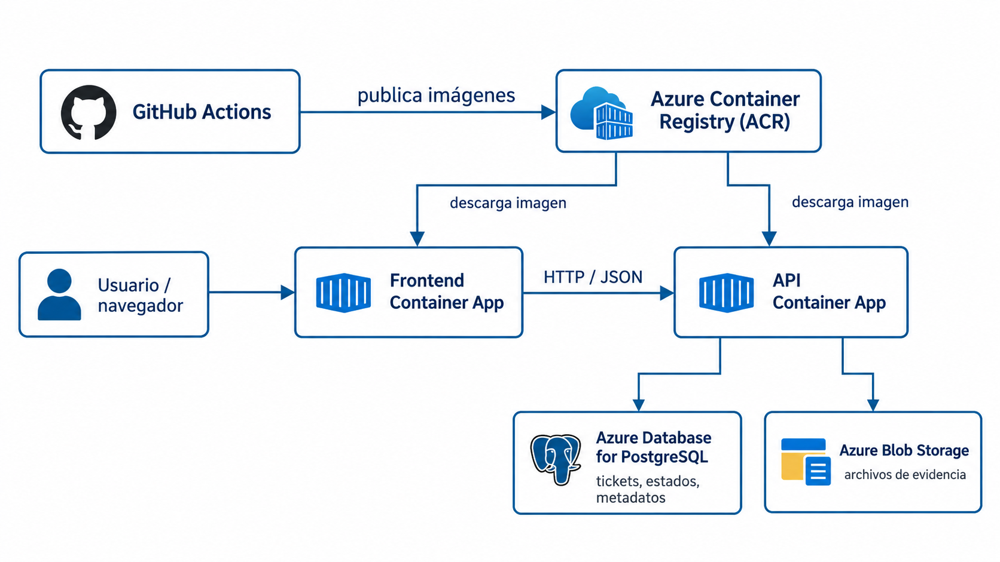
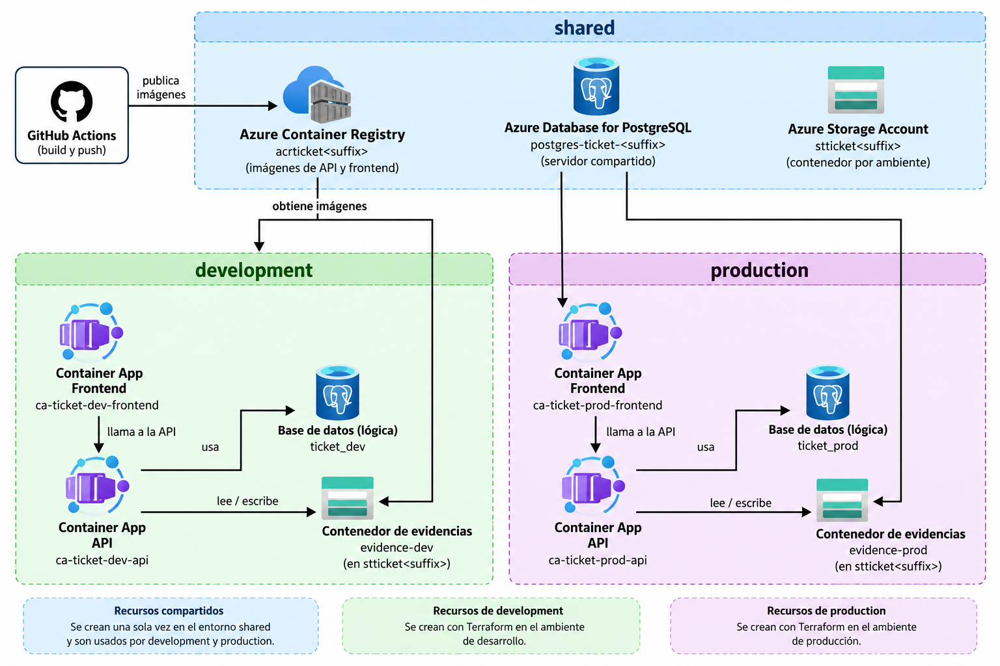
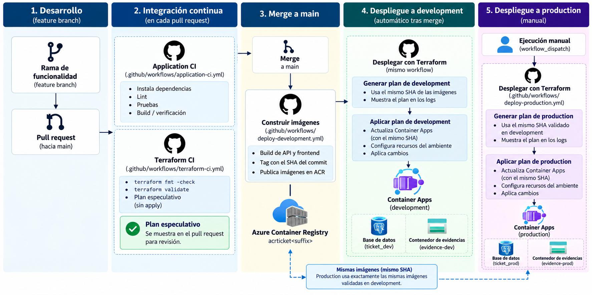

# Laboratorio 4. Infraestructura como código con Terraform

## Información general

| Elemento | Detalle |
|---|---|
| Modalidad | Parejas |
| Valor | 8% |
| Fecha límite | Sábado 31 de octubre de 2026 |
| Plataforma | GitHub y Microsoft Azure |
| Herramienta principal | Terraform |
| Repositorio base | `guillermocalderon2021/devops-lab04-ticket-platform-base` |

!!! info "Propósito"
    En este laboratorio se partirá de una aplicación funcional desplegada mediante una configuración de Terraform deliberadamente limitada. El trabajo consiste en evolucionar esa línea base hasta obtener una infraestructura modular, separada por ámbitos de responsabilidad y ambientes, con state remoto y cambios de infraestructura integrados al flujo de CI/CD.

    La solución final deberá permitir revisar, desplegar y reproducir cambios de aplicación e infraestructura mediante un proceso controlado y trazable.

---

# 1. Escenario y repositorio de trabajo

Ticket Platform es una aplicación para registrar tickets de soporte, cambiar su estado y adjuntar archivos de evidencia.

La solución utiliza:

- React para el frontend;
- Node.js y Express para la API;
- Azure Container Apps para ejecutar frontend y API;
- Azure Container Registry para almacenar las imágenes;
- Azure Database for PostgreSQL Flexible Server para los datos estructurados;
- Azure Blob Storage para archivos adjuntos.



*Figura 1. Arquitectura inicial de Ticket Platform y relación entre GitHub Actions, ACR, los Container Apps, PostgreSQL y Blob Storage.*

La infraestructura inicial funciona, pero presenta limitaciones intencionales:

- existe un único ambiente;
- toda la infraestructura está definida en un único root module;
- el state es local;
- no existe separación entre infraestructura compartida, development y production;
- no existen módulos reutilizables;
- Terraform no se valida mediante pull requests;
- los cambios de infraestructura no forman parte de un proceso automatizado de entrega.

## Crear el repositorio de la pareja

El repositorio base se proporcionará como **template repository**.

1. Abrir el repositorio base en GitHub.
2. Seleccionar **Use this template**.
3. Seleccionar **Create a new repository**.
4. Crear el repositorio bajo la cuenta de uno de los integrantes.
5. Configurarlo como **privado**.
6. Utilizar un nombre que identifique claramente a la pareja. Se recomienda:

   ```text
   devops-lab04-CARNET1-CARNET2
   ```

Crear el repositorio únicamente con la rama principal proporcionada por la plantilla.

Un repositorio creado desde una plantilla es independiente del repositorio base. No es un fork y no comparte su historial de commits.

## Agregar al docente

1. Abrir **Settings** en el repositorio.
2. Ingresar a la sección de colaboradores.
3. Agregar como colaborador al usuario:

   ```text
   guillermocalderon2021
   ```

Comprobar que la invitación fue enviada.

!!! warning "Requisito de entrega"
    El docente debe conservar acceso al repositorio durante el desarrollo y la evaluación del laboratorio.

## Clonar el repositorio

Cada integrante debe trabajar sobre el repositorio de la pareja.


## Preparar los archivos locales

En la carpeta `config`:

1. crear una copia de `lab.env.example`;
2. nombrarla `lab.env`;
3. abrirla y completar los valores de la pareja.

Debe tener una estructura similar a:

```text
AZURE_LOCATION=REGION_PERMITIDA
GITHUB_REPOSITORY=OWNER/REPOSITORY
IMAGE_NAME=ticket-api
FRONTEND_IMAGE_NAME=ticket-frontend
IMAGE_TAG=baseline
```

`GITHUB_REPOSITORY` debe identificar el repositorio de la pareja.

En la carpeta `terraform`:

1. crear una copia de `secrets.auto.tfvars.example`;
2. nombrarla `secrets.auto.tfvars`;
3. definir una contraseña válida para PostgreSQL.

!!! danger "Archivos locales"
    Los archivos de configuración local, secretos, states y planes binarios no deben versionarse.

    Antes de cada commit debe revisarse `git status`.

---

# 2. Construcción y verificación de la línea base

Esta parte permite comprobar que la aplicación y la suscripción funcionan antes de modificar la arquitectura.

## Verificar prerrequisitos

El primer script es:

```text
scripts/00-check-prerequisites.sh
```

### Qué hace

Comprueba la disponibilidad de Azure CLI, Terraform, GitHub CLI, Git, Docker, Node.js y npm. También verifica que existen `config/lab.env`, una sesión válida de Azure CLI y una sesión válida de GitHub CLI.

No crea recursos.

### Ejecutar

Desde la raíz del repositorio:

```bash
./scripts/00-check-prerequisites.sh
```

Si una comprobación falla, corregirla antes de continuar.

## Crear el bootstrap de Azure

El script:

```text
scripts/01-bootstrap-azure.sh
```

crea recursos auxiliares necesarios para el laboratorio.

### Qué hace

Crea:

- un Resource Group de bootstrap;
- un Storage Account reservado para el state remoto;
- el Blob Container `tfstate`;
- una managed identity para operaciones de `plan`;
- una managed identity para operaciones de `apply`;
- las asignaciones RBAC necesarias para ambas identidades;
- acceso `Storage Blob Data Contributor` para el usuario que ejecuta el bootstrap sobre la cuenta de state.

El último permiso permite migrar y verificar el state remoto utilizando la sesión de Azure CLI.

El script genera además `config/bootstrap.env` con nombres e identificadores que utilizarán los pasos posteriores.

### Ejecutar

```bash
./scripts/01-bootstrap-azure.sh
```

Después:

1. abrir `config/bootstrap.env`;
2. revisar los valores generados;
3. abrir Azure Portal;
4. comprobar que existen el Resource Group de bootstrap, el Storage Account y las dos managed identities.

El Blob Container `tfstate` debe estar vacío.

## Configurar OIDC entre GitHub y Azure

El script:

```text
scripts/02-configure-oidc.sh
```

prepara autenticación federada sin client secrets.

### Qué hace

El script:

- consulta los identificadores inmutables del propietario y del repositorio de GitHub;
- configura una federated identity credential para pull requests sobre la identidad de `plan`;
- configura credenciales federadas para `shared`, `development` y `production` sobre la identidad de `apply`.

### Ejecutar

```bash
./scripts/02-configure-oidc.sh
```

El script debe terminar sin errores.

## Configurar GitHub

El script:

```text
scripts/03-configure-github.sh
```

crea los GitHub Environments `shared`, `development` y `production`.

También crea variables de GitHub Actions para:

- suscripción;
- tenant;
- región;
- client IDs y object IDs de las identidades de plan y apply;
- backend remoto;
- ACR;
- imágenes.

### Ejecutar

```bash
./scripts/03-configure-github.sh
```

Después:

1. abrir **Settings → Environments**;
2. comprobar que existen los tres environments;
3. abrir **Settings → Secrets and variables → Actions → Variables**;
4. comprobar que las variables fueron creadas.

## Preparar las variables locales de Terraform

El script:

```text
scripts/04-prepare-terraform-files.sh
```

genera `terraform/terraform.tfvars`.

### Qué hace

Combina `config/lab.env` y `config/bootstrap.env`. La contraseña permanece separada en `terraform/secrets.auto.tfvars`.

### Ejecutar

```bash
./scripts/04-prepare-terraform-files.sh
```

Después, abrir `terraform/terraform.tfvars` y revisar los valores.

## Registrar Azure Container Registry

```bash
az provider register   --namespace Microsoft.ContainerRegistry   --wait
```

Comprobar:

```bash
az provider show   --namespace Microsoft.ContainerRegistry   --query registrationState   --output tsv
```

No continuar hasta obtener `Registered`.

## Crear ACR y permisos de arranque

El script:

```text
scripts/05-provision-registry.sh
```

realiza una aplicación parcial controlada.

### Qué hace

Crea únicamente los recursos necesarios para poder publicar las imágenes iniciales:

- Resource Group;
- ACR;
- managed identity de runtime;
- `AcrPull`;
- `AcrPush`.

Utiliza `-target` exclusivamente para resolver la dependencia de arranque.

### Ejecutar

```bash
./scripts/05-provision-registry.sh
```

Comprobar en Azure que ACR y la identidad fueron creados.

## Publicar las imágenes iniciales

El script:

```text
scripts/06-publish-initial-image.sh
```

solicita a GitHub la ejecución de `.github/workflows/publish-images.yml`.

### Qué hace el workflow

Publica:

```text
ticket-api:baseline
ticket-frontend:baseline
```

mediante autenticación OIDC.

### Ejecutar

```bash
./scripts/06-publish-initial-image.sh
```

Después verificar el workflow en **Actions** y las dos imágenes en ACR.

## Registrar los providers restantes

```bash
az provider register   --namespace Microsoft.DBforPostgreSQL   --wait
```

```bash
az provider register   --namespace Microsoft.App   --wait
```

Comprobar que ambos están `Registered`.

## Completar el despliegue inicial

El script:

```text
scripts/07-deploy-initial.sh
```

completa la infraestructura monolítica.

### Qué hace

Crea PostgreSQL, la base de datos, Storage Account, Blob Container `evidence`, Container Apps Environment, API y frontend.

### Ejecutar

```bash
./scripts/07-deploy-initial.sh
```

No continuar hasta que Terraform termine correctamente.

## Verificar la línea base

Desde el frontend:

1. crear un ticket;
2. recargar la página;
3. cambiar su estado;
4. adjuntar un archivo;
5. descargarlo.

Desde Azure comprobar los recursos principales.

En el Storage Account de bootstrap, `tfstate` todavía debe estar vacío.

---

# 3. Reorganización y modularización

## Analizar antes de modificar

Revisar los archivos del root inicial y visualizar:

```bash
terraform -chdir=terraform state list
```

Identificar responsabilidades y dependencias.

La arquitectura objetivo es:

```text
shared
├── Azure Container Registry
├── Storage Account de la aplicación
├── PostgreSQL Flexible Server
└── managed identity de runtime

development
├── Container Apps Environment
├── Frontend Container App
├── API Container App
├── tickets_development
└── evidence-development

production
├── Container Apps Environment
├── Frontend Container App
├── API Container App
├── tickets_production
└── evidence-production
```



*Figura 2. Separación de recursos compartidos y recursos administrados por development y production. En la figura los nombres de las bases aparecen abreviados; la implementación debe utilizar `tickets_development` y `tickets_production`.*

## Eliminar la infraestructura monolítica

Después de verificar la línea base:

```bash
terraform -chdir=terraform destroy
```

Revisar el plan antes de confirmar.

No eliminar el bootstrap.

## Crear la nueva estructura

```text
terraform/
├── modules/
│   └── application/
│       ├── main.tf
│       ├── variables.tf
│       └── outputs.tf
│
└── environments/
    ├── shared/
    ├── development/
    └── production/
```

Cada root debe contener, como mínimo, `main.tf`, `variables.tf`, `outputs.tf`, `providers.tf` y `versions.tf`.

Después de crear la nueva estructura:

1. crear un `terraform.tfvars` local dentro de `shared`;
2. crear un `terraform.tfvars` local dentro de `development`;
3. crear un `terraform.tfvars` local dentro de `production`;
4. incluir en cada archivo únicamente los valores que declara ese root;
5. utilizar como referencia los valores previamente generados en `terraform/terraform.tfvars`;
6. conservar la contraseña en un único archivo local:

   ```text
   terraform/secrets.auto.tfvars
   ```

Los tres `terraform.tfvars` están cubiertos por `.gitignore` y no deben versionarse.

Cuando un root necesite la contraseña durante una ejecución local, suministrar el archivo sensible de forma explícita:

```text
-var-file=../../secrets.auto.tfvars
```

Esta separación evita trasladar a todos los roots variables que no forman parte de su interfaz.

## Diseñar el módulo `application`

El módulo debe encapsular:

- Container Apps Environment;
- frontend;
- API;
- base de datos del ambiente;
- Blob Container de evidencias.

Debe utilizarse desde development y production.

## Implementar `shared`

Debe administrar:

- Resource Group compartido;
- ACR;
- Storage Account;
- PostgreSQL Flexible Server;
- managed identity de runtime;
- `AcrPull`;
- `AcrPush`.

Además debe conceder a la identidad de plan:

```text
Storage Account Key Operator Service Role
```

con alcance limitado al Storage Account de la aplicación.

### Motivo

La aplicación inicial consume una access key de Storage. Los speculative plans necesitan evaluar esa configuración. `Reader` no permite obtener las access keys.

El primer `apply` de `shared` debe ejecutarse localmente con el usuario del estudiante, que posee permisos para crear role assignments.

## Publicar nuevamente `baseline`

Después de recrear ACR desde `shared`, abrir **Actions → Publish application images** y ejecutar el workflow con `image_tag = baseline`.

## Implementar development y production

Ambos roots deben utilizar `module "application"`.

Cuando necesiten recursos de `shared`, deben consultarlos mediante data sources y no volver a declararlos con `resource`.

Development debe crear:

```text
tickets_development
evidence-development
```

Production debe crear:

```text
tickets_production
evidence-production
```

Aplicar primero development y luego production. Comprobar que ambos funcionan.

## Versionar lockfiles

Cada root debe conservar su propio `.terraform.lock.hcl`.

Los tres lockfiles deben versionarse.

---

# 4. Migración a state remoto

Cada root se migrará al Storage Account creado durante el bootstrap.

## Configurar el backend

Cada root debe declarar:

```hcl
terraform {
  backend "azurerm" {}
}
```

Dentro de cada root crear un archivo `backend.hcl`. Este archivo no contiene credenciales y puede versionarse.

Debe incluir:

```hcl
storage_account_name = "NOMBRE_DEL_STORAGE_DEL_BOOTSTRAP"
container_name       = "tfstate"
key                  = "CLAVE_DEL_STATE"
use_azuread_auth     = true
```

Utilizar una key distinta para cada root:

```text
shared       → ticket-shared.tfstate
development  → ticket-development.tfstate
production   → ticket-production.tfstate
```

No compartir una misma key entre roots.

### Autenticación local

Durante la migración se utilizará la sesión existente de Azure CLI. El bootstrap ya concedió al usuario `Storage Blob Data Contributor` sobre la cuenta de state.

No es necesario almacenar una access key del backend.

## Migrar un root a la vez

Para cada root:

1. abrir su `terraform.tfvars` y verificar los valores;
2. visualizar el state local y comprobar que contiene los recursos esperados;
3. revisar `backend.hcl`;
4. desde la carpeta del root ejecutar:

   ```bash
   ARM_USE_CLI=true terraform init      -migrate-state      -backend-config=backend.hcl
   ```

5. confirmar la migración cuando Terraform lo solicite;
6. ejecutar un `terraform plan`, suministrando `../../secrets.auto.tfvars` cuando ese root declare `postgres_admin_password`;
7. comprobar que la migración por sí sola no propone recrear infraestructura.

Repetir el proceso para `shared`, `development` y `production`.

Al finalizar, abrir el Blob Container `tfstate` en Azure Portal y comprobar que existen los tres blobs. No abrir ni publicar el contenido del state.

---

# 5. Terraform en pull requests

## Crear el secreto de PostgreSQL

En GitHub:

**Settings → Secrets and variables → Actions → Secrets**

Crear:

```text
POSTGRES_ADMIN_PASSWORD
```

con la misma contraseña de `terraform/secrets.auto.tfvars`.

Los workflows deben exponerla como:

```text
TF_VAR_postgres_admin_password
```

## Crear `terraform-ci.yml`

Debe ejecutarse en pull requests que afecten `terraform/`.

Debe:

- tener `id-token: write` y `contents: read`;
- utilizar `PLAN_CLIENT_ID`;
- autenticarse mediante OIDC;
- ejecutar `terraform fmt -check -recursive`;
- ejecutar `terraform validate`;
- producir speculative plans para los roots afectados;
- inicializar cada root con su `backend.hcl`;
- no ejecutar `apply`.

En los pasos de Terraform deben suministrarse:

```text
ARM_CLIENT_ID=${{ vars.PLAN_CLIENT_ID }}
ARM_TENANT_ID=${{ vars.AZURE_TENANT_ID }}
ARM_SUBSCRIPTION_ID=${{ vars.AZURE_SUBSCRIPTION_ID }}
ARM_USE_OIDC=true
ARM_USE_AZUREAD=true
ARM_USE_CLI=false
TF_VAR_postgres_admin_password=${{ secrets.POSTGRES_ADMIN_PASSWORD }}
```

Las demás variables no sensibles requeridas por cada root deben obtenerse de las GitHub Actions variables preparadas por `03-configure-github.sh` y exponerse como `TF_VAR_*`.

La inicialización en GitHub debe usar:

```bash
terraform init   -input=false   -backend-config=backend.hcl
```

El job de pull request no debe asociarse a un GitHub Environment. La federated identity credential de `plan` fue creada específicamente para el subject de `pull_request`.

### Comprobación

1. crear una rama;
2. agregar `terraform-ci.yml`;
3. realizar un cambio pequeño y válido de Terraform;
4. publicar la rama;
5. crear un pull request hacia `main`;
6. comprobar `fmt`, `validate` y los planes;
7. verificar que no existe ningún `terraform apply`.

El pull request solo debe integrarse cuando las verificaciones terminen correctamente.

---

# 6. Entrega a development y promoción a production

Al finalizar el laboratorio existirán cinco workflows:

```text
application-ci.yml      → validación de la aplicación
publish-images.yml      → publicación de imágenes baseline durante el bootstrap
terraform-ci.yml        → validación y speculative plan en pull requests
deploy-development.yml  → build y despliegue automático de development
deploy-production.yml   → promoción manual a production
```

Los dos primeros ya existen en el repositorio base. Los tres últimos deben ser creados por la pareja.

`shared` no se aplicará automáticamente.

La identidad `apply` utiliza `Contributor`, que puede administrar recursos pero no crear role assignments. No debe ampliarse a `Owner` únicamente para automatizar este laboratorio.

```text
shared
├── plan en PR
└── apply local controlado

development
├── plan en PR
└── apply automático después del merge

production
├── plan en PR
└── promoción manual
```



*Figura 3. Flujo de integración y entrega. Production utiliza las mismas imágenes identificadas por SHA que fueron desplegadas y verificadas previamente en development. En la figura los nombres de las bases aparecen abreviados; la implementación debe utilizar `tickets_development` y `tickets_production`.*

## Imágenes inmutables

A partir de esta fase, los despliegues utilizarán como tag:

```text
Git SHA
```

No utilizar `latest`.

## Crear `deploy-development.yml`

Debe ejecutarse después de un merge a `main`.

Debe utilizar:

```text
environment: development
```

y `APPLY_CLIENT_ID`.

En una ejecución debe:

1. obtener el commit integrado en `main`;
2. autenticarse en Azure mediante OIDC;
3. construir API y frontend;
4. etiquetar ambas imágenes con `${{ github.sha }}`;
5. publicar ambas imágenes en ACR;
6. inicializar `terraform/environments/development` con `backend.hcl`;
7. generar un plan guardado mediante `terraform plan -out=tfplan`, utilizando `${{ github.sha }}` como `image_tag`;
8. aplicar exactamente `tfplan`;
9. mostrar el SHA desplegado en el resumen de la ejecución.

El job que obtiene el token de Azure debe utilizar:

```text
environment: development
```

El secreto de PostgreSQL debe llegar mediante `TF_VAR_postgres_admin_password`. Las variables no sensibles deben provenir de las variables de GitHub Actions.

## Crear `deploy-production.yml`

Debe utilizar:

```yaml
on:
  workflow_dispatch:
    inputs:
      image_tag:
        description: SHA de la imagen validada en development
        required: true
```

y:

```text
environment: production
```

Production no debe construir imágenes.

Debe:

1. recibir el SHA validado en development;
2. autenticarse en Azure mediante OIDC;
3. comprobar en ACR que ese tag existe para API y frontend;
4. inicializar `terraform/environments/production` con `backend.hcl`;
5. generar `tfplan` utilizando el SHA recibido como `image_tag`;
6. aplicar exactamente ese plan.

El job debe utilizar:

```text
environment: production
```

La misma imagen debe viajar de development a production. Si el SHA no existe para cualquiera de las dos imágenes, el workflow debe fallar antes de ejecutar Terraform.

---

# 7. Cambio integrador: `diagnostic-logs`

## Requerimiento

Archivos normales:

```text
evidence-<environment>
```

Archivos `.log`, sin distinguir mayúsculas y minúsculas:

```text
diagnostic-logs-<environment>
```

Ejemplos:

```text
captura.png  → evidence-development
server.log   → diagnostic-logs-development
TRACE.LOG    → diagnostic-logs-development
```

## Cambio de Terraform

Modificar `module "application"` para crear:

```text
diagnostic-logs-development
diagnostic-logs-production
```

El Storage Account permanece en `shared`.

La API debe recibir los nombres de ambos containers mediante configuración de runtime.

## Cambio de aplicación

La API debe:

1. seleccionar el container según la extensión;
2. almacenar el archivo;
3. persistir el container utilizado;
4. utilizar esa información al descargar.

## Evolución de PostgreSQL

La tabla `evidence` actualmente conserva `blob_name`, pero ahora también debe poder determinar el container.

La modificación debe funcionar sobre una base ya existente.

Modificar solamente `CREATE TABLE IF NOT EXISTS` no altera una tabla creada previamente.

Debe incorporarse una migración idempotente del esquema, sin eliminar datos existentes.

## Pruebas

Agregar pruebas para:

- archivo normal;
- `.log`;
- `.LOG`;
- persistencia del container;
- descarga desde el container correcto.

## Entregar por el pipeline

Crear:

```text
feature/diagnostic-logs
```

El PR debe ejecutar:

```text
Application CI
Terraform CI
```

Después del merge:

1. observar `deploy-development.yml`;
2. registrar el SHA;
3. verificar development;
4. comprobar `diagnostic-logs-development`;
5. ejecutar manualmente `deploy-production.yml`;
6. introducir el mismo SHA;
7. verificar production;
8. comprobar `diagnostic-logs-production`.

---

# 8. Verificación, documentación y entrega

## README final

Debe documentar:

- arquitectura;
- responsabilidades de cada root;
- módulo;
- states;
- Terraform CI;
- despliegue de development;
- promoción a production;
- OIDC;
- imágenes inmutables;
- `diagnostic-logs`.

## Evidencias

Incluir únicamente evidencias de Azure que el docente no puede reconstruir desde GitHub:

1. tres blobs de state;
2. recursos principales por ámbito;
3. containers de evidencia y diagnóstico de development;
4. containers de evidencia y diagnóstico de production;
5. mismo SHA desplegado en development y production.

## Entrega en Moodle

Entregar:

- URL del repositorio;
- nombres;
- carnets.

**Fecha límite: sábado 31 de octubre de 2026.**

## Eliminación posterior

Después de la revisión docente:

1. destruir production;
2. destruir development;
3. destruir shared;
4. eliminar el bootstrap cuando ya no sea necesario conservar el state.

---

# 9. Evaluación

| Criterio | Ponderación | Cumplimiento esperado |
|---|---:|---|
| Modularización y estructura de Terraform | 20% | `module "application"` reutilizable, interfaces claras y ausencia de duplicación sustancial entre development y production. |
| Separación `shared`, development y production | 15% | Ownership correcto de recursos; bases de datos, Container Apps y containers de evidencia separados por ambiente. |
| State remoto e independencia de states | 15% | Tres blobs distintos, backend autenticado con Microsoft Entra ID y planes posteriores a la migración sin recreaciones provocadas por el cambio de backend. |
| Terraform CI en pull requests | 15% | `fmt`, `validate` y speculative plan mediante OIDC, sin `apply` en PR y con fallos visibles cuando la configuración es inválida. |
| Entrega a development y promoción a production | 15% | Imágenes etiquetadas con SHA, development automático y production manual reutilizando exactamente el mismo SHA; plan guardado aplicado sin regenerarlo. |
| Cambio `diagnostic-logs` | 15% | Nuevo container por ambiente, configuración de runtime, persistencia de ubicación, migración compatible con datos existentes, carga/descarga correctas y pruebas automatizadas. |
| Reproducibilidad, seguridad y documentación | 5% | Sin secretos ni states versionados, lockfiles presentes, README suficiente y ausencia de pasos manuales no documentados para reconstruir la solución. |
| **Total** | **100%** | |

### Interpretación de resultados parciales

- **Cumplimiento completo:** el criterio funciona de extremo a extremo y puede verificarse mediante código, state, workflow o ejecución.
- **Cumplimiento parcial:** la idea principal está implementada, pero falta una parte verificable, existe duplicación significativa, se requiere intervención manual no documentada o el flujo falla en un caso relevante.
- **Insuficiente:** el criterio no está implementado, depende de recursos creados manualmente para sustituir Terraform o no puede reproducirse.

La calificación obtenida corresponde al **8% de la nota final del curso**.

!!! danger "Cambios manuales"
    Los recursos evaluados no deben crearse manualmente desde Azure Portal para sustituir Terraform. El portal puede utilizarse para inspección, verificación y diagnóstico.

## Uso de inteligencia artificial

Se permite utilizar herramientas de inteligencia artificial como apoyo.

Cada integrante debe poder explicar la estructura de Terraform, los states, permisos, planes, workflows, promoción de artefactos y cambios de aplicación.
