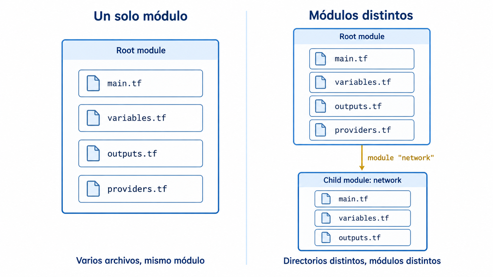
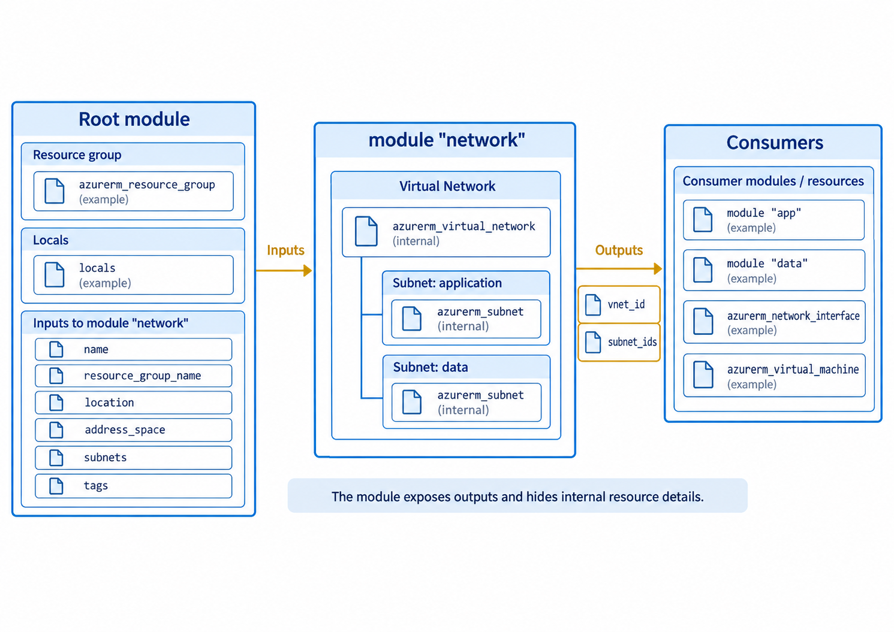
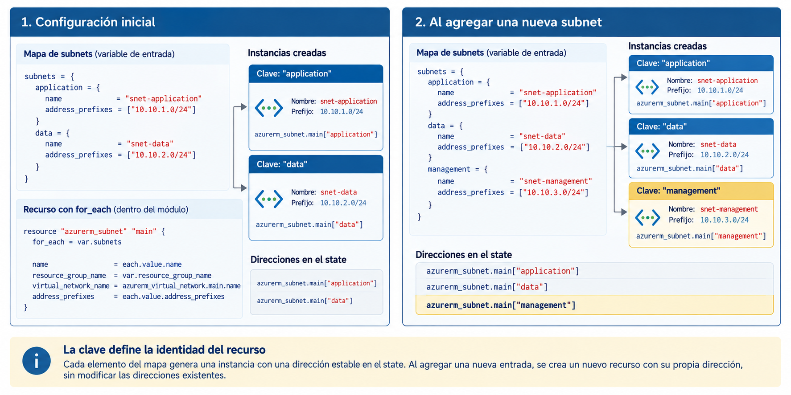
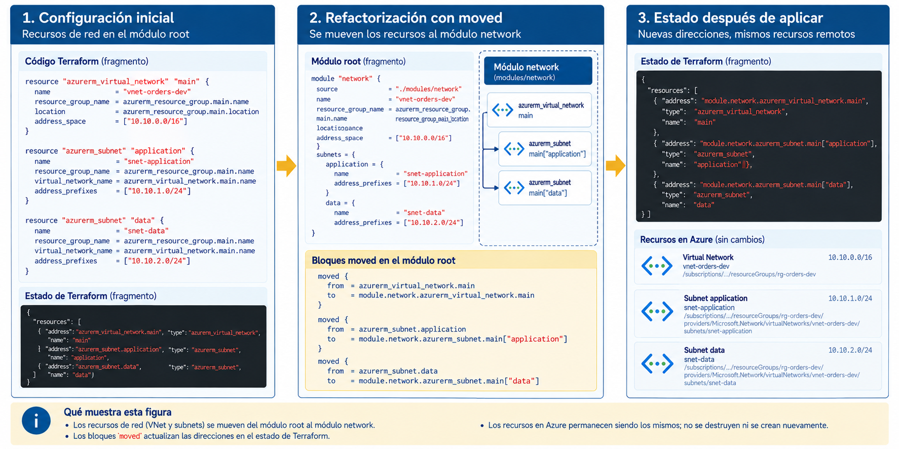

# Clase 15. Terraform modular

## Objetivos

Al finalizar la sesión se espera que el estudiante pueda:

- Distinguir entre la organización de una configuración en varios archivos y la creación de módulos;
- Describir la relación entre root modules y child modules;
- Definir interfaces de módulos mediante input variables y output values;
- Crear múltiples instancias de recursos mediante `for_each`;
- Componer módulos mediante referencias entre outputs e inputs;
- Refactorizar recursos existentes hacia un módulo sin recrear la infraestructura;
- Reconocer criterios técnicos para decidir cuándo una agrupación de recursos debe convertirse en un módulo.

---

## 1. Organización de configuraciones Terraform

Terraform carga como una sola configuración los archivos `.tf` ubicados en el directorio de trabajo. Ese conjunto constituye un módulo.

Por ejemplo:

```text
terraform/
├── main.tf
├── variables.tf
├── outputs.tf
└── providers.tf
```

representa un único módulo organizado en cuatro archivos. Cuando Terraform se ejecuta desde ese directorio, el conjunto constituye el **root module**.

La división en archivos organiza el código por responsabilidad. Los límites de alcance y encapsulación aparecen al separar la configuración en módulos.

Una estructura como:

```text
terraform/
├── network.tf
├── compute.tf
├── storage.tf
└── variables.tf
```

sigue siendo un único módulo.

### 1.1. Root module y child modules

El módulo desde el cual se ejecutan comandos como:

```bash
terraform plan
terraform apply
```

se denomina **root module**.

Un módulo puede invocar otros módulos. Los módulos invocados se denominan **child modules**.



*Figura 1. Los archivos `.tf` de un mismo directorio pertenecen al mismo módulo; un child module se define en su propio directorio y se invoca desde otro módulo.*

La invocación se realiza mediante un bloque `module`:

```hcl
module "network" {
  source = "./modules/network"
}
```

El argumento `source` indica dónde se encuentra el código del módulo.

Para un módulo local:

```hcl
source = "./modules/network"
```

Terraform utiliza los archivos `.tf` contenidos en ese directorio como un módulo separado.

Una estructura mínima es:

```text
terraform/
├── main.tf
├── variables.tf
├── outputs.tf
├── providers.tf
└── modules/
    └── network/
        ├── main.tf
        ├── variables.tf
        └── outputs.tf
```

Los nombres `main.tf`, `variables.tf` y `outputs.tf` forman parte de una convención ampliamente utilizada para organizar módulos reutilizables.

### 1.2. Propósito de la modularización

La separación en módulos introduce límites de responsabilidad e interfaces explícitas dentro de la configuración.

Una unidad de infraestructura es una buena candidata a módulo cuando sus recursos forman un conjunto coherente y pueden describirse mediante una interfaz estable.

En esta sesión se utilizará como ejemplo una red base de aplicación:

```text
Virtual Network
├── Subnet application
└── Subnet data
```

La VNet y sus subnets forman una unidad coherente. Otros componentes pueden depender de:

- el identificador de la VNet;
- el identificador de una subnet concreta;
- el conjunto de subnets disponibles.

Los detalles internos de creación permanecen dentro del módulo. La interfaz expone únicamente la información necesaria para los consumidores:

```text
              inputs
                 │
                 ▼
         ┌────────────────┐
         │ module network │
         │                │
         │ VNet           │
         │ Subnets        │
         └───────┬────────┘
                 │
              outputs
                 │
                 ▼
       recursos o módulos consumidores
```

La modularización puede:

- agrupar recursos que cambian conjuntamente;
- reducir duplicación;
- establecer convenciones;
- encapsular detalles internos;
- limitar los parámetros expuestos al consumidor;
- proporcionar una interfaz reutilizable;
- instanciar la misma arquitectura con valores diferentes.

La abstracción aporta valor cuando define una frontera útil. Un módulo que se limita a reproducir todos los argumentos de un recurso subyacente añade una capa adicional sin mejorar el diseño.

---

## 2. Valores, tipos y expresiones

Los módulos se comunican mediante valores. Para diseñar una interfaz útil es necesario distinguir entre valores de entrada, valores calculados internamente y valores expuestos al exterior.

Terraform utiliza principalmente:

```text
input variables  →  módulo  →  output values
                         │
                         └── local values
```

### 2.1. Input variables

Las input variables reciben valores proporcionados desde fuera del módulo.

```hcl
variable "location" {
  description = "Región de Azure donde se crean los recursos"
  type        = string
}
```

La declaración forma parte de la interfaz del módulo y establece el tipo esperado para el valor recibido.

Una variable puede incluir:

- `type`;
- `description`;
- `default`;
- `nullable`;
- `sensitive`;
- reglas de `validation`.

Por ejemplo:

```hcl
variable "environment" {
  description = "Ambiente al que pertenece la infraestructura"
  type        = string
  default     = "development"

  validation {
    condition = contains(
      ["development", "staging", "production"],
      var.environment
    )

    error_message = "environment debe ser development, staging o production."
  }
}
```

La validación se ejecuta antes de intentar crear infraestructura. Si el valor no satisface la condición, Terraform detiene la operación.

### 2.2. Tipos simples y compuestos

Los tipos simples más frecuentes son:

```text
string
number
bool
```

Una red requiere estructuras más expresivas.

El espacio de direcciones de una VNet puede representarse mediante:

```hcl
variable "address_space" {
  type = list(string)
}
```

Un valor válido sería:

```hcl
address_space = [
  "10.10.0.0/16"
]
```

Para representar varias subnets podría utilizarse un mapa de objetos:

```hcl
variable "subnets" {
  description = "Subnets que forman parte de la Virtual Network"

  type = map(object({
    name             = string
    address_prefixes = list(string)
  }))
}
```

Un valor compatible sería:

```hcl
subnets = {
  application = {
    name             = "snet-application"
    address_prefixes = ["10.10.1.0/24"]
  }

  data = {
    name             = "snet-data"
    address_prefixes = ["10.10.2.0/24"]
  }
}
```

La estructura contiene varios niveles:

```text
map
│
├── application
│   └── object
│       ├── name: string
│       └── address_prefixes: list(string)
│
└── data
    └── object
        ├── name: string
        └── address_prefixes: list(string)
```

La elección del tipo forma parte del diseño del módulo. Un tipo demasiado genérico reduce la capacidad de Terraform para validar la configuración. Un tipo excesivamente rígido puede dificultar extensiones legítimas.

### 2.3. Local values

Un `local` representa un valor calculado dentro de un módulo o configuración.

```hcl
locals {
  common_tags = {
    application = var.application_name
    environment = var.environment
    managed_by  = "terraform"
  }
}
```

Se referencia mediante:

```hcl
local.common_tags
```

Una variable y un `local` tienen propósitos diferentes:

| Elemento | Procedencia | Uso principal |
|---|---|---|
| `var.name` | Entrada externa | Configurar el módulo |
| `local.name` | Cálculo interno | Evitar repetición y expresar valores derivados |
| `output.name` | Salida del módulo | Exponer información al consumidor |

Los `locals` admiten funciones y expresiones.

Por ejemplo:

```hcl
locals {
  common_tags = merge(
    {
      application = var.application_name
      environment = var.environment
      managed_by  = "terraform"
    },
    var.additional_tags
  )
}
```

`merge()` combina mapas. Si una misma clave aparece más de una vez, prevalece el valor del mapa ubicado más a la derecha.

### 2.4. Output values

Un output expone un valor producido por un módulo.

```hcl
output "vnet_id" {
  description = "ID de la Virtual Network"
  value       = azurerm_virtual_network.main.id
}
```

En el root module, un output propio se muestra después de `terraform apply` y puede consultarse mediante:

```bash
terraform output
```

Un output definido dentro de un child module también forma parte de su interfaz pública.

Si el módulo se invoca como:

```hcl
module "network" {
  source = "./modules/network"
}
```

su output se referencia como:

```hcl
module.network.vnet_id
```

El módulo consumidor no necesita conocer la dirección interna:

```text
azurerm_virtual_network.main.id
```

Utiliza la interfaz:

```text
module.network.vnet_id
```

La interfaz desacopla a los consumidores de los detalles internos de implementación.

### 2.5. Data sources

Un bloque `resource` declara un objeto que Terraform administrará.

```hcl
resource "azurerm_virtual_network" "main" {
  # ...
}
```

Un bloque `data` consulta información existente sin asumir la administración de su ciclo de vida.

```hcl
data "azurerm_resource_group" "shared" {
  name = "rg-shared-services"
}
```

El valor consultado se referencia como:

```hcl
data.azurerm_resource_group.shared.location
```

La distinción entre ambos bloques corresponde a la **responsabilidad de administración**:

```text
resource → Terraform administra el objeto
data     → Terraform consulta el objeto
```

Los data sources son útiles cuando un módulo depende de infraestructura administrada por otro sistema, otro equipo o otra configuración Terraform.

---

## 3. Construcción de un módulo de red

La práctica utiliza Azure, pero el objetivo es estudiar el diseño modular de una configuración Terraform.

La infraestructura inicial será:

```text
Resource Group
└── Virtual Network: vnet-orders-dev
    ├── Subnet: snet-application
    └── Subnet: snet-data
```

El Resource Group permanecerá en el root module. La VNet y sus subnets se moverán posteriormente al módulo `network`.

### 3.1. Preparación de Azure

Comprobar la suscripción activa:

```bash
az account show --output table
```

El proveedor `Microsoft.Network` debe estar registrado.

Comprobar su estado:

```bash
az provider show   --namespace Microsoft.Network   --query registrationState   --output tsv
```

Si no aparece:

```text
Registered
```

registrarlo:

```bash
az provider register   --namespace Microsoft.Network   --wait
```

La región utilizada debe estar permitida por la política de la suscripción. Se recomienda utilizar la misma región que haya funcionado correctamente en la práctica anterior.

### 3.2. Configuración inicial

Crear un directorio:

```bash
mkdir terraform-modules
cd terraform-modules
```

Estructura inicial:

```text
terraform-modules/
├── main.tf
├── variables.tf
├── terraform.tfvars
├── terraform.tfvars.example
└── .gitignore
```

#### `variables.tf`

```hcl
variable "subscription_id" {
  description = "ID de la suscripción de Azure"
  type        = string
}

variable "location" {
  description = "Región de Azure donde se crean los recursos"
  type        = string
}

variable "resource_group_name" {
  description = "Nombre del Resource Group"
  type        = string
}

variable "application_name" {
  description = "Nombre de la aplicación asociada a la infraestructura"
  type        = string
}

variable "environment" {
  description = "Ambiente al que pertenece la infraestructura"
  type        = string
  default     = "development"

  validation {
    condition = contains(
      ["development", "staging", "production"],
      var.environment
    )

    error_message = "environment debe ser development, staging o production."
  }
}

variable "additional_tags" {
  description = "Tags adicionales aplicados a los recursos que admiten tags"
  type        = map(string)
  default     = {}
}
```

#### `terraform.tfvars.example`

```hcl
subscription_id     = "ID_DE_LA_SUSCRIPCION"
location            = "REGION_PERMITIDA"
resource_group_name = "rg-orders-dev-IDENTIFICADOR"
application_name    = "orders-platform"
environment         = "development"

additional_tags = {
  owner = "platform-team"
}
```

Crear `terraform.tfvars` a partir de este archivo y sustituir los valores específicos del entorno.

#### `.gitignore`

```gitignore
.terraform/
*.tfstate
*.tfstate.*
*.tfplan
terraform.tfvars
```

`.terraform.lock.hcl` no debe incluirse en `.gitignore`.

#### `main.tf`

```hcl
terraform {
  required_version = ">= 1.12"

  required_providers {
    azurerm = {
      source  = "hashicorp/azurerm"
      version = "~> 5.0"
    }
  }
}

provider "azurerm" {
  features {}

  subscription_id = var.subscription_id
}

locals {
  common_tags = merge(
    {
      application = var.application_name
      environment = var.environment
      managed_by  = "terraform"
    },
    var.additional_tags
  )
}

resource "azurerm_resource_group" "main" {
  name     = var.resource_group_name
  location = var.location

  tags = local.common_tags
}

resource "azurerm_virtual_network" "main" {
  name                = "vnet-orders-dev"
  location            = azurerm_resource_group.main.location
  resource_group_name = azurerm_resource_group.main.name
  address_space       = ["10.10.0.0/16"]

  tags = local.common_tags
}

resource "azurerm_subnet" "application" {
  name                 = "snet-application"
  resource_group_name  = azurerm_resource_group.main.name
  virtual_network_name = azurerm_virtual_network.main.name
  address_prefixes     = ["10.10.1.0/24"]
}

resource "azurerm_subnet" "data" {
  name                 = "snet-data"
  resource_group_name  = azurerm_resource_group.main.name
  virtual_network_name = azurerm_virtual_network.main.name
  address_prefixes     = ["10.10.2.0/24"]
}
```

AzureRM admite subnets declaradas como bloques inline de una VNet o como recursos `azurerm_subnet` separados. La práctica utiliza recursos separados para administrarlos mediante `for_each` dentro del módulo. Ambos mecanismos deben mantenerse separados para una misma VNet.

Inicializar y verificar:

```bash
terraform init
terraform fmt
terraform validate
terraform plan
```

Aplicar:

```bash
terraform apply
```

Después:

```bash
terraform plan
```

debe producir:

```text
No changes.
```

La refactorización comienza a partir de este estado convergente.

### 3.3. Identificación de la interfaz

Antes de mover recursos debe definirse la frontera del módulo.

El módulo será responsable de:

```text
network
├── Virtual Network
├── Subnet application
└── Subnet data
```

El root module seguirá siendo responsable del Resource Group.

La interfaz de entrada recibe la información que permanece bajo responsabilidad del root module:

```text
resource_group_name
location
name
address_space
subnets
tags
```

La interfaz de salida expone la información necesaria para otros componentes:

```text
vnet_id
subnet_ids
```

La interfaz queda representada así:



*Figura 2. El root module proporciona los valores de entrada, `module "network"` encapsula la VNet y sus subnets, y los outputs constituyen la interfaz utilizada por otros recursos o módulos.*

El Resource Group permanece en el root module porque constituye un límite de responsabilidad distinto y puede ser compartido por otros componentes. Esta separación mantiene una composición relativamente plana.

### 3.4. Estructura del child module

Crear:

```text
modules/
└── network/
    ├── main.tf
    ├── variables.tf
    └── outputs.tf
```

La estructura completa será:

```text
terraform-modules/
├── main.tf
├── variables.tf
├── terraform.tfvars
├── terraform.tfvars.example
├── .gitignore
└── modules/
    └── network/
        ├── main.tf
        ├── variables.tf
        └── outputs.tf
```

#### `modules/network/variables.tf`

```hcl
variable "name" {
  description = "Nombre de la Virtual Network"
  type        = string
}

variable "resource_group_name" {
  description = "Resource Group donde se crea la red"
  type        = string
}

variable "location" {
  description = "Región de Azure"
  type        = string
}

variable "address_space" {
  description = "Espacios CIDR asignados a la Virtual Network"
  type        = list(string)
}

variable "subnets" {
  description = "Subnets administradas por el módulo"

  type = map(object({
    name             = string
    address_prefixes = list(string)
  }))
}

variable "tags" {
  description = "Tags aplicados a los recursos que los admiten"
  type        = map(string)
  default     = {}
}
```

El módulo omite:

```hcl
variable "subscription_id"
```

La suscripción pertenece a la configuración del provider y se mantiene en el root module.

La configuración concreta del provider también permanece fuera del child module:

```hcl
provider "azurerm" {
  # ...
}
```

dentro de un módulo reutilizable. Las configuraciones de provider se definen en el root module y los recursos de los child modules utilizan normalmente la configuración heredada.

#### `modules/network/main.tf`

```hcl
resource "azurerm_virtual_network" "main" {
  name                = var.name
  location            = var.location
  resource_group_name = var.resource_group_name
  address_space       = var.address_space

  tags = var.tags
}

resource "azurerm_subnet" "main" {
  for_each = var.subnets

  name                 = each.value.name
  resource_group_name  = var.resource_group_name
  virtual_network_name = azurerm_virtual_network.main.name
  address_prefixes     = each.value.address_prefixes
}
```

`for_each` crea una instancia del recurso por cada elemento del mapa.

Para:

```hcl
subnets = {
  application = {
    name             = "snet-application"
    address_prefixes = ["10.10.1.0/24"]
  }

  data = {
    name             = "snet-data"
    address_prefixes = ["10.10.2.0/24"]
  }
}
```

Terraform crea las direcciones:

```text
azurerm_subnet.main["application"]
azurerm_subnet.main["data"]
```

Dentro del bloque:

```hcl
each.key
```

representa la clave:

```text
application
data
```

y:

```hcl
each.value
```

representa el objeto asociado a esa clave.

Por ejemplo:

```hcl
each.value.name
```

produce:

```text
snet-application
```

para la instancia `application`.

### 3.5. `for_each` y estabilidad de direcciones

`for_each` define tanto la multiplicidad de recursos como la identidad de cada instancia dentro del state.

Con:

```hcl
for_each = var.subnets
```

la identidad de cada instancia depende de una clave estable:

```text
"application"
"data"
```

Si posteriormente se agrega:

```hcl
management = {
  name             = "snet-management"
  address_prefixes = ["10.10.3.0/24"]
}
```

Terraform agrega una nueva dirección:

```text
azurerm_subnet.main["management"]
```

sin cambiar las direcciones de las instancias existentes.



*Figura 3. Las claves del mapa forman parte de las direcciones de las instancias creadas con `for_each`. Agregar una nueva clave crea una nueva dirección sin modificar las existentes.*

`count` utiliza índices numéricos:

```text
resource.example[0]
resource.example[1]
```

y resulta apropiado cuando se requieren varias instancias prácticamente iguales cuya identidad puede expresarse por posición o cantidad.

`for_each` es preferible cuando cada instancia tiene una identidad lógica propia.

### 3.6. Outputs del módulo

Crear `modules/network/outputs.tf`:

```hcl
output "vnet_id" {
  description = "ID de la Virtual Network"
  value       = azurerm_virtual_network.main.id
}

output "subnet_ids" {
  description = "Mapa de IDs de las subnets, indexado por su clave lógica"

  value = {
    for key, subnet in azurerm_subnet.main :
    key => subnet.id
  }
}
```

La expresión:

```hcl
{
  for key, subnet in azurerm_subnet.main :
  key => subnet.id
}
```

transforma el conjunto de instancias administradas por `for_each` en un mapa.

El resultado tiene la siguiente forma general:

```hcl
{
  application = "/subscriptions/.../subnets/snet-application"
  data        = "/subscriptions/.../subnets/snet-data"
}
```

El consumidor utiliza el mapa publicado por el módulo como parte de su interfaz.

---

## 4. Composición

La composición conecta módulos y recursos mediante valores de entrada y salida. Cada componente publica una interfaz y consume únicamente los valores que necesita.

### 4.1. Invocación desde el root module

Después de crear el child module, el root module puede invocarlo:

```hcl
module "network" {
  source = "./modules/network"

  name                = "vnet-orders-dev"
  resource_group_name = azurerm_resource_group.main.name
  location            = azurerm_resource_group.main.location
  address_space       = ["10.10.0.0/16"]

  subnets = {
    application = {
      name             = "snet-application"
      address_prefixes = ["10.10.1.0/24"]
    }

    data = {
      name             = "snet-data"
      address_prefixes = ["10.10.2.0/24"]
    }
  }

  tags = local.common_tags
}
```

Cada argumento, excepto `source`, corresponde a una variable declarada por el child module.

Por ejemplo:

```hcl
name = "vnet-orders-dev"
```

satisface:

```hcl
variable "name" {
  type = string
}
```

### 4.2. Alcance de variables

Una variable declarada en el root module pertenece al alcance de ese módulo:

```hcl
variable "location" {
  type = string
}
```

El child module declara su propio `var.location`. El caller transmite el valor explícitamente:

```hcl
module "network" {
  source = "./modules/network"

  location = var.location
}
```

Desde el root:

```text
var.location
```

es un valor del root module.

Dentro de `module.network`:

```text
var.location
```

es una variable diferente, declarada por ese módulo, que recibió el valor enviado por el caller.

La relación es:

```text
root var.location
       │
       ▼
module.network argument "location"
       │
       ▼
child var.location
```

Los nombres pueden coincidir por convención, pero cada declaración pertenece a un alcance diferente.

### 4.3. Dependencias implícitas

La referencia:

```hcl
resource_group_name = azurerm_resource_group.main.name
```

transmite el valor y establece una dependencia en el grafo de Terraform.

El grafo resultante contiene la relación:

```text
azurerm_resource_group.main
             │
             ▼
       module.network
```

El módulo depende de los atributos producidos por el Resource Group.

De forma similar, dentro del módulo:

```hcl
virtual_network_name = azurerm_virtual_network.main.name
```

establece una dependencia entre las subnets y la VNet.

La referencia directa ya expresa la dependencia, por lo que agregar:

```hcl
depends_on = [
  azurerm_virtual_network.main
]
```

sería redundante.

`depends_on` se reserva para relaciones de dependencia que existen por comportamiento y que Terraform no puede deducir a partir de referencias de datos.

### 4.4. Consumo de outputs

Desde el root module:

```hcl
module.network.vnet_id
```

produce el ID de la VNet.

Para una subnet específica:

```hcl
module.network.subnet_ids["application"]
```

Esta expresión puede utilizarse como argumento de otro recurso o módulo.

La relación entre ambos módulos puede representarse así:

```text
module.network
      │
      │ subnet_ids["application"]
      ▼
module.application
```

Por ejemplo:

```hcl
module "application" {
  source = "./modules/application"

  subnet_id = module.network.subnet_ids["application"]
}
```

`module.application` se utiliza únicamente para representar el consumo del output. La composición se establece cuando un módulo produce un valor y otro lo utiliza como entrada.

El módulo `application` depende de la interfaz publicada por `network`, no de su implementación interna.

### 4.5. Outputs del root module

El root module también puede publicar esos valores:

```hcl
output "vnet_id" {
  description = "ID de la red de la aplicación"
  value       = module.network.vnet_id
}

output "application_subnet_id" {
  description = "ID de la subnet utilizada por la capa de aplicación"
  value       = module.network.subnet_ids["application"]
}
```

Después:

```bash
terraform output
```

puede producir:

```text
application_subnet_id = "/subscriptions/.../subnets/snet-application"
vnet_id               = "/subscriptions/.../virtualNetworks/vnet-orders-dev"
```

Los outputs deben responder a necesidades de consumidores. Exponer cada atributo interno reduce el encapsulamiento y crea una interfaz innecesariamente amplia.

---

## 5. Refactorización de infraestructura existente

Hasta este punto existe un problema: la infraestructura ya fue creada desde el root module.

El state contiene direcciones como:

```text
azurerm_virtual_network.main
azurerm_subnet.application
azurerm_subnet.data
```

Después de mover el código al child module, las nuevas direcciones serán:

```text
module.network.azurerm_virtual_network.main
module.network.azurerm_subnet.main["application"]
module.network.azurerm_subnet.main["data"]
```

Las direcciones cambiaron, aunque los objetos de Azure sean los mismos.

### 5.1. Dirección Terraform e identidad remota

Terraform utiliza el state para asociar:

```text
dirección Terraform ↔ objeto remoto
```

Antes:

```text
azurerm_virtual_network.main
        ↕
Azure Virtual Network vnet-orders-dev
```

Después de mover el bloque al módulo, la configuración contiene:

```text
module.network.azurerm_virtual_network.main
```

pero el state todavía conserva la dirección anterior.

Sin una declaración de refactorización, Terraform trata las direcciones anterior y nueva como identidades distintas:

```text
recurso anterior → deja de estar declarado en esa dirección
recurso nuevo    → aparece en una dirección diferente
```

El nombre remoto del objeto en Azure no establece por sí mismo la continuidad entre ambas direcciones.

### 5.2. Bloques `moved`

Los cambios de dirección se declaran mediante:

```hcl
moved {
  from = DIRECCION_ANTERIOR
  to   = DIRECCION_NUEVA
}
```

Agregar en el root module:

```hcl
moved {
  from = azurerm_virtual_network.main
  to   = module.network.azurerm_virtual_network.main
}

moved {
  from = azurerm_subnet.application
  to   = module.network.azurerm_subnet.main["application"]
}

moved {
  from = azurerm_subnet.data
  to   = module.network.azurerm_subnet.main["data"]
}
```

Estos bloques indican que los objetos ya administrados deben conservar su identidad, pero pasar a nuevas direcciones Terraform.



*Figura 4. Los bloques `moved` trasladan las asociaciones del state hacia las nuevas direcciones del módulo. La VNet y las subnets permanecen como los mismos objetos remotos en Azure.*

La intención es:

### 5.3. Sustitución de los recursos del root

Eliminar del root module los bloques:

```hcl
resource "azurerm_virtual_network" "main" {
  # ...
}

resource "azurerm_subnet" "application" {
  # ...
}

resource "azurerm_subnet" "data" {
  # ...
}
```

y mantener:

```hcl
resource "azurerm_resource_group" "main" {
  name     = var.resource_group_name
  location = var.location

  tags = local.common_tags
}
```

Agregar el bloque:

```hcl
module "network" {
  source = "./modules/network"

  name                = "vnet-orders-dev"
  resource_group_name = azurerm_resource_group.main.name
  location            = azurerm_resource_group.main.location
  address_space       = ["10.10.0.0/16"]

  subnets = {
    application = {
      name             = "snet-application"
      address_prefixes = ["10.10.1.0/24"]
    }

    data = {
      name             = "snet-data"
      address_prefixes = ["10.10.2.0/24"]
    }
  }

  tags = local.common_tags
}

moved {
  from = azurerm_virtual_network.main
  to   = module.network.azurerm_virtual_network.main
}

moved {
  from = azurerm_subnet.application
  to   = module.network.azurerm_subnet.main["application"]
}

moved {
  from = azurerm_subnet.data
  to   = module.network.azurerm_subnet.main["data"]
}
```

### 5.4. Reinicialización

Se ha agregado un nuevo módulo, por lo que debe ejecutarse:

```bash
terraform init
```

Terraform detecta el módulo local:

```text
Initializing modules...
```

Después:

```bash
terraform fmt -recursive
terraform validate
terraform plan
```

El plan debe revisarse con atención.

El plan debe registrar los cambios de dirección y conservar la VNet y las subnets existentes.

La salida incluirá mensajes equivalentes a movimientos de direcciones:

```text
azurerm_virtual_network.main
has moved to
module.network.azurerm_virtual_network.main
```

y para las subnets:

```text
azurerm_subnet.application
has moved to
module.network.azurerm_subnet.main["application"]
```

Una propuesta de recreación de la red indica que la refactorización todavía contiene diferencias y debe corregirse antes de ejecutar `terraform apply`.

Las causas posibles incluyen:

- un nombre diferente;
- un rango CIDR diferente;
- una propiedad omitida o agregada;
- una dirección incorrecta en un bloque `moved`;
- diferencias introducidas al trasladar el recurso al módulo.

### 5.5. Aplicación de la refactorización

Una vez verificados los movimientos y la ausencia de reemplazos inesperados:

```bash
terraform apply
```

Después:

```bash
terraform state list
```

debe mostrar direcciones similares a:

```text
azurerm_resource_group.main
module.network.azurerm_subnet.main["application"]
module.network.azurerm_subnet.main["data"]
module.network.azurerm_virtual_network.main
```

La infraestructura remota permanece, pero el state ahora utiliza las nuevas direcciones.

Comprobar:

```bash
terraform plan
```

El resultado esperado es:

```text
No changes.
```

### 5.6. Conservación de los bloques `moved`

Después de la migración, el state utiliza las nuevas direcciones. En configuraciones compartidas, los bloques `moved` conservan además la compatibilidad con consumidores cuyo state todavía contiene las direcciones anteriores.

El bloque registra la relación entre ambas versiones de la configuración.

Por ello, en módulos reutilizables debe tratarse su eliminación como un cambio potencialmente incompatible.

---

## 6. Fuentes, versiones y criterios de diseño

Un módulo local es solo una de las formas de reutilizar módulos.

### 6.1. Fuentes de módulos

Terraform admite distintas fuentes.

#### Directorio local

```hcl
module "network" {
  source = "./modules/network"
}
```

Adecuado cuando el root module y el child module se mantienen dentro del mismo repositorio.

#### Terraform Registry

Un módulo publicado en un registry utiliza una dirección con formato:

```text
namespace/name/provider
```

Por ejemplo:

```hcl
module "network" {
  source  = "Azure/avm-res-network-virtualnetwork/azurerm"
  version = "X.Y.Z"

  # argumentos del módulo
}
```

La versión concreta debe seleccionarse a partir de la documentación del módulo y de los requisitos de compatibilidad del proyecto.

#### Repositorio Git

Otra fuente posible es un repositorio Git:

```hcl
module "network" {
  source = "git::https://github.com/example/terraform-azurerm-network.git?ref=v1.4.0"
}
```

En este caso:

```text
ref=v1.4.0
```

selecciona una revisión Git, normalmente un tag, una rama o un commit.

### 6.2. `source` y `version`

El argumento:

```hcl
version = "..."
```

se utiliza para módulos obtenidos desde un **module registry**.

Por ejemplo:

```hcl
module "example" {
  source  = "namespace/module/provider"
  version = "~> 2.3"
}
```

Para módulos locales:

```hcl
source = "./modules/network"
```

no se utiliza `version`.

Para módulos obtenidos directamente desde Git, la revisión se selecciona mediante la fuente, por ejemplo:

```text
?ref=v1.4.0
```

La selección de versión depende de la fuente:

```text
Registry module → version = "..."
Git module      → ?ref=...
Local module    → comparte la versión del repositorio que lo contiene
```

### 6.3. Restricciones de versión

Una restricción como:

```hcl
version = "2.3.1"
```

solicita una versión específica.

Una restricción como:

```hcl
version = "~> 2.3"
```

permite versiones compatibles según las reglas del operador pesimista.

Sin una restricción de versión, una inicialización futura puede seleccionar una versión más reciente del módulo e incorporar cambios incompatibles.

Los módulos reutilizables forman parte del conjunto de dependencias de la configuración.

### 6.4. `terraform init` y módulos

Después de agregar o modificar una fuente de módulo:

```bash
terraform init
```

actualiza las dependencias necesarias.

Para solicitar actualización de módulos y providers dentro de las restricciones declaradas:

```bash
terraform init -upgrade
```

`terraform init -upgrade` busca versiones más recientes que continúen satisfaciendo las restricciones declaradas.

### 6.5. Reutilización del módulo local

Una vez definida la interfaz, el mismo módulo podría utilizarse para otra red:

```hcl
module "analytics_network" {
  source = "./modules/network"

  name                = "vnet-analytics-dev"
  resource_group_name = azurerm_resource_group.main.name
  location            = azurerm_resource_group.main.location
  address_space       = ["10.20.0.0/16"]

  subnets = {
    processing = {
      name             = "snet-processing"
      address_prefixes = ["10.20.1.0/24"]
    }

    data = {
      name             = "snet-data"
      address_prefixes = ["10.20.2.0/24"]
    }
  }

  tags = local.common_tags
}
```

La segunda instancia se utiliza como ejemplo de reutilización. El código del módulo permanece igual y cambia únicamente su configuración de entrada.

### 6.6. Frontera del módulo

La interfaz del módulo separa los parámetros controlados por el consumidor de las decisiones fijadas por la implementación.

Una interfaz demasiado rígida dificulta la reutilización:

```hcl
address_space = ["10.10.0.0/16"]
```

definido internamente impediría utilizar otro rango.

Una interfaz que expone mecánicamente cada atributo del provider reproduce la complejidad del recurso subyacente y aporta poca abstracción.

El diseño separa:

```text
decisiones controladas por el consumidor
```

de:

```text
decisiones incorporadas al estándar del módulo
```

Por ejemplo, un módulo corporativo podría fijar internamente determinadas convenciones de diagnóstico, seguridad o etiquetado y exponer únicamente las decisiones que varían entre aplicaciones.

### 6.7. Módulos y providers

Los módulos reutilizables declaran los providers que requieren. La configuración concreta del provider pertenece al entorno del consumidor y se mantiene en el root module.

Un módulo distribuible declara, por ejemplo:

```hcl
terraform {
  required_providers {
    azurerm = {
      source = "hashicorp/azurerm"
    }
  }
}
```

pero la configuración:

```hcl
provider "azurerm" {
  features {}
  subscription_id = var.subscription_id
}
```

debe mantenerse normalmente en el root module.

Esto evita que el child module controle credenciales, suscripciones u otras decisiones de ejecución que pertenecen al caller.

### 6.8. Composición frente a anidamiento profundo

Un child module puede invocar otros módulos. A medida que aumenta la profundidad de la jerarquía también aumenta la dificultad para seguir:

- procedencia de valores;
- dependencias;
- errores;
- cambios de state;
- versiones;
- límites de responsabilidad.

Una composición plana suele ser más sencilla:

```text
Root module
├── module.network
├── module.application
└── module.database
```

con valores transmitidos explícitamente:

```text
module.network.subnet_ids["application"]
                  │
                  ▼
        module.application
```

frente a una jerarquía donde cada módulo crea internamente múltiples capas de módulos que el caller no puede identificar con facilidad.

### 6.9. Criterios para crear un módulo

Una agrupación es una buena candidata cuando varias de estas condiciones se cumplen:

- los recursos forman una unidad arquitectónica reconocible;
- los recursos suelen crearse y modificarse conjuntamente;
- existe una interfaz razonablemente estable;
- la misma estructura se necesita en más de un contexto;
- se desea imponer una convención técnica;
- los consumidores no necesitan conocer todos los detalles internos;
- la abstracción reduce decisiones repetitivas.

La existencia de varios archivos, un recurso con muchos argumentos o unas pocas líneas repetidas no constituye por sí sola una frontera modular.

Cada módulo introduce una interfaz que debe diseñarse, versionarse, documentarse y mantenerse.

---

## Actividad de análisis

Considérese la siguiente interfaz:

```hcl
module "network" {
  source = "./modules/network"

  subscription_id           = var.subscription_id
  resource_group_name       = var.resource_group_name
  resource_group_location   = var.location
  resource_group_tags       = local.common_tags
  virtual_network_name      = "vnet-orders-dev"
  virtual_network_location  = var.location
  virtual_network_rg_name   = var.resource_group_name
  virtual_network_tags      = local.common_tags
  subnet_application_name   = "snet-application"
  subnet_application_prefix = "10.10.1.0/24"
  subnet_data_name          = "snet-data"
  subnet_data_prefix        = "10.10.2.0/24"
}
```

Analizar:

1. qué argumentos representan decisiones realmente diferentes;
2. cuáles duplican información que podría transmitirse una sola vez;
3. cuáles pertenecen al provider y no al módulo;
4. cómo podría representarse el conjunto de subnets mediante un tipo compuesto;
5. qué outputs deberían formar parte de la interfaz pública.

Una posible interfaz revisada es:

```hcl
module "network" {
  source = "./modules/network"

  name                = "vnet-orders-dev"
  resource_group_name = azurerm_resource_group.main.name
  location            = azurerm_resource_group.main.location
  address_space       = ["10.10.0.0/16"]

  subnets = {
    application = {
      name             = "snet-application"
      address_prefixes = ["10.10.1.0/24"]
    }

    data = {
      name             = "snet-data"
      address_prefixes = ["10.10.2.0/24"]
    }
  }

  tags = local.common_tags
}
```

La calidad de la segunda interfaz depende de que sus parámetros representen decisiones del consumidor y de que el módulo conserve una responsabilidad claramente delimitada.

---

## Referencias

### Terraform

- HashiCorp. *Modules overview*. <https://developer.hashicorp.com/terraform/language/modules>
- HashiCorp. *Creating Modules*. <https://developer.hashicorp.com/terraform/language/modules/develop>
- HashiCorp. *Standard Module Structure*. <https://developer.hashicorp.com/terraform/language/modules/develop/structure>
- HashiCorp. *Use modules in your configuration*. <https://developer.hashicorp.com/terraform/language/modules/configuration>
- HashiCorp. *Module composition*. <https://developer.hashicorp.com/terraform/language/modules/develop/composition>
- HashiCorp. *Providers within modules*. <https://developer.hashicorp.com/terraform/language/modules/develop/providers>
- HashiCorp. *Refactor modules*. <https://developer.hashicorp.com/terraform/language/modules/develop/refactoring>
- HashiCorp. *for_each meta-argument*. <https://developer.hashicorp.com/terraform/language/meta-arguments/for_each>
- HashiCorp. *Module block reference*. <https://developer.hashicorp.com/terraform/language/block/module>
- HashiCorp. *Terraform Associate 004 Exam Content List*. <https://developer.hashicorp.com/terraform/tutorials/certification-004/associate-review-004>

### Azure

- HashiCorp. *AzureRM Provider*. <https://registry.terraform.io/providers/hashicorp/azurerm/latest/docs>
- HashiCorp. *azurerm_virtual_network*. <https://registry.terraform.io/providers/hashicorp/azurerm/latest/docs/resources/virtual_network>
- HashiCorp. *azurerm_subnet*. <https://registry.terraform.io/providers/hashicorp/azurerm/latest/docs/resources/subnet>
