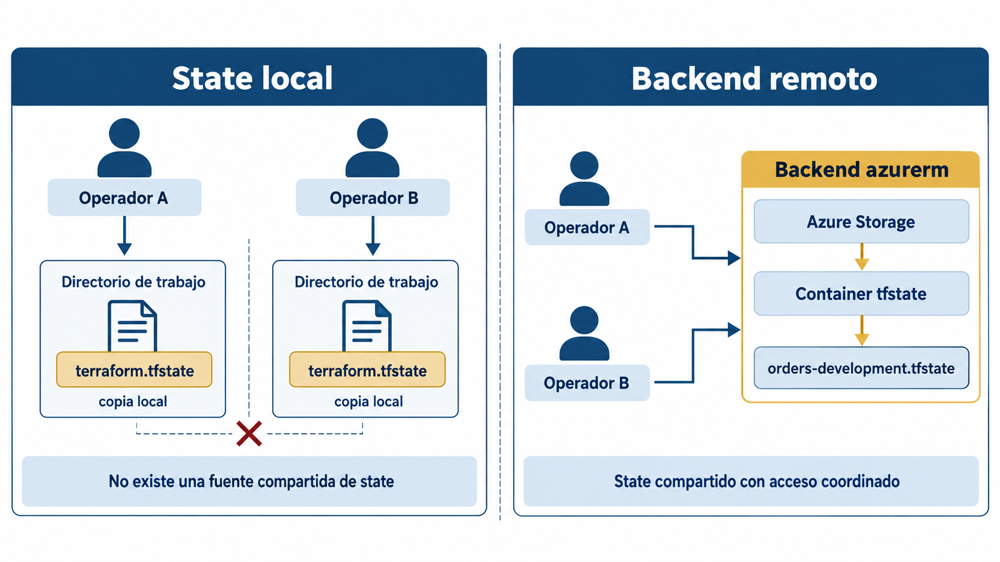
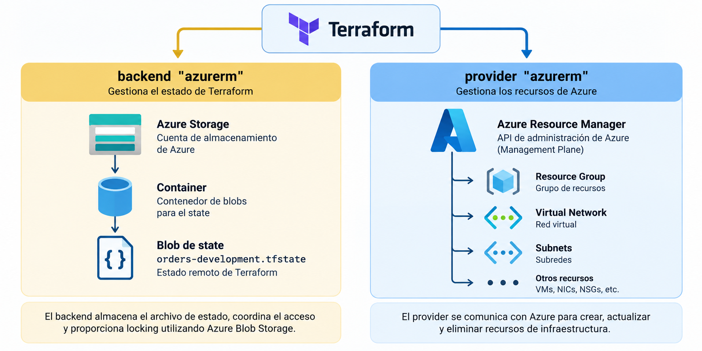
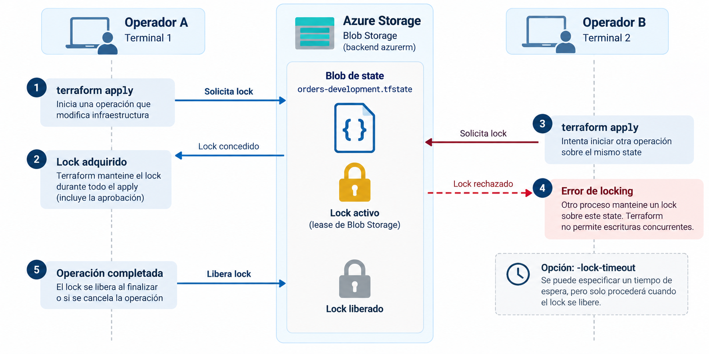
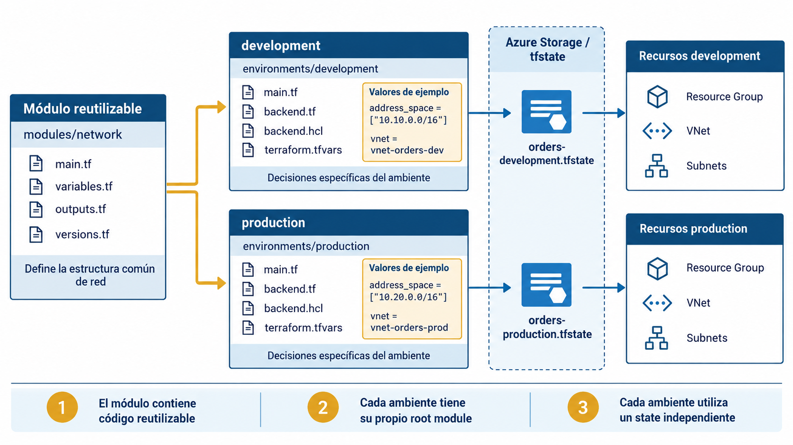

# Clase 16. Estado remoto y ambientes


!!! note "Resultados de aprendizaje"
    Al finalizar la clase se espera poder:

    - explicar por qué el state local limita el trabajo colaborativo con Terraform;
    - distinguir la función del backend de la función del provider;
    - configurar un backend remoto en Azure Storage;
    - migrar un state existente desde el backend local hacia un backend remoto;
    - explicar cómo funciona el locking y qué problema de concurrencia evita;
    - organizar configuraciones Terraform para múltiples ambientes manteniendo states independientes;
    - comparar directorios separados y CLI workspaces como estrategias para administrar varios ambientes;
    - identificar decisiones de seguridad asociadas al almacenamiento y acceso al state.

## 1. Terraform en un equipo

Hasta este punto, las configuraciones pueden ejecutarse desde una sola estación de trabajo. Terraform mantiene la relación entre la configuración y la infraestructura real mediante el state.

Con el backend predeterminado, ese state se guarda en el archivo:

```text
terraform.tfstate
```

Para una práctica individual, este mecanismo permite observar con claridad el funcionamiento de Terraform. En un equipo introduce problemas operativos.

Supóngase que dos integrantes trabajan sobre la misma infraestructura:

```text
Ana                              Luis
│                                 │
├── terraform.tfstate local       ├── terraform.tfstate local
│                                 │
├── modifica una subnet           ├── agrega otra subnet
│                                 │
└── terraform apply               └── terraform apply
```

Cada estación posee una copia distinta del conocimiento que Terraform utiliza para decidir qué administra. No existe una fuente compartida que garantice que ambos comandos parten del mismo state.

El problema requiere más que compartir un archivo. El state forma parte del mecanismo operativo de Terraform y necesita:

- almacenamiento accesible por los operadores autorizados;
- control de acceso;
- protección ante escrituras concurrentes;
- persistencia independiente de una computadora;
- disponibilidad para procesos automatizados;
- tratamiento apropiado de información sensible.

Terraform resuelve la ubicación y el mecanismo de acceso al state mediante un **backend**.

## 2. Backends

Un backend determina dónde almacena Terraform su state y, dependiendo del tipo de backend, puede proporcionar capacidades adicionales como locking.

El backend utilizado de forma predeterminada es `local`. Un backend remoto modifica la ubicación y el mecanismo de acceso al state.



*Figura 1. Con state local, cada operador depende de una copia propia. Un backend remoto establece una fuente compartida de state y permite coordinar su acceso.*

La configuración de los recursos sigue siendo la misma. El backend modifica dónde Terraform mantiene el state y cómo accede a él.

### 2.1. Backend y provider

Backend y provider cumplen responsabilidades diferentes.

| Componente | Responsabilidad |
|---|---|
| Backend | Almacenar el state y, cuando corresponde, coordinar su acceso |
| Provider | Interactuar con la API de una plataforma para administrar recursos |

En esta clase se utilizan dos componentes relacionados con Azure:



*Figura 2. El backend `azurerm` administra el almacenamiento y coordinación del state en Azure Blob Storage; el provider `azurerm` utiliza las API de Azure para administrar recursos de infraestructura.*

Ambos se denominan `azurerm`, pero no son el mismo componente ni cumplen la misma función.

El provider se declara dentro de `required_providers` y se configura mediante un bloque `provider`.

```hcl
terraform {
  required_providers {
    azurerm = {
      source  = "hashicorp/azurerm"
      version = "~> 5.0"
    }
  }
}

provider "azurerm" {
  features {}

  subscription_id = var.subscription_id
}
```

El backend se declara dentro del bloque `terraform`:

```hcl
terraform {
  backend "azurerm" {}
}
```

Los backends forman parte de Terraform CLI; no se instalan como providers.

### 2.2. Configuración del backend

La configuración del backend se procesa durante:

```bash
terraform init
```

Esto ocurre antes de que Terraform evalúe la configuración normal del módulo. Por esa razón, un backend no puede utilizar input variables, `locals`, atributos de recursos ni data sources.

La siguiente configuración es inválida:

```hcl
terraform {
  backend "azurerm" {
    storage_account_name = var.storage_account_name
  }
}
```

Terraform todavía no ha evaluado `var.storage_account_name` cuando necesita inicializar el backend.

Una alternativa consiste en declarar una configuración parcial:

```hcl
terraform {
  backend "azurerm" {
    use_azuread_auth = true
    use_cli          = true
  }
}
```

y proporcionar los valores que identifican el almacenamiento durante `terraform init`.

Por ejemplo:

```bash
terraform init   -backend-config="storage_account_name=stordersdevstate1234"   -backend-config="container_name=tfstate"   -backend-config="key=orders-platform.tfstate"
```

Cuando existen varios valores, resulta más mantenible utilizar un archivo:

```text
backend.hcl
```

con contenido como:

```hcl
storage_account_name = "stordersdevstate1234"
container_name       = "tfstate"
key                  = "orders-platform.tfstate"
```

En este escenario no se incluye `resource_group_name` porque Terraform accede directamente al endpoint estándar de Blob Storage utilizando el nombre de la cuenta. El backend `azurerm` necesita datos del management plane, como `resource_group_name` y `subscription_id`, cuando debe consultar Azure Resource Manager para resolver el endpoint, por ejemplo al utilizar `lookup_blob_endpoint = true`.

La inicialización se reduce a:

```bash
terraform init -backend-config=backend.hcl
```

Los archivos de configuración del backend no deben contener credenciales.

## 3. Estado remoto en Azure Storage

El backend `azurerm` almacena el state como un blob dentro de un container de Azure Storage.

```text
Azure subscription
│
└── Resource Group
    │
    └── Storage Account
        │
        └── Blob Container
            │
            └── orders-platform.tfstate
```

Para esta clase se utilizará un Storage Account dedicado al state.

### 3.1. Infraestructura del backend

El backend debe existir antes de que una configuración pueda utilizarlo. El Storage Account que almacena el state no puede depender del mismo state que todavía no existe.

Este problema de inicialización suele denominarse **bootstrap**. Puede resolverse mediante una configuración Terraform independiente, un proceso de plataforma previo o herramientas de administración del proveedor.

En esta clase se utilizará Azure CLI para mantener separado el bootstrap del contenido principal.

### 3.2. Creación del almacenamiento

Primero se verifica la suscripción activa:

```bash
az account show --output table
```

Si corresponde, se selecciona explícitamente:

```bash
az account set --subscription "ID_O_NOMBRE"
```

Se definen nombres:

```bash
RESOURCE_GROUP="rg-tfstate-dev"
LOCATION="REGION_PERMITIDA"
STORAGE_ACCOUNT="sttfstateIDENTIFICADOR"
CONTAINER="tfstate"
```

El nombre de un Storage Account debe ser globalmente único.

Se crea el Resource Group:

```bash
az group create \
  --name "$RESOURCE_GROUP" \
  --location "$LOCATION"
```

Se crea el Storage Account:

```bash
az storage account create \
  --name "$STORAGE_ACCOUNT" \
  --resource-group "$RESOURCE_GROUP" \
  --location "$LOCATION" \
  --sku Standard_LRS \
  --kind StorageV2 \
  --allow-blob-public-access false
```

La autenticación que se utilizará para crear el container y para acceder posteriormente al state opera sobre el **data plane** de Blob Storage. Por esa razón, antes de crear el container se asigna a la identidad de la persona el rol `Storage Blob Data Contributor` sobre el Storage Account.

Se obtiene el identificador del Storage Account:

```bash
STORAGE_ACCOUNT_ID=$(az storage account show \
  --name "$STORAGE_ACCOUNT" \
  --resource-group "$RESOURCE_GROUP" \
  --query id \
  --output tsv)
```

Se obtiene el identificador de la identidad autenticada:

```bash
USER_OBJECT_ID=$(az ad signed-in-user show \
  --query id \
  --output tsv)
```

Se asigna el rol:

```bash
az role assignment create \
  --assignee-object-id "$USER_OBJECT_ID" \
  --assignee-principal-type User \
  --role "Storage Blob Data Contributor" \
  --scope "$STORAGE_ACCOUNT_ID"
```

La asignación RBAC puede tardar algunos minutos en propagarse. Si la creación del container falla inmediatamente después con un error de autorización, debe verificarse primero que el rol ya sea efectivo.

Finalmente se crea el container utilizando la identidad autenticada:

```bash
az storage container create \
  --name "$CONTAINER" \
  --account-name "$STORAGE_ACCOUNT" \
  --auth-mode login
```

!!! note "Permisos para asignar roles"
    La persona que ejecuta `az role assignment create` necesita permisos para crear asignaciones RBAC. En un entorno institucional, esta asignación puede realizarla previamente una persona administradora. Tener permisos para crear un Storage Account no implica necesariamente disponer de permisos para asignar roles.

### 3.3. Autenticación del backend

El backend necesita autenticarse contra el data plane del Storage Account.

Para desarrollo local se utilizará la sesión de Azure CLI:

```bash
az login
```

y el backend:

```hcl
terraform {
  backend "azurerm" {
    use_azuread_auth = true
    use_cli          = true
  }
}
```

La identidad utilizada debe disponer de permisos para leer y escribir blobs en el container. Para este escenario, el rol recomendado es:

```text
Storage Blob Data Contributor
```

La autenticación local mediante Azure CLI es apropiada para la práctica de esta clase. En un pipeline no se debe depender de una sesión interactiva. La autenticación federada mediante OpenID Connect se abordará en la siguiente clase.

### 3.4. Dos planos de acceso

Azure distingue entre operaciones de administración y operaciones sobre los datos almacenados.

```text
Management plane
    │
    ├── crear Storage Account
    ├── configurar propiedades
    └── administrar recursos

Data plane
    │
    ├── leer blobs
    ├── escribir blobs
    └── adquirir leases
```

Tener permisos para administrar el Storage Account no implica necesariamente tener permisos para leer y escribir su contenido.

### 3.5. Protección del state almacenado

Azure Storage cifra los datos en reposo antes de persistirlos. Por tanto, el blob que contiene el state queda cubierto por el cifrado del servicio.

El cifrado en reposo no sustituye el control de acceso. El state puede contener valores sensibles obtenidos de recursos o providers, y una identidad autorizada para leer el blob puede acceder a su contenido. La protección del backend requiere, como mínimo:

- acceso mediante identidades individuales o de workload;
- permisos de mínimo privilegio;
- ausencia de acceso público al container;
- exclusión del state de los repositorios de código.

## 4. Migración desde state local

Se parte de una configuración que ya administra recursos y cuyo state se encuentra localmente:

```text
terraform/
├── main.tf
├── variables.tf
├── outputs.tf
├── terraform.tfvars
└── terraform.tfstate
```

Antes de modificar el backend se comprueba que la configuración esté sincronizada:

```bash
terraform plan
```

El resultado esperado es:

```text
No changes.
```

Se agrega:

```hcl
terraform {
  backend "azurerm" {
    use_azuread_auth = true
    use_cli          = true
  }
}
```

y se crea:

```hcl
# backend.hcl

storage_account_name = "sttfstateIDENTIFICADOR"
container_name       = "tfstate"
key                  = "orders-platform.tfstate"
```

A continuación:

```bash
terraform init -migrate-state -backend-config=backend.hcl
```

Terraform detecta el state del backend anterior y solicita confirmación para copiarlo al nuevo backend.

```text
terraform.tfstate
      │
      │ terraform init -migrate-state
      ▼
Azure Blob Storage
      │
      └── orders-platform.tfstate
```

La identidad de los recursos administrados no cambia por mover el state.

### 4.1. Verificación

Después de la migración:

```bash
terraform state list
```

debe mostrar las mismas direcciones que antes.

También se ejecuta:

```bash
terraform plan
```

El resultado esperado continúa siendo:

```text
No changes.
```

La migración correcta del backend cambia el lugar donde se almacena el state; no constituye por sí misma un cambio de infraestructura.

### 4.2. Archivos locales después de la migración

Terraform mantiene metadatos de inicialización dentro de:

```text
.terraform/
```

Ese directorio no debe versionarse.

Un `.gitignore` apropiado incluye:

```gitignore
.terraform/
*.tfstate
*.tfstate.*
*.tfplan
terraform.tfvars
```

El archivo `.terraform.lock.hcl` cumple una función diferente: registra selecciones de providers y normalmente sí se versiona.

### 4.3. Fallos al persistir state

Con un backend remoto, Terraform normalmente mantiene el state fuera del disco local.

Existe una excepción relevante: si Terraform modifica infraestructura pero después no puede persistir la nueva versión del state en el backend, puede escribir una copia local para evitar perder la información obtenida durante la ejecución.

Esa copia representa un problema de recuperación, no un nuevo state independiente que deba ignorarse. Antes de continuar se debe:

1. resolver la causa que impide escribir en el backend;
2. preservar la copia local generada;
3. comprobar qué infraestructura cambió realmente;
4. restaurar cuidadosamente el state correcto en el backend.

Terraform dispone de:

```bash
terraform state push ARCHIVO_STATE
```

para cargar explícitamente un state local cuando una recuperación lo requiere. Este comando modifica directamente el state remoto y debe utilizarse únicamente después de verificar que el archivo corresponde a la infraestructura real y que ninguna otra operación ha avanzado el backend.

Repetir `terraform apply` sin resolver primero la discrepancia puede agravar el problema, porque Terraform podría tomar decisiones basadas en un state remoto desactualizado.

## 5. Locking

Compartir un state introduce un problema adicional: dos procesos pueden intentar modificarlo al mismo tiempo.

```text
Operador A                         Operador B
     │                                  │
terraform apply                    terraform apply
     │                                  │
     └──────────────┬───────────────────┘
                    ▼
              mismo state
```

Terraform utiliza **state locking** cuando el backend lo soporta.

### 5.1. Lock sobre Azure Blob Storage

El backend `azurerm` utiliza capacidades nativas de Azure Blob Storage para bloquear el state durante operaciones que pueden escribirlo.



*Figura 3. Una operación que adquiere el lock sobre el blob de state impide que otro proceso escriba simultáneamente. El lock se libera al finalizar o cancelar la operación.*

Si otro proceso intenta una operación incompatible mientras el lock está activo, Terraform no permite la escritura concurrente.

El lock protege el state compartido. No reemplaza:

- revisión de cambios;
- control de acceso;
- autorización para ejecutar `apply`;
- separación de ambientes;
- políticas de despliegue.

### 5.2. Contención de state

Cuando Terraform no puede adquirir un lock, informa el conflicto y proporciona datos que permiten identificar la operación propietaria.

Deshabilitar locking:

```bash
terraform apply -lock=false
```

elimina una protección importante y no constituye una solución normal.

### 5.3. `force-unlock`

Una operación puede terminar de forma anormal y dejar un lock que ya no corresponde a un proceso activo.

Terraform proporciona:

```bash
terraform force-unlock LOCK_ID
```

Este comando debe utilizarse únicamente después de verificar que ninguna ejecución legítima continúa utilizando ese state.

### 5.4. Alcance del locking

El lock protege **un state concreto** frente a escrituras concurrentes. No coordina automáticamente todos los states de una organización.

Por ejemplo:

```text
orders-development.tfstate ── lock A
orders-production.tfstate  ── lock B
```

Los locks son independientes. Si dos configuraciones distintas intentan administrar accidentalmente el mismo objeto remoto, el mecanismo de locking no detecta ese conflicto porque cada configuración opera sobre un state diferente.

El locking protege la consistencia del state compartido; la correcta delimitación de qué recursos pertenecen a cada state sigue siendo una decisión de diseño.

## 6. Múltiples ambientes

Una misma aplicación suele existir en varios ambientes:

```text
development
staging
production
```

Estos ambientes pueden compartir arquitectura, pero no deben compartir el mismo state.

```text
Código reutilizable
        │
        ├── development → state development
        │
        └── production  → state production
```

### 6.1. Razones para separar states

La separación reduce el alcance de cada operación.

Un `terraform plan` ejecutado para `development` debe analizar únicamente recursos de `development`. Un `terraform destroy` sobre ese ambiente no debe incluir recursos de producción.

La separación también permite aplicar:

- permisos distintos;
- procesos de aprobación distintos;
- credenciales distintas;
- ciclos de cambio distintos;
- backends o claves de state independientes.

### 6.2. Directorios por ambiente

Para el curso se utilizará:

```text
terraform/
├── modules/
│   └── network/
│       ├── main.tf
│       ├── variables.tf
│       ├── outputs.tf
│       └── versions.tf
│
└── environments/
    ├── development/
    │   ├── main.tf
    │   ├── variables.tf
    │   ├── outputs.tf
    │   ├── backend.tf
    │   ├── backend.hcl
    │   └── terraform.tfvars
    │
    └── production/
        ├── main.tf
        ├── variables.tf
        ├── outputs.tf
        ├── backend.tf
        ├── backend.hcl
        └── terraform.tfvars
```

Cada directorio de ambiente constituye un root module independiente.



*Figura 4. `development` y `production` reutilizan el mismo módulo de red, pero cada ambiente mantiene su propio root module, su propio state y su propio conjunto de recursos remotos.*

### 6.3. Desarrollo

`environments/development/main.tf`:

```hcl
terraform {
  required_version = ">= 1.12"

  required_providers {
    azurerm = {
      source  = "hashicorp/azurerm"
      version = "~> 5.0"
    }
  }
}

provider "azurerm" {
  features {}

  subscription_id = var.subscription_id
}

locals {
  common_tags = merge(
    {
      application = var.application_name
      environment = "development"
      managed_by  = "terraform"
    },
    var.additional_tags
  )
}

resource "azurerm_resource_group" "main" {
  name     = var.resource_group_name
  location = var.location

  tags = local.common_tags
}

module "network" {
  source = "../../modules/network"

  name                = "vnet-orders-dev"
  resource_group_name = azurerm_resource_group.main.name
  location            = azurerm_resource_group.main.location
  address_space       = ["10.10.0.0/16"]

  subnets = {
    application = {
      name             = "snet-application"
      address_prefixes = ["10.10.1.0/24"]
    }

    data = {
      name             = "snet-data"
      address_prefixes = ["10.10.2.0/24"]
    }
  }

  tags = local.common_tags
}
```

`backend.tf`:

```hcl
terraform {
  backend "azurerm" {
    use_azuread_auth = true
    use_cli          = true
  }
}
```

`backend.hcl`:

```hcl
storage_account_name = "sttfstateIDENTIFICADOR"
container_name       = "tfstate"
key                  = "orders-development.tfstate"
```

### 6.4. Producción

Producción utiliza el mismo módulo, pero posee su propio root module y su propio state.

`backend.hcl`:

```hcl
storage_account_name = "sttfstateIDENTIFICADOR"
container_name       = "tfstate"
key                  = "orders-production.tfstate"
```

Puede compartirse el mismo Storage Account y container manteniendo blobs diferentes:

```text
tfstate/
├── orders-development.tfstate
└── orders-production.tfstate
```

También pueden utilizarse cuentas o containers distintos cuando se requiera mayor aislamiento.

La condición esencial es que las configuraciones no escriban sobre la misma key de state.

### 6.5. Diferencias entre ambientes

La reutilización no exige que ambos ambientes sean idénticos.

```text
development
10.10.0.0/16

production
10.20.0.0/16
```

El módulo expresa la estructura común. Cada root module expresa decisiones específicas del ambiente.

```text
modules/network
    │
    └── cómo se construye una red

environments/production
    │
    └── qué red necesita producción
```

## 7. Terraform CLI workspaces

Terraform CLI permite asociar varios states a una misma configuración mediante **workspaces**.

El workspace inicial es `default`. Los comandos básicos son:

```bash
terraform workspace show
terraform workspace new development
terraform workspace select development
```

y el nombre activo puede consultarse desde HCL mediante:

```hcl
terraform.workspace
```

Conceptualmente:

```text
misma configuración

default      → state A
development  → state B
production   → state C
```

Un workspace separa state, pero mantiene la misma configuración de backend y no crea por sí mismo permisos, credenciales o procesos de aprobación independientes.

| Estrategia | Ventaja principal | Límite principal |
|---|---|---|
| CLI workspaces | Varias instancias de una misma configuración con poco código adicional | Separación administrativa limitada |
| Root modules por ambiente | Límites explícitos de configuración, backend y proceso operativo | Mayor repetición en los root modules |

Para este curso se utilizarán root modules separados para `development` y `production`. Los workspaces se estudian como una alternativa válida cuando las instancias comparten el mismo modelo operativo.

## 8. Organización de un repositorio Terraform

La estructura resultante separa tres responsabilidades:

```text
terraform/
├── modules/          → código reutilizable
│   └── network/
│
├── environments/     → decisiones específicas de cada ambiente
│   ├── development/
│   └── production/
│
└── .gitignore
```

El repositorio conserva configuración, módulos, documentación y `.terraform.lock.hcl`. El backend conserva el state. Las credenciales provienen de mecanismos externos de autenticación.

Una exclusión mínima para esta práctica es:

```gitignore
.terraform/
*.tfstate
*.tfstate.*
*.tfplan
terraform.tfvars
```

`backend.hcl` puede versionarse cuando contiene únicamente identificadores no sensibles. `terraform.tfvars` también puede versionarse en proyectos donde sus valores sean deliberadamente públicos; en esta clase se mantiene fuera del repositorio para evitar incorporar accidentalmente información sensible o valores locales.

## 9. Práctica: de configuración individual a configuración de equipo

La práctica reutiliza la infraestructura desarrollada en la clase anterior.

El objetivo consiste en transformar una configuración con state local en una estructura con:

- backend remoto;
- autenticación mediante Azure CLI;
- state separado por ambiente;
- módulo `network` reutilizado;
- verificación de locking.

### 9.1. Parte A. Preparar el backend

1. Autenticarse con `az login`.
2. Verificar la suscripción con `az account show --output table`.
3. Crear un Resource Group para el backend.
4. Crear un Storage Account con nombre globalmente único.
5. Crear el container `tfstate`.
6. Verificar permisos sobre blobs.

### 9.2. Parte B. Migrar el state de desarrollo

Partir de la configuración aplicada en la clase anterior.

Verificar:

```bash
terraform plan
```

Debe mostrar:

```text
No changes.
```

Agregar `backend.tf` y crear `backend.hcl`.

Ejecutar:

```bash
terraform init -migrate-state -backend-config=backend.hcl
```

Después:

```bash
terraform state list
terraform plan
```

Registrar las direcciones existentes, el resultado del plan y la ubicación del blob.

### 9.3. Parte C. Separar los ambientes

La reorganización del repositorio no debe crear una segunda copia de la infraestructura de desarrollo. El root module de `development` continuará utilizando **el mismo state remoto** migrado en la parte anterior.

Crear:

```text
modules/network
environments/development
environments/production
```

Mover el módulo reutilizable a:

```text
modules/network
```

y trasladar la configuración del ambiente existente a:

```text
environments/development
```

El archivo `backend.hcl` de `development` debe continuar apuntando a la key ya migrada:

```text
orders-development.tfstate
```

Desde el nuevo directorio:

```bash
cd environments/development
terraform init -backend-config=backend.hcl
terraform state list
terraform plan
```

Puntos de control:

- `terraform state list` debe mostrar las mismas direcciones que antes de reorganizar;
- `terraform plan` debe terminar con `No changes.`;
- una ruta diferente en el sistema de archivos no implica un state diferente;
- las direcciones Terraform deben permanecer estables si únicamente se reorganizan archivos y rutas de módulos sin cambiar la estructura lógica de recursos.

A continuación se crea `environments/production` como un root module independiente. Su `backend.hcl` utiliza una key diferente:

```text
orders-production.tfstate
```

y un espacio de direcciones distinto:

```text
development → 10.10.0.0/16
production  → 10.20.0.0/16
```

Desde producción:

```bash
cd ../production
terraform init -backend-config=backend.hcl
terraform state list
terraform plan
```

Al tratarse de un state nuevo, `terraform state list` estará vacío antes del primer apply y el plan mostrará la creación de la infraestructura de producción.

Antes de aplicar, debe comprobarse qué ambiente, qué key y qué recursos aparecen en el plan.

### 9.4. Parte D. Observar el locking

La demostración se realiza sobre `development` y requiere dos terminales abiertas en el mismo directorio.

1. Introducir un cambio pequeño y reversible en la configuración de desarrollo, por ejemplo agregar temporalmente un tag:

```hcl
additional_tags = {
  owner       = "platform-team"
  experiment  = "locking"
}
```

2. En la terminal A ejecutar:

```bash
terraform apply
```

3. Cuando Terraform muestre el plan y solicite confirmación, **no responder todavía**. En ese momento la operación mantiene el lock del state.

4. En la terminal B ejecutar:

```bash
terraform apply -lock-timeout=10s
```

5. Observar el mensaje de contención y registrar la información del lock.

6. Volver a la terminal A y responder:

```text
no
```

para cancelar el apply y liberar el lock.

7. Retirar el cambio temporal de la configuración.

La observación debe permitir responder:

1. ¿qué operación adquirió el lock?;
2. ¿qué información recibió el segundo proceso?;
3. ¿por qué el segundo proceso no puede continuar aunque su configuración sea correcta?;
4. ¿por qué `-lock=false` elimina una protección necesaria?;
5. ¿en qué situación estaría justificado `terraform force-unlock`?

### 9.5. Limpieza

Antes de destruir recursos se verifica el ambiente y el backend.

```bash
terraform plan -destroy
terraform destroy
```

La infraestructura utilizada para almacenar el state se elimina únicamente después de destruir las configuraciones que dependen de ella y confirmar que ya no se necesita conservar sus states.

## 10. Análisis

Considérese:

```text
environments/
├── development/
│   └── backend.hcl → key = "orders.tfstate"
│
└── production/
    └── backend.hcl → key = "orders.tfstate"
```

Ambos ambientes apuntan al mismo Storage Account, container y key.

### Preguntas

1. ¿Qué problema existe aunque los directorios tengan configuraciones distintas?
2. ¿Qué state leerá Terraform al ejecutar desde `production`?
3. ¿Qué podría ocurrir si ambos ambientes tienen direcciones Terraform similares?
4. ¿Qué cambio mínimo corrige el problema?
5. ¿Sería suficiente utilizar distintos archivos `terraform.tfvars` manteniendo la misma key?

??? info "Resolución comentada"
    La key identifica el blob utilizado como state. Si ambos ambientes usan la misma combinación de Storage Account, container y key, comparten el mismo state. Los archivos `.tfvars` modifican valores de entrada, pero no separan el state. La corrección mínima consiste en asignar una key diferente a cada ambiente, por ejemplo `orders-development.tfstate` y `orders-production.tfstate`. También pueden utilizarse containers o Storage Accounts diferentes cuando se requiere mayor aislamiento.

### Caso 2. States diferentes, mismo recurso remoto

Considérese ahora que `development` y `production` utilizan keys distintas y, por tanto, poseen locks independientes. Por un error de configuración, ambos root modules utilizan el mismo Resource Group y el mismo nombre de VNet:

```text
development state → rg-orders-shared / vnet-orders
production state  → rg-orders-shared / vnet-orders
```

Preguntas:

1. ¿El locking de Terraform evita que ambos ambientes entren en conflicto?
2. ¿Qué ocurrirá normalmente cuando el segundo state intente crear un recurso que ya existe?
3. ¿Qué riesgo adicional aparecería si el mismo recurso remoto fuese importado deliberadamente en ambos states?
4. ¿Qué principio de diseño debería impedir esta situación?

??? info "Resolución comentada"
    Los locks pertenecen a cada state, por lo que dos keys distintas pueden estar desbloqueadas simultáneamente. Si el segundo root module intenta crear un recurso Azure con una identidad ya existente, la API normalmente rechazará la creación. Si el mismo recurso se importa en ambos states, dos configuraciones diferentes podrían intentar administrarlo sin coordinación mutua. Cada recurso remoto debería tener una única autoridad de administración claramente definida.

## 11. Errores frecuentes

### 11.1. Crear el backend dentro de la configuración que depende de él

Terraform necesita inicializar el backend antes de poder evaluar y aplicar los recursos del root module. La infraestructura que aloja el backend requiere un bootstrap independiente.

### 11.2. Utilizar variables dentro del bloque `backend`

El backend se inicializa antes de evaluar las input variables del módulo. Los valores variables del backend deben proporcionarse mediante mecanismos admitidos durante `terraform init`.

### 11.3. Usar una misma key para ambientes distintos

Dos root modules que apuntan a la misma key comparten state aunque se encuentren en directorios diferentes.

### 11.4. Versionar `terraform.tfstate`

El state puede contener información sensible y requiere coordinación de escritura. Git no sustituye un backend diseñado para state compartido.

### 11.5. Deshabilitar locking ante una contención

`-lock=false` elimina una protección frente a operaciones concurrentes. Una contención legítima se resuelve esperando a que termine la operación que posee el lock.

### 11.6. Ejecutar `force-unlock` sin verificar el proceso propietario

Forzar el desbloqueo de un state utilizado activamente permite que otra operación escriba al mismo tiempo.

### 11.7. Confundir permisos del Resource Manager con permisos sobre blobs

La administración del Storage Account y el acceso a su data plane son permisos diferentes.

## 12. Criterios de diseño

Una configuración Terraform utilizada por un equipo debe definir con claridad:

- el backend que almacena cada state;
- la identidad autorizada para leerlo y modificarlo;
- el mecanismo de locking disponible;
- la frontera de recursos administrados por cada state;
- la separación entre código reutilizable y configuración de ambiente;
- la forma de autenticación de personas y procesos automatizados.

Estas decisiones preparan la siguiente clase. El `plan` pasará a formar parte de la revisión de cambios y el `apply` deberá ejecutarse mediante una identidad automatizada y controles explícitos.

## Referencias

- HashiCorp. *Backend block configuration overview*. <https://developer.hashicorp.com/terraform/language/backend>
- HashiCorp. *Backend Type: azurerm*. <https://developer.hashicorp.com/terraform/language/backend/azurerm>
- HashiCorp. *State Storage and Locking*. <https://developer.hashicorp.com/terraform/language/state/backends>
- HashiCorp. *State Locking*. <https://developer.hashicorp.com/terraform/language/state/locking>
- HashiCorp. *Manage workspaces*. <https://developer.hashicorp.com/terraform/cli/workspaces>
- Microsoft. *Store Terraform state in Azure Storage*. <https://learn.microsoft.com/azure/developer/terraform/store-state-in-azure-storage>
- Microsoft. *Authorize access to blobs with Azure CLI*. <https://learn.microsoft.com/azure/storage/blobs/authorize-data-operations-cli>
- Microsoft. *Azure Storage encryption for data at rest*. <https://learn.microsoft.com/azure/storage/common/storage-service-encryption>
