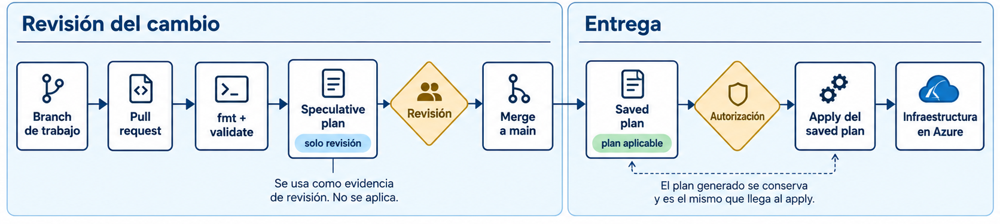
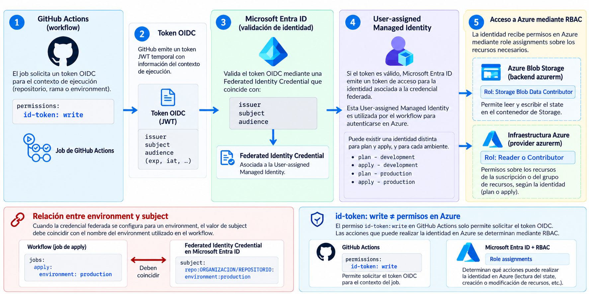
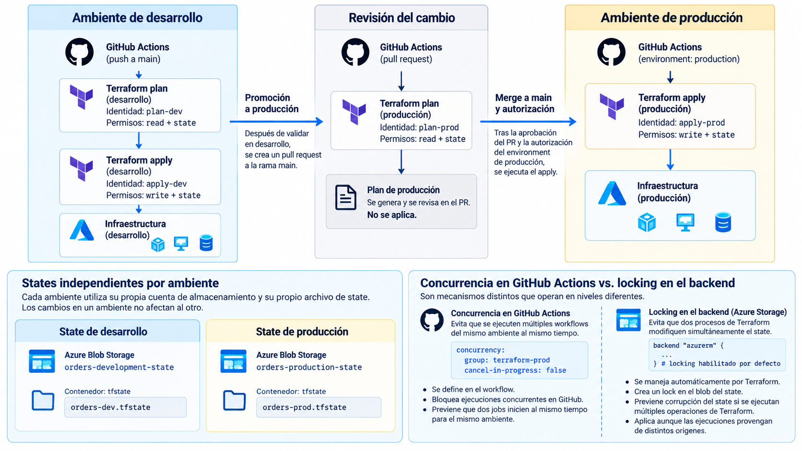
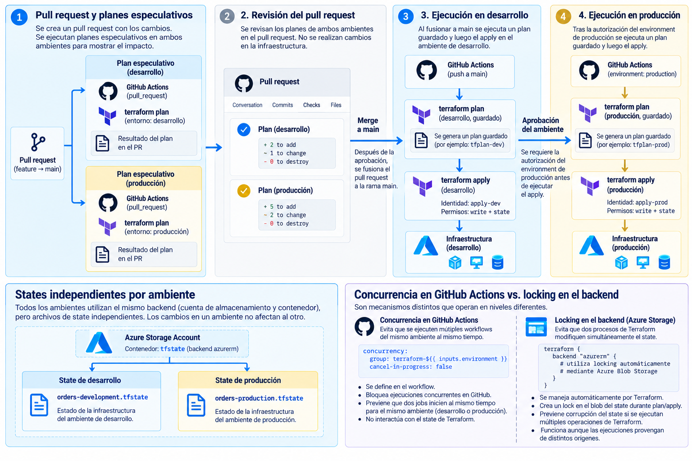

# Clase 17. Terraform en CI/CD


!!! note "Resultados de aprendizaje"
    Al finalizar la clase se espera poder:

    - explicar qué cambia cuando Terraform se ejecuta desde un pipeline;
    - distinguir validación estática, plan especulativo, saved plan y apply;
    - interpretar un plan como artefacto de revisión;
    - autenticar GitHub Actions en Azure mediante OIDC sin secretos de larga duración;
    - diseñar un flujo de promoción desde desarrollo hacia producción;
    - diferenciar concurrencia del pipeline y locking del state;
    - identificar los controles necesarios para que el plan aplicado corresponda con el plan generado.

## 1. Terraform dentro del proceso de cambios

En las clases anteriores, Terraform se ejecutó desde una estación de trabajo autenticada en Azure:

```text
editar configuración
        │
        ▼
terraform plan
        │
        ▼
revisar
        │
        ▼
terraform apply
```

La Clase 16 trasladó el state a Azure Storage. Eso permitió que distintos operadores o procesos autorizados trabajaran sobre una fuente compartida de state.

El problema de esta clase es distinto. Cuando la infraestructura se administra desde un repositorio, el equipo necesita controlar también el proceso mediante el cual una modificación llega a un ambiente:

```text
cambio en Git
    │
    ▼
validaciones
    │
    ▼
plan
    │
    ▼
revisión
    │
    ▼
integración
    │
    ▼
aplicación controlada
```

La automatización debe responder preguntas que una ejecución local deja a cargo de una persona:

- qué versión del código se está ejecutando;
- qué ambiente se está modificando;
- qué state se utiliza;
- qué identidad ejecuta Terraform;
- qué permisos posee esa identidad;
- qué plan se revisó;
- qué plan se aplica;
- qué sucede si dos ejecuciones intentan modificar el mismo ambiente.

El objetivo no consiste en sustituir:

```bash
terraform plan
terraform apply
```

por dos pasos YAML. El objetivo es conservar la relación entre **código, plan, autorización, identidad, state y cambio aplicado**.

### 1.1. Flujo recomendado

La documentación de HashiCorp para automatización conserva el ciclo:

1. `terraform init`;
2. `terraform plan -out=...`;
3. revisión humana;
4. `terraform apply <saved-plan>`.

En flujos basados en Git, se agrega una fase previa: las pull requests pueden ejecutar **speculative plans**, que permiten revisar el efecto del código propuesto sin producir todavía el plan destinado a aplicarse.

Una arquitectura común queda así:



*Figura 1. La pull request utiliza un plan especulativo como evidencia de revisión; después del merge se genera un saved plan que puede autorizarse y aplicarse de forma controlada.*

Microsoft publica una arquitectura de referencia para Terraform con GitHub Actions que utiliza este mismo principio: plan en el pipeline, saved plan transferido como artefacto, apply posterior, OIDC, identidades separadas para plan y apply, environments, aprobaciones y controles de concurrencia.

Por tanto, en esta clase **no se simplifica el flujo eliminando la relación entre plan y apply**. Se implementa el patrón con las condiciones necesarias para que sea reproducible.

## 2. Validación y plan en pull requests

Una pull request representa una propuesta. Todavía no constituye autorización para modificar infraestructura.

El pipeline debe producir evidencia para la revisión.

### 2.1. `terraform fmt`

```bash
terraform fmt -check -recursive
```

Comprueba que los archivos HCL siguen el formato canónico de Terraform.

Un fallo indica un problema de formato. Un resultado correcto no implica que la configuración sea técnicamente adecuada.

### 2.2. `terraform validate`

Para validar sin acceder al backend remoto:

```bash
terraform init -backend=false -input=false
terraform validate
```

`validate` comprueba sintaxis y consistencia interna de la configuración.

Por ejemplo:

```hcl
address_space = ["10.10.0.0/16"]
```

puede ser perfectamente válido aunque el rango seleccionado sea incorrecto para la arquitectura de la organización.

Por tanto:

```text
validate exitoso
≠
diseño correcto
```

### 2.3. Speculative plan

HashiCorp denomina **speculative plan** al plan generado sin `-out`:

```bash
terraform plan -input=false
```

El plan describe qué ocurriría si la configuración se aplicara contra el state y la infraestructura actuales, pero no se crea con intención de ser aplicado posteriormente.

En una pull request cumple una función de revisión:

```text
código propuesto
      │
      ▼
speculative plan
      │
      ▼
evidencia para revisión
```

Para producirlo en el ejemplo de la Clase 16 se necesita inicializar el backend:

```bash
terraform init \
  -input=false \
  -backend-config=backend.hcl

terraform plan \
  -input=false \
  -no-color
```

### 2.4. Interpretación del plan

Un pipeline puede finalizar correctamente y mostrar:

```text
Plan: 1 to add, 0 to change, 1 to destroy.
```

Ese resultado no es un fallo del pipeline. Terraform consiguió calcular el cambio solicitado.

La pregunta de revisión es otra:

> ¿Ese cambio corresponde con la intención de la pull request y su impacto es aceptable?

Los símbolos del plan permiten distinguir acciones:

| Símbolo | Significado general |
|---|---|
| `+` | creación |
| `~` | actualización in-place |
| `-` | destrucción |
| `-/+` | destrucción y posterior creación |
| `+/-` | creación antes de destruir, cuando el ciclo de vida lo permite |

Considérese:

```text
# module.network.azurerm_subnet.main["data"] must be replaced
-/+ resource "azurerm_subnet" "main" {
      ~ address_prefixes = [
          - "10.10.2.0/24",
          + "10.10.20.0/24",
        ]
    }
```

La revisión debe considerar:

- recurso afectado;
- tipo de operación;
- ambiente;
- interrupción posible;
- dependencias;
- pérdida potencial de información;
- correspondencia entre el cambio declarado y el cambio observado.

La afirmación:

```text
workflow exitoso
```

solo significa que las verificaciones configuradas terminaron correctamente.

No significa:

```text
infraestructura segura
```

### 2.5. Pull requests y ambientes

El repositorio utiliza dos root modules:

```text
terraform/
├── modules/
│   └── network/
└── environments/
    ├── development/
    └── production/
```

Una modificación a `modules/network` puede afectar **ambos** ambientes.

Por esa razón, un workflow de PR no debe asumir que todo cambio corresponde únicamente a `development`. Para cambios compartidos, deben revisarse los planes de los ambientes afectados.

En esta clase se mostrarán:

```text
PR
├── plan development
└── plan production
```

Si el cambio modifica únicamente archivos específicos de un ambiente, los filtros del workflow pueden reducir las ejecuciones. El principio permanece: **el plan debe corresponder con el ambiente potencialmente afectado**.

## 3. Identidad del pipeline

Un runner de GitHub Actions no posee la sesión interactiva creada mediante:

```bash
az login
```

Necesita una identidad de workload.

### 3.1. Secreto de larga duración frente a OIDC

Con un client secret:

```text
GitHub
   │
   │ conoce un secreto reutilizable
   ▼
Microsoft Entra ID
   │
   ▼
Azure
```

Mientras el secreto siga siendo válido, quien lo posea puede intentar utilizarlo.

Con OIDC:

```text
GitHub Actions
      │
      │ demuestra el contexto del workflow
      ▼
token OIDC de corta duración
      │
      ▼
Microsoft Entra ID
      │
      │ verifica la relación de confianza
      ▼
token de acceso temporal
```

GitHub no almacena un password o private key de Azure.

### 3.2. `issuer`, `subject` y `audience`

Una federated identity credential define qué tokens acepta Microsoft Entra ID.

Los tres elementos principales son:

| Elemento | Pregunta |
|---|---|
| `issuer` | ¿Quién emitió el token? |
| `subject` | ¿Qué workload afirma ser? |
| `audience` | ¿Para quién fue emitido? |

Para GitHub Actions:

```text
issuer = https://token.actions.githubusercontent.com
```

Un subject de pull request puede ser:

```text
repo:ORGANIZACION/REPOSITORIO:pull_request
```

Un subject asociado a un GitHub Environment puede ser:

```text
repo:ORGANIZACION/REPOSITORIO:environment:production
```

La relación debe coincidir con el contexto real del workflow.

Por ejemplo:

```yaml
jobs:
  apply-production:
    environment: production
```

produce un contexto compatible con una federated credential diseñada para:

```text
repo:ORGANIZACION/REPOSITORIO:environment:production
```

`environment: production` no es únicamente una etiqueta visual. Puede formar parte de la identidad federada que Azure acepta.

### 3.3. `id-token: write`

El workflow necesita:

```yaml
permissions:
  id-token: write
  contents: read
```

`id-token: write` autoriza al job a solicitar el token OIDC de GitHub.

No concede permisos en Azure.

La autorización efectiva requiere:



*Figura 2. GitHub Actions obtiene un token OIDC cuyo contexto es validado por Microsoft Entra ID mediante una credencial federada. RBAC determina posteriormente qué puede hacer la identidad en Azure.*

### 3.4. `azure/login` y autenticación directa de Terraform

Microsoft documenta `azure/login` como mecanismo estándar para establecer una sesión de Azure CLI o Azure PowerShell desde GitHub Actions.

Sin embargo, el backend `azurerm` y el provider AzureRM pueden consumir directamente el token OIDC disponible en GitHub Actions.

Por eso los workflows de esta clase **no necesitan `azure/login`** para ejecutar Terraform.

Se utilizará:

```yaml
env:
  ARM_CLIENT_ID: ${{ vars.AZURE_CLIENT_ID }}
  ARM_TENANT_ID: ${{ vars.AZURE_TENANT_ID }}
  ARM_SUBSCRIPTION_ID: ${{ vars.AZURE_SUBSCRIPTION_ID }}
  ARM_USE_OIDC: "true"
  ARM_USE_AZUREAD: "true"
```

`ARM_USE_OIDC` habilita el mecanismo OIDC.

`ARM_USE_AZUREAD` es especialmente relevante para el backend `azurerm`: indica que Azure Blob Storage debe autenticarse mediante Microsoft Entra ID.

Si un workflow necesitara ejecutar posteriormente:

```bash
az ...
```

sí sería razonable utilizar `azure/login` para preparar la sesión de Azure CLI.

### 3.5. Backend y provider

La misma ejecución de Terraform necesita autenticarse para dos responsabilidades diferentes:

```text
Terraform
   │
   ├── backend azurerm
   │       └── Azure Blob Storage
   │             └── state
   │
   └── provider azurerm
           └── Azure APIs
                 └── infraestructura
```

Para el backend se necesita acceso al container que almacena el state. En este curso se utiliza:

```text
Storage Blob Data Contributor
```

Para los recursos de red:

- la identidad de plan puede utilizar `Reader` sobre el Resource Group;
- la identidad de apply necesita permisos de modificación, por ejemplo `Contributor` sobre el Resource Group del ambiente.

El permiso del backend y el permiso del provider resuelven problemas diferentes.

## 4. Preparación reproducible de OIDC y RBAC

La configuración de GitHub Actions no funciona por sí sola. Antes deben existir las identidades, la federación y los role assignments.

La arquitectura de referencia de Microsoft separa plan y apply para aplicar mínimo privilegio. Esta clase mantiene ese patrón:



*Figura 3. Cada ambiente utiliza identidades distintas para plan y apply. El acceso al state y los permisos sobre la infraestructura se asignan mediante roles independientes.*

Así, el pipeline de revisión no recibe automáticamente permisos de escritura.

### 4.1. Convenciones

Los comandos siguientes están escritos para **Bash**.

Definir:

```bash
SUBSCRIPTION_ID="$(az account show --query id -o tsv)"
TENANT_ID="$(az account show --query tenantId -o tsv)"

LOCATION="REGION_PERMITIDA"

GITHUB_OWNER="ORGANIZACION"
GITHUB_REPO="REPOSITORIO"

IDENTITY_RG="rg-orders-identities"

DEV_RG="rg-orders-dev-IDENTIFICADOR"
PROD_RG="rg-orders-prod-IDENTIFICADOR"

STATE_RG="rg-orders-tfstate"
STORAGE_ACCOUNT="NOMBRE_STORAGE_ACCOUNT"
STATE_CONTAINER="tfstate"
```

`LOCATION` debe corresponder con una región permitida por las políticas de la suscripción.

Crear el Resource Group para identidades:

```bash
az group create \
  --name "$IDENTITY_RG" \
  --location "$LOCATION"
```

### 4.2. Crear identidades administradas asignadas por el usuario

```bash
DEV_PLAN_ID="id-orders-dev-plan"
DEV_APPLY_ID="id-orders-dev-apply"
PROD_PLAN_ID="id-orders-prod-plan"
PROD_APPLY_ID="id-orders-prod-apply"
```

```bash
for IDENTITY in \
  "$DEV_PLAN_ID" \
  "$DEV_APPLY_ID" \
  "$PROD_PLAN_ID" \
  "$PROD_APPLY_ID"
do
  az identity create \
    --name "$IDENTITY" \
    --resource-group "$IDENTITY_RG" \
    --location "$LOCATION"
done
```

Obtener los identificadores necesarios:

```bash
DEV_PLAN_CLIENT_ID=$(az identity show \
  --name "$DEV_PLAN_ID" \
  --resource-group "$IDENTITY_RG" \
  --query clientId -o tsv)

DEV_PLAN_PRINCIPAL_ID=$(az identity show \
  --name "$DEV_PLAN_ID" \
  --resource-group "$IDENTITY_RG" \
  --query principalId -o tsv)
```

El mismo procedimiento se utiliza para las otras tres identidades.

### 4.3. Credenciales federadas para plan

Los planes se generan en dos contextos:

```text
pull_request
main
```

El contexto `pull_request` permite ejecutar el speculative plan.

El contexto de `main` permite generar el saved plan después del merge.

Para `development`:

```bash
az identity federated-credential create \
  --name github-pr \
  --identity-name "$DEV_PLAN_ID" \
  --resource-group "$IDENTITY_RG" \
  --issuer "https://token.actions.githubusercontent.com" \
  --subject "repo:${GITHUB_OWNER}/${GITHUB_REPO}:pull_request" \
  --audiences "api://AzureADTokenExchange"
```

```bash
az identity federated-credential create \
  --name github-main \
  --identity-name "$DEV_PLAN_ID" \
  --resource-group "$IDENTITY_RG" \
  --issuer "https://token.actions.githubusercontent.com" \
  --subject "repo:${GITHUB_OWNER}/${GITHUB_REPO}:ref:refs/heads/main" \
  --audiences "api://AzureADTokenExchange"
```

Repetir ambas credenciales para `$PROD_PLAN_ID`.

### 4.4. Credenciales federadas para apply

Las identidades de apply se vinculan a GitHub Environments.

Para `development`:

```bash
az identity federated-credential create \
  --name github-development \
  --identity-name "$DEV_APPLY_ID" \
  --resource-group "$IDENTITY_RG" \
  --issuer "https://token.actions.githubusercontent.com" \
  --subject "repo:${GITHUB_OWNER}/${GITHUB_REPO}:environment:development" \
  --audiences "api://AzureADTokenExchange"
```

Para `production`:

```bash
az identity federated-credential create \
  --name github-production \
  --identity-name "$PROD_APPLY_ID" \
  --resource-group "$IDENTITY_RG" \
  --issuer "https://token.actions.githubusercontent.com" \
  --subject "repo:${GITHUB_OWNER}/${GITHUB_REPO}:environment:production" \
  --audiences "api://AzureADTokenExchange"
```

### 4.5. Permisos sobre el state

Obtener el scope del container:

```bash
STORAGE_ACCOUNT_ID=$(az storage account show \
  --name "$STORAGE_ACCOUNT" \
  --resource-group "$STATE_RG" \
  --query id \
  --output tsv)

STATE_CONTAINER_SCOPE="${STORAGE_ACCOUNT_ID}/blobServices/default/containers/${STATE_CONTAINER}"
```

Las cuatro identidades necesitan acceder al state correspondiente. En este ejemplo comparten el container y utilizan keys diferentes.

Asignar:

```bash
for PRINCIPAL_ID in \
  "$DEV_PLAN_PRINCIPAL_ID" \
  "$DEV_APPLY_PRINCIPAL_ID" \
  "$PROD_PLAN_PRINCIPAL_ID" \
  "$PROD_APPLY_PRINCIPAL_ID"
do
  az role assignment create \
    --assignee-object-id "$PRINCIPAL_ID" \
    --assignee-principal-type ServicePrincipal \
    --role "Storage Blob Data Contributor" \
    --scope "$STATE_CONTAINER_SCOPE"
done
```

Aunque la identidad de plan sea de solo lectura sobre los recursos de infraestructura, Terraform necesita las operaciones del backend necesarias para trabajar con el state y su locking.

### 4.6. Permisos sobre los ambientes

Obtener los Resource Group IDs:

```bash
DEV_RG_ID=$(az group show \
  --name "$DEV_RG" \
  --query id \
  --output tsv)

PROD_RG_ID=$(az group show \
  --name "$PROD_RG" \
  --query id \
  --output tsv)
```

Plan:

```bash
az role assignment create \
  --assignee-object-id "$DEV_PLAN_PRINCIPAL_ID" \
  --assignee-principal-type ServicePrincipal \
  --role "Reader" \
  --scope "$DEV_RG_ID"
```

```bash
az role assignment create \
  --assignee-object-id "$PROD_PLAN_PRINCIPAL_ID" \
  --assignee-principal-type ServicePrincipal \
  --role "Reader" \
  --scope "$PROD_RG_ID"
```

Apply:

```bash
az role assignment create \
  --assignee-object-id "$DEV_APPLY_PRINCIPAL_ID" \
  --assignee-principal-type ServicePrincipal \
  --role "Contributor" \
  --scope "$DEV_RG_ID"
```

```bash
az role assignment create \
  --assignee-object-id "$PROD_APPLY_PRINCIPAL_ID" \
  --assignee-principal-type ServicePrincipal \
  --role "Contributor" \
  --scope "$PROD_RG_ID"
```

!!! note "Alcance de Reader"
    `Reader` es suficiente para el caso de red utilizado en esta clase. Otros providers o recursos pueden necesitar lecturas de data plane o permisos adicionales para calcular un plan. El mínimo privilegio debe validarse contra los recursos reales administrados.

### 4.7. Configuración en GitHub

Crear los environments:

```text
development
production
```

En las variables del repositorio o de los environments registrar:

```text
AZURE_TENANT_ID
AZURE_SUBSCRIPTION_ID
DEV_PLAN_CLIENT_ID
DEV_APPLY_CLIENT_ID
PROD_PLAN_CLIENT_ID
PROD_APPLY_CLIENT_ID
```

Estos identificadores no son credenciales secretas. La autorización proviene de la federación y RBAC.

Para `production`, configurar required reviewers cuando la edición y el tipo de repositorio de GitHub lo permitan.

Cuando esa protección no esté disponible, debe utilizarse un mecanismo alternativo de autorización explícita. Más adelante se muestra una opción basada en `workflow_dispatch`.

## 5. Workflows de CI/CD

Se utilizarán dos workflows:

```text
.github/
└── workflows/
    ├── terraform-pr.yml
    └── terraform-cd.yml
```

El primero revisa propuestas.

El segundo aplica cambios ya integrados a `main`.

### 5.1. Workflow de pull request

```yaml
name: Terraform PR

on:
  pull_request:
    branches:
      - main
    paths:
      - "terraform/**"
      - ".github/workflows/terraform-pr.yml"

permissions:
  contents: read
  id-token: write

jobs:
  validate:
    runs-on: ubuntu-latest

    steps:
      - name: Checkout
        uses: actions/checkout@v4

      - name: Setup Terraform
        uses: hashicorp/setup-terraform@v4
        with:
          terraform_version: "1.12.2"

      - name: Format
        working-directory: terraform
        run: terraform fmt -check -recursive

      - name: Init development without backend
        working-directory: terraform/environments/development
        run: terraform init -backend=false -input=false

      - name: Validate development
        working-directory: terraform/environments/development
        run: terraform validate

      - name: Init production without backend
        working-directory: terraform/environments/production
        run: terraform init -backend=false -input=false

      - name: Validate production
        working-directory: terraform/environments/production
        run: terraform validate

  plan-development:
    needs: validate
    runs-on: ubuntu-latest

    permissions:
      contents: read
      id-token: write

    env:
      ARM_CLIENT_ID: ${{ vars.DEV_PLAN_CLIENT_ID }}
      ARM_TENANT_ID: ${{ vars.AZURE_TENANT_ID }}
      ARM_SUBSCRIPTION_ID: ${{ vars.AZURE_SUBSCRIPTION_ID }}
      ARM_USE_OIDC: "true"
      ARM_USE_AZUREAD: "true"

    defaults:
      run:
        working-directory: terraform/environments/development

    steps:
      - uses: actions/checkout@v4

      - uses: hashicorp/setup-terraform@v4
        with:
          terraform_version: "1.12.2"

      - name: Initialize backend
        run: terraform init -input=false -backend-config=backend.hcl

      - name: Speculative plan
        run: terraform plan -input=false -no-color

  plan-production:
    needs: validate
    runs-on: ubuntu-latest

    permissions:
      contents: read
      id-token: write

    env:
      ARM_CLIENT_ID: ${{ vars.PROD_PLAN_CLIENT_ID }}
      ARM_TENANT_ID: ${{ vars.AZURE_TENANT_ID }}
      ARM_SUBSCRIPTION_ID: ${{ vars.AZURE_SUBSCRIPTION_ID }}
      ARM_USE_OIDC: "true"
      ARM_USE_AZUREAD: "true"

    defaults:
      run:
        working-directory: terraform/environments/production

    steps:
      - uses: actions/checkout@v4

      - uses: hashicorp/setup-terraform@v4
        with:
          terraform_version: "1.12.2"

      - name: Initialize backend
        run: terraform init -input=false -backend-config=backend.hcl

      - name: Speculative plan
        run: terraform plan -input=false -no-color
```

Este workflow no ejecuta `apply`.

Además, el plan de `production` no recibe la identidad de apply. El código propuesto puede consultar únicamente aquello que la identidad de plan tiene permitido.

### 5.2. Del merge al despliegue

Después del merge a `main`, el proceso de entrega utiliza una secuencia de ambientes:



*Figura 4. La configuración aceptada se aplica primero en development y posteriormente en production. Los ambientes mantienen states independientes; la concurrencia de GitHub Actions y el locking del backend actúan en niveles diferentes.*

Este patrón coincide con el principio de promoción progresiva utilizado en arquitecturas de referencia de Azure: un cambio se ejecuta primero en un ambiente anterior y producción se mantiene detrás de una autorización más estricta.

No se utiliza el speculative plan de la PR como plan aplicable. Después del merge se genera un **nuevo saved plan sobre `main`**.

### 5.3. Saved plan

```bash
terraform plan \
  -input=false \
  -out=tfplan
```

El archivo contiene el conjunto exacto de acciones que posteriormente puede ejecutar:

```bash
terraform apply \
  -input=false \
  tfplan
```

Cuando `apply` recibe un saved plan, Terraform no vuelve a calcular otro plan.

Esto permite conservar una propiedad importante:

```text
plan generado
        =
plan aplicado
```

### 5.4. Plan y apply en jobs distintos

GitHub Environments protege jobs completos. Para colocar una aprobación entre plan y apply, normalmente se necesitan jobs distintos.

Microsoft utiliza en su implementación de referencia un patrón donde el plan se publica como artefacto y el job de apply lo descarga después de la aprobación.

HashiCorp, de forma más general, advierte que ejecutar plan y apply en máquinas diferentes exige preservar las condiciones bajo las cuales se produjo el plan. Un saved plan puede depender de:

- misma versión de Terraform;
- mismos providers;
- mismo sistema operativo y arquitectura;
- archivos de configuración equivalentes;
- rutas de trabajo compatibles.

En automatizaciones donde esas condiciones no estén garantizadas, HashiCorp recomienda conservar el working directory inicializado completo.

En GitHub Actions de esta clase se reducen esas diferencias mediante:

- `ubuntu-latest` en ambos jobs;
- la misma versión fija de Terraform;
- `.terraform.lock.hcl` versionado;
- checkout del mismo commit;
- misma estructura de repositorio;
- artefacto con retención breve.

Este patrón debe considerarse una decisión consciente del pipeline, no una propiedad automática de cualquier saved plan.

### 5.5. Sensibilidad del saved plan

`tfplan` puede contener:

- configuración;
- state utilizado durante el cálculo;
- variables;
- valores sensibles presentes en esos datos.

Por tanto:

```text
tfplan
≠
log público
```

No se versiona en Git y el acceso al artefacto debe restringirse.

## 6. Continuous Delivery por ambientes

El workflow siguiente muestra la estructura central. Se omiten únicamente repeticiones mecánicas que se indican explícitamente.

```yaml
name: Terraform CD

on:
  push:
    branches:
      - main
    paths:
      - "terraform/**"

permissions:
  contents: read
  id-token: write

concurrency:
  group: terraform-orders-platform
  cancel-in-progress: false

jobs:
  plan-development:
    runs-on: ubuntu-latest

    env:
      ARM_CLIENT_ID: ${{ vars.DEV_PLAN_CLIENT_ID }}
      ARM_TENANT_ID: ${{ vars.AZURE_TENANT_ID }}
      ARM_SUBSCRIPTION_ID: ${{ vars.AZURE_SUBSCRIPTION_ID }}
      ARM_USE_OIDC: "true"
      ARM_USE_AZUREAD: "true"

    defaults:
      run:
        working-directory: terraform/environments/development

    steps:
      - uses: actions/checkout@v4

      - uses: hashicorp/setup-terraform@v4
        with:
          terraform_version: "1.12.2"

      - name: Initialize
        run: terraform init -input=false -backend-config=backend.hcl

      - name: Create saved plan
        run: terraform plan -input=false -out=tfplan

      - name: Show plan
        run: terraform show -no-color tfplan

      - name: Upload plan
        uses: actions/upload-artifact@v4
        with:
          name: development-tfplan
          path: terraform/environments/development/tfplan
          retention-days: 1

  apply-development:
    needs: plan-development
    runs-on: ubuntu-latest
    environment: development

    env:
      ARM_CLIENT_ID: ${{ vars.DEV_APPLY_CLIENT_ID }}
      ARM_TENANT_ID: ${{ vars.AZURE_TENANT_ID }}
      ARM_SUBSCRIPTION_ID: ${{ vars.AZURE_SUBSCRIPTION_ID }}
      ARM_USE_OIDC: "true"
      ARM_USE_AZUREAD: "true"

    defaults:
      run:
        working-directory: terraform/environments/development

    steps:
      - uses: actions/checkout@v4

      - uses: hashicorp/setup-terraform@v4
        with:
          terraform_version: "1.12.2"

      - name: Initialize
        run: terraform init -input=false -backend-config=backend.hcl

      - name: Download plan
        uses: actions/download-artifact@v4
        with:
          name: development-tfplan
          path: terraform/environments/development

      - name: Apply saved plan
        run: terraform apply -input=false tfplan

  plan-production:
    needs: apply-development
    runs-on: ubuntu-latest

    env:
      ARM_CLIENT_ID: ${{ vars.PROD_PLAN_CLIENT_ID }}
      ARM_TENANT_ID: ${{ vars.AZURE_TENANT_ID }}
      ARM_SUBSCRIPTION_ID: ${{ vars.AZURE_SUBSCRIPTION_ID }}
      ARM_USE_OIDC: "true"
      ARM_USE_AZUREAD: "true"

    defaults:
      run:
        working-directory: terraform/environments/production

    steps:
      - uses: actions/checkout@v4

      - uses: hashicorp/setup-terraform@v4
        with:
          terraform_version: "1.12.2"

      - name: Initialize
        run: terraform init -input=false -backend-config=backend.hcl

      - name: Create saved plan
        run: terraform plan -input=false -out=tfplan

      - name: Show plan
        run: terraform show -no-color tfplan

      - name: Upload plan
        uses: actions/upload-artifact@v4
        with:
          name: production-tfplan
          path: terraform/environments/production/tfplan
          retention-days: 1

  apply-production:
    needs: plan-production
    runs-on: ubuntu-latest
    environment: production

    env:
      ARM_CLIENT_ID: ${{ vars.PROD_APPLY_CLIENT_ID }}
      ARM_TENANT_ID: ${{ vars.AZURE_TENANT_ID }}
      ARM_SUBSCRIPTION_ID: ${{ vars.AZURE_SUBSCRIPTION_ID }}
      ARM_USE_OIDC: "true"
      ARM_USE_AZUREAD: "true"

    defaults:
      run:
        working-directory: terraform/environments/production

    steps:
      - uses: actions/checkout@v4

      - uses: hashicorp/setup-terraform@v4
        with:
          terraform_version: "1.12.2"

      - name: Initialize
        run: terraform init -input=false -backend-config=backend.hcl

      - name: Download plan
        uses: actions/download-artifact@v4
        with:
          name: production-tfplan
          path: terraform/environments/production

      - name: Apply saved plan
        run: terraform apply -input=false tfplan
```

### 6.1. Qué se está promoviendo

Los dos ambientes no comparten state ni recursos:

```text
development
├── orders-development.tfstate
└── recursos development

production
├── orders-production.tfstate
└── recursos production
```

Lo que se promueve es **la versión de la configuración aceptada en `main`**.

Un cambio en el módulo reutilizable puede aplicarse primero a development y después evaluarse contra production.

Los valores específicos del ambiente siguen siendo independientes:

```text
development → 10.10.0.0/16
production  → 10.20.0.0/16
```

Promover no significa copiar el state de development a production.

### 6.2. Aprobación de production

Si `production` tiene required reviewers, el job:

```yaml
environment: production
```

queda bloqueado hasta recibir la aprobación requerida.

GitHub no envía el job al runner ni entrega sus environment secrets hasta que se superan las protection rules configuradas.

La disponibilidad de required reviewers depende del plan de GitHub y del tipo de repositorio.

### 6.3. Alternativa con `workflow_dispatch`

Cuando el repositorio no dispone de approval protection para environments, producción no debe ejecutarse automáticamente solo porque el mecanismo de aprobación no esté disponible.

Una alternativa consiste en detener el flujo automático después de development y utilizar un workflow de producción activado manualmente:

```yaml
on:
  workflow_dispatch:
```

Ese workflow vuelve a generar el plan de production desde `main`, lo muestra y lo aplica dentro de la ejecución autorizada.

No proporciona una aprobación *entre* plan y apply, por lo que no es equivalente a required reviewers. Sí mantiene una autorización explícita previa a la modificación de production.

## 7. Concurrencia y state locking

GitHub Actions y Terraform poseen mecanismos diferentes.

### 7.1. Concurrencia del pipeline

```yaml
concurrency:
  group: terraform-orders-platform
  cancel-in-progress: false
```

impide que dos ejecuciones del mismo grupo avancen en paralelo.

Esto evita, por ejemplo:

```text
CD commit A
     ╲
      X ejecución simultánea
     ╱
CD commit B
```

GitHub mantiene una ejecución y gestiona la otra según las reglas del concurrency group.

### 7.2. Locking del state

Terraform protege cada state mediante las capacidades de locking del backend.

```text
orders-development.tfstate
             │
             └── lock propio

orders-production.tfstate
             │
             └── lock propio
```

Esto protege el state incluso si Terraform es ejecutado por otro sistema o desde una estación de trabajo.

### 7.3. Diferencia

| Control | Protege frente a |
|---|---|
| GitHub `concurrency` | ejecuciones simultáneas del pipeline con la misma clave |
| Terraform locking | operaciones concurrentes sobre un state |
| Azure RBAC | acciones no autorizadas por una identidad |
| GitHub Environment | condiciones de despliegue hacia un ambiente |

Ningún mecanismo sustituye a los otros.

## 8. Casos de análisis

### 8.1. Workflow verde, plan peligroso

Una pull request indica que únicamente agregará una etiqueta.

El plan de production muestra:

```text
Plan: 0 to add, 2 to change, 1 to destroy.
```

Analizar:

1. si el workflow debe considerarse suficiente para aprobar;
2. qué recurso se destruye;
3. por qué el plan difiere de la intención declarada;
4. si puede existir drift, cambio de provider o modificación indirecta.

### 8.2. Concurrencia

Dos commits llegan a `main` con pocos segundos de diferencia.

Analizar:

1. qué evita `concurrency`;
2. qué ocurriría sin ese control;
3. por qué el state locking sigue siendo necesario;
4. qué ocurriría si una persona ejecuta Terraform localmente durante el pipeline.

### 8.3. Código no confiable

Un repositorio público recibe una pull request desde un fork.

Analizar:

1. qué partes del workflow pueden ejecutarse sin identidad Azure;
2. por qué una pull request externa no debe obtener automáticamente permisos de producción;
3. qué relación existe entre `subject`, contexto del workflow y RBAC;
4. por qué `pull_request_target` requiere especial cuidado cuando se ejecuta código proveniente de la pull request.

## 9. Práctica guiada

La práctica parte del repositorio de las clases 15 y 16.

### 9.1. Estado inicial

```text
terraform/
├── modules/
│   └── network/
└── environments/
    ├── development/
    └── production/
```

Agregar:

```text
.github/
└── workflows/
    ├── terraform-pr.yml
    └── terraform-cd.yml
```

### 9.2. Preparación

Antes de ejecutar los workflows:

1. crear las cuatro managed identities;
2. crear las federated identity credentials;
3. asignar acceso al state;
4. asignar Reader a las identidades de plan;
5. asignar Contributor a las identidades de apply;
6. crear los environments `development` y `production`;
7. registrar los client IDs, tenant ID y subscription ID;
8. comprobar que `.terraform.lock.hcl` esté versionado;
9. comprobar que `tfplan` esté excluido mediante `.gitignore`.

Agregar:

```gitignore
tfplan
*.tfplan
```

### 9.3. Cambio de prueba

```bash
git switch -c infra/add-cost-center-tag
```

Modificar la configuración compartida:

```hcl
additional_tags = {
  owner       = "platform-team"
  cost_center = "engineering"
}
```

Realizar:

```bash
git add .
git commit -m "Add infrastructure cost center tag"
git push -u origin infra/add-cost-center-tag
```

Crear una pull request hacia `main`.

### 9.4. Evidencia de la pull request

Deben observarse:

- `fmt`;
- `validate`;
- plan de development;
- plan de production;
- identidad utilizada para cada plan;
- state correspondiente a cada ambiente;
- recursos modificados;
- ausencia de destrucciones inesperadas.

Después de aprobar y hacer merge:

```text
main
↓
saved plan development
↓
apply development
↓
saved plan production
↓
approval
↓
apply production
```

### 9.5. Comprobación posterior

Después de cada apply:

```bash
terraform plan
```

sobre el ambiente correspondiente debería producir, si no existe otro cambio:

```text
No changes.
```

El resultado demuestra que la configuración, el state y la infraestructura convergen después de la ejecución.

## 10. Cierre de la Unidad III

La unidad completa puede leerse como una secuencia de problemas:

```text
¿Cómo describir infraestructura?
        │
        ▼
configuración declarativa

¿Cómo relacionarla con lo existente?
        │
        ▼
state

¿Cómo converger sin repetir cambios?
        │
        ▼
idempotencia

¿Qué ocurre si alguien cambia recursos fuera de Terraform?
        │
        ▼
drift

¿Cómo evitar duplicar configuraciones?
        │
        ▼
módulos

¿Cómo colaborar y separar ambientes?
        │
        ▼
state remoto + ambientes

¿Cómo revisar y ejecutar cambios en equipo?
        │
        ▼
CI/CD
```

El resultado no es únicamente un conjunto de archivos HCL. Es un mecanismo de cambio de infraestructura con:

- configuración versionada;
- state remoto;
- aislamiento por ambiente;
- revisión previa;
- identidades no interactivas;
- permisos delimitados;
- planes observables;
- autorización para deployment;
- locking;
- control de concurrencia;
- trazabilidad en Git y GitHub Actions.

## 11. Laboratorio 4

Después de esta clase se asigna el **Laboratorio 4: Infraestructura como código con Terraform**.

El laboratorio integra:

- configuración declarativa;
- state;
- drift;
- módulos;
- state remoto;
- ambientes;
- CI/CD para infraestructura.

Las instrucciones, entregables y criterios de evaluación pertenecen al documento independiente del laboratorio.

## 12. Referencias

- HashiCorp. *Running Terraform in automation*.  
  <https://developer.hashicorp.com/terraform/tutorials/automation/automate-terraform>

- HashiCorp. *terraform plan command*.  
  <https://developer.hashicorp.com/terraform/cli/commands/plan>

- HashiCorp. *terraform apply command*.  
  <https://developer.hashicorp.com/terraform/cli/commands/apply>

- HashiCorp. *Backend Type: azurerm*.  
  <https://developer.hashicorp.com/terraform/language/backend/azurerm>

- HashiCorp. *setup-terraform*.  
  <https://github.com/hashicorp/setup-terraform>

- Microsoft. *Deploy to Azure with IaC and GitHub Actions*.  
  <https://learn.microsoft.com/en-us/devops/deliver/iac-github-actions>

- Microsoft. *Using GitHub Actions Workload identity federation (OIDC) with Azure for Terraform Deployments*.  
  <https://learn.microsoft.com/en-us/samples/azure-samples/github-terraform-oidc-ci-cd/github-terraform-oidc-ci-cd/>

- Microsoft. *Authenticate to Azure from GitHub Actions by OpenID Connect*.  
  <https://learn.microsoft.com/en-us/azure/developer/github/connect-from-azure-openid-connect>

- Microsoft. *az identity federated-credential*.  
  <https://learn.microsoft.com/en-us/cli/azure/identity/federated-credential>

- GitHub. *Deployment environments*.  
  <https://docs.github.com/en/actions/concepts/workflows-and-actions/deployment-environments>

- GitHub. *Deploying with GitHub Actions*.  
  <https://docs.github.com/en/actions/how-tos/deploy/configure-and-manage-deployments/control-deployments>

- GitHub. *Control the concurrency of workflows and jobs*.  
  <https://docs.github.com/en/actions/how-tos/write-workflows/choose-when-workflows-run/control-workflow-concurrency>
