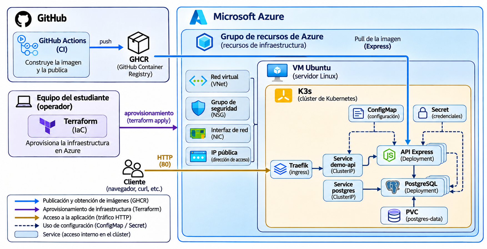
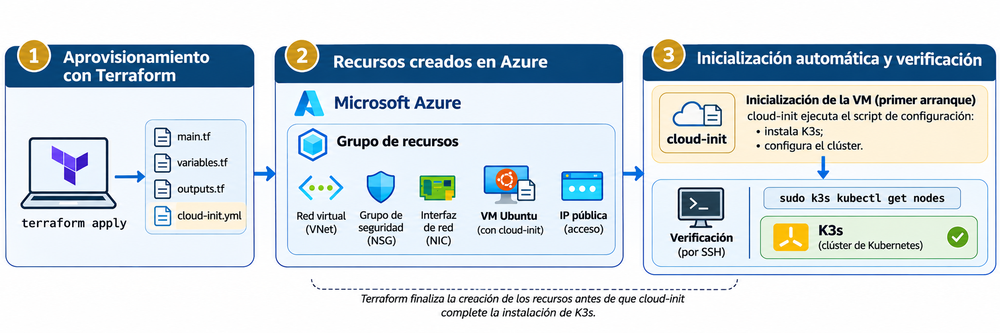
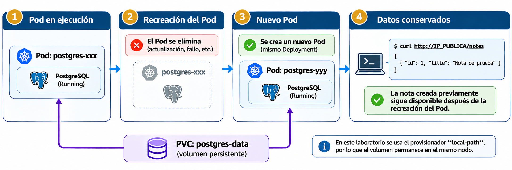

# Integración de infraestructura, Kubernetes y despliegue de aplicaciones

## Introducción

El despliegue de una aplicación en Kubernetes requiere coordinar la construcción de imágenes, la disponibilidad de infraestructura, la instalación del clúster y la configuración de los recursos que ejecutarán la aplicación. Estas operaciones se realizan mediante herramientas diferentes y no necesariamente concluyen al mismo tiempo. Por esta razón, la ejecución satisfactoria de un pipeline o el aprovisionamiento de una máquina virtual no bastan para establecer que una aplicación está disponible para sus usuarios.

En este material se desarrolla un caso de integración basado en una API construida con Express y una base de datos PostgreSQL. El código se mantiene en GitHub; GitHub Actions ejecuta las pruebas y publica la imagen en GitHub Container Registry (GHCR); Terraform aprovisiona la infraestructura en Azure; y `cloud-init` instala K3s en una máquina virtual Ubuntu. Sobre ese clúster se despliegan los componentes de la aplicación y se comprueba su funcionamiento mediante solicitudes HTTP y operaciones de lectura y escritura sobre la base de datos.

Se emplea una instalación de Kubernetes sobre una sola máquina virtual para examinar directamente la relación entre infraestructura, plataforma y aplicación. Esta configuración permite reproducir el despliegue con recursos limitados, aunque no proporciona las garantías de disponibilidad de una plataforma de producción con varios nodos.

## Objetivos de aprendizaje

Al finalizar el estudio de este material, se espera que el estudiante sea capaz de:

- Explicar la relación entre la construcción de una imagen, el aprovisionamiento de infraestructura y el despliegue de una aplicación en Kubernetes.
- Distinguir las responsabilidades del proveedor de nube, Terraform, las herramientas de inicialización del servidor y Kubernetes.
- Comparar una instalación autoadministrada de Kubernetes con los servicios gestionados, considerando sus implicaciones operativas.
- Configurar y verificar un despliegue que integre una API Express, PostgreSQL, configuración externa y almacenamiento persistente.
- Interpretar los resultados de las comprobaciones de infraestructura, salud de la aplicación y persistencia de datos, reconociendo sus límites.
- Eliminar de forma controlada los recursos aprovisionados para evitar consumo innecesario de servicios en la nube.

## Arquitectura de despliegue y responsabilidades

### Separación entre artefacto, infraestructura y aplicación

La ejecución de una aplicación contenerizada requiere recursos que tienen ciclos de vida diferentes. El código fuente cambia con la evolución del producto; la imagen constituye el artefacto que se construye a partir de una revisión concreta; la infraestructura proporciona capacidad de cómputo y conectividad; y la plataforma de orquestación administra las instancias que ejecutan ese artefacto. Aunque estos elementos participan en un mismo despliegue, no deben confundirse sus mecanismos de creación, actualización y recuperación.

En el proyecto utilizado, GitHub Actions ejecuta pruebas y construye una imagen a partir del directorio `app/`. GHCR conserva esa imagen bajo una referencia que incorpora el identificador del commit. La etiqueta permite relacionar el artefacto publicado con la revisión del repositorio utilizada por el workflow. Sin embargo, una etiqueta de contenedor puede modificarse o volver a utilizarse; cuando se requieren garantías estrictas de identidad, la referencia por *digest* identifica el contenido de la imagen de manera más precisa. En esta práctica se utiliza una etiqueta asociada al commit para mantener visible esa relación.

Terraform define los recursos de Azure: grupo de recursos, red virtual, subred, dirección IP pública, grupo de seguridad, interfaz de red y máquina virtual. Su proveedor AzureRM traduce la configuración declarativa en operaciones sobre la API de Azure. Terraform compara la configuración con el estado del que dispone y con la información que recupera del proveedor para preparar un plan. No construye la imagen ni decide cuántas réplicas de Express deben estar disponibles en Kubernetes.

Una vez creada la máquina virtual, `cloud-init` ejecuta las tareas de inicialización previstas para Ubuntu, entre ellas la instalación de K3s. A partir de ese momento, Kubernetes recibe manifiestos que describen objetos de aplicación y procura mantener su estado deseado. Cada herramienta actúa sobre recursos distintos y obtiene información de sistemas diferentes. Por ello, el éxito de una operación no implica automáticamente que las siguientes hayan terminado.

La arquitectura del despliegue se representa en la siguiente figura:



*Figura 1. Arquitectura de integración de CI/CD, infraestructura en Azure y despliegue sobre Kubernetes.*

El diagrama reúne dos recorridos que conviene distinguir. La imagen se descarga desde GHCR cuando el runtime del nodo necesita crear el contenedor; GHCR no interviene en el procesamiento normal de las solicitudes HTTP. En cambio, las peticiones del cliente llegan a la dirección pública de Azure, atraviesan las reglas de red, son atendidas por Traefik y se encaminan al Service de la API. Express utiliza otro Service para localizar PostgreSQL dentro del clúster. El tráfico de aplicación y la obtención de imágenes tienen dependencias y riesgos diferentes.

| Capa | Elemento de esta implementación | Responsabilidad |
| --- | --- | --- |
| Código y automatización | Repositorio y GitHub Actions | Pruebas, construcción y publicación del artefacto |
| Distribución | GHCR | Almacenamiento y descarga de imágenes |
| Infraestructura | Terraform, AzureRM y Azure | Aprovisionamiento de recursos de cómputo y red |
| Inicialización del servidor | `cloud-init` | Configuración de arranque e instalación de K3s |
| Plataforma | K3s y componentes de Kubernetes | API del clúster, planificación y reconciliación de cargas |
| Aplicación | Deployments, Services y ConfigMap | Ejecución, comunicación y configuración no sensible |
| Acceso y datos | Traefik, Secret y PVC | Entrada HTTP, distribución de credenciales y almacenamiento |

La separación ofrece ventajas operativas concretas. Una nueva versión de Express puede desplegarse modificando la imagen del Deployment sin reemplazar la máquina virtual. De igual forma, una actualización de reglas de red puede realizarse con Terraform sin reconstruir la aplicación. La independencia, sin embargo, no es absoluta: si cambia la dirección de un Service, la configuración de una aplicación puede requerir ajustes; si desaparece la VM, también desaparece el clúster instalado en ella.

Conviene mantener la configuración de infraestructura y los manifiestos de aplicación en archivos identificables y sujetos a control de versiones. El uso de Git no garantiza por sí mismo la reproducibilidad, pero permite revisar qué se modificó, recuperar configuraciones anteriores y relacionar un despliegue con una revisión concreta. Las contraseñas y las claves privadas quedan fuera de este mecanismo de publicación.

### Kubernetes gestionado y autoadministrado

Kubernetes ofrece una interfaz declarativa para administrar cargas de trabajo, pero su utilización exige que exista previamente un clúster operativo. La elección entre un servicio gestionado y una instalación autoadministrada determina quién opera los componentes que hacen posible esa interfaz.

Los servicios AKS, GKE y EKS ofrecen modalidades gestionadas de Kubernetes. El proveedor asume la operación de componentes del plano de control y proporciona mecanismos de integración con redes, identidades, almacenamiento y observabilidad. Esto no elimina las tareas del equipo de desarrollo o plataforma. Siguen siendo necesarias decisiones sobre permisos, versiones, políticas de red, configuración de workloads, tratamiento de datos, actualizaciones y recuperación de la aplicación. La distribución concreta de responsabilidades depende del servicio y de la modalidad contratada.

Con K3s instalado en una VM, Azure administra la infraestructura que ofrece al cliente, pero no opera Kubernetes por él. Quien administra el servidor debe ocuparse de la instalación, las versiones, los parches del sistema, la disponibilidad del plano de control, las copias de seguridad correspondientes, el acceso a la API del clúster y los componentes de entrada y almacenamiento. K3s simplifica la distribución e instalación de Kubernetes, pero no convierte por sí solo una instalación en un servicio gestionado.

| Aspecto | Servicio gestionado de Kubernetes | K3s en VM propia |
| --- | --- | --- |
| Plano de control | Operado total o parcialmente por el proveedor, según la modalidad | Administrado por el responsable de la VM y del clúster |
| Sistema operativo y nodos | Responsabilidades compartidas, con herramientas de mantenimiento del proveedor | Parches, configuración y mantenimiento a cargo del operador |
| Escalamiento | Funciones de integración y automatización disponibles, sujetas a configuración | Requiere preparar nodos e integrar los mecanismos correspondientes |
| Integración de nube | Servicios de identidad, red y almacenamiento habitualmente integrados | Integración adicional según los componentes instalados |
| Recuperación de la plataforma | Mecanismos ofrecidos por el proveedor, con obligaciones del cliente | Debe diseñarse y probarse expresamente |
| Flexibilidad y control | Dependientes de la modalidad y de las restricciones del servicio | Mayor control directo sobre el servidor y la instalación |
| Costos | Capacidad de cómputo y otros cargos según el servicio; posibles cargos de gestión | VM, almacenamiento, red y trabajo operativo asumido por el equipo |

Una decisión arquitectónica debe considerar el tipo de aplicación, su criticidad, el número de ambientes, las necesidades de disponibilidad, las capacidades del equipo y el costo total de operación. El precio de una VM aislada no es una comparación suficiente con un servicio gestionado: omite el tiempo de mantenimiento, la vigilancia del sistema, las pruebas de recuperación y el riesgo asociado a tareas que pueden quedar sin responsable.

Para experimentar con los mecanismos de aprovisionamiento y despliegue, una VM con K3s permite observar de forma directa las dependencias de la plataforma y limita la infraestructura inicial. Para servicios que exigen disponibilidad sostenida, continuidad ante fallos y mantenimiento periódico, deben evaluarse otras arquitecturas. Incluso un clúster autoadministrado de varios nodos requiere diseñar por separado el plano de control, el almacenamiento y la distribución de tráfico.

## Aprovisionamiento e inicialización de la plataforma

### Terraform y el estado de infraestructura

La configuración de Terraform expresa qué recursos deben existir y cómo se relacionan. En este proyecto, la interfaz de red depende de una subred y utiliza una dirección pública; la VM depende de una interfaz de red configurada y de las restricciones de acceso definidas. El grafo de dependencias permite que Terraform ordene las operaciones cuando resulta necesario. No debe interpretarse el orden de los bloques del archivo `main.tf` como una secuencia imperativa de comandos.

Terraform mantiene un archivo de estado que asocia las direcciones lógicas de sus recursos con los objetos creados en Azure. El estado es indispensable para reconocer qué administra, calcular cambios y destruir los recursos posteriormente. Un plan representa la diferencia que Terraform pretende aplicar en ese momento; antes de aprobarlo, debe verificarse qué recursos serán creados, actualizados, reemplazados o eliminados. Los errores de permisos, cuotas, políticas y capacidad aparecen al interactuar con Azure y no siempre pueden detectarse mediante una validación sintáctica de los archivos.

La modificación manual de recursos desde Azure puede producir diferencias entre la infraestructura existente y la configuración versionada. Terraform puede detectarlas al consultar al proveedor y proponer acciones para reconciliarlas. Por ello, una corrección improvisada fuera de Terraform puede resolver temporalmente un síntoma y, al mismo tiempo, dejar una configuración difícil de reproducir. Las intervenciones manuales excepcionales deben registrarse y reconciliarse con el estado y la configuración antes de continuar.

En una actividad individual, el estado local simplifica la preparación, pero constituye una limitación si varias personas ejecutan Terraform sobre los mismos recursos. Un trabajo colaborativo requiere definir almacenamiento remoto, coordinación de operaciones y protección del estado. El estado también puede contener información sensible; excluirlo de Git no reemplaza los controles de acceso ni el cifrado adecuado cuando se almacena de forma compartida.

### Configuración de arranque y disponibilidad de Kubernetes

Una VM creada por Azure no contiene necesariamente todos los servicios que ejecutará la aplicación. El archivo `cloud-init.yaml.tftpl` dispone que Ubuntu descargue y ejecute el instalador de K3s durante el arranque. Terraform entrega esa configuración a la VM mediante `custom_data`, pero el proceso de inicialización ocurre dentro del sistema operativo y puede continuar después de que Azure informe que el recurso fue creado.

Por esa razón, deben distinguirse tres estados: **infraestructura aprovisionada**, **servidor inicializado** y **plataforma operativa**. `terraform apply` permite comprobar el primer estado. `cloud-init status --wait` ayuda a conocer la finalización de las tareas de inicialización. `kubectl get nodes` y la inspección de Pods de sistema aportan evidencias sobre Kubernetes. Ninguna de estas señales, considerada de forma aislada, demuestra que la API de Express sea accesible por Internet.



*Figura 2. Aprovisionamiento de infraestructura e inicialización automática de K3s en Azure.*

La instalación inicial tampoco equivale a un mecanismo permanente de gestión de configuración. El archivo de arranque se utiliza cuando se inicializa la VM; modificarlo en el repositorio no significa que una máquina existente vuelva a ejecutar automáticamente todas sus instrucciones. Si se requiere reconstruir el entorno, el procedimiento debe contemplar la creación de la VM, la instalación de K3s, la disponibilidad de la imagen y la aplicación de los manifiestos. En ambientes permanentes sería necesario establecer un procedimiento de actualización y recuperación que no dependiera de intervenciones informales.

El mismo razonamiento explica por qué los manifiestos de Kubernetes se editan en el repositorio local y se transfieren después a la VM. Si la única copia actualizada reside en el servidor, destruirlo puede significar perder la configuración utilizada. El mecanismo `scp` es suficiente para demostrar la separación entre el equipo de desarrollo y el destino de despliegue, aunque no representa por sí mismo una solución de entrega continua. Una automatización posterior podría sustituir esa transferencia manual por un mecanismo controlado de despliegue.

## Operación, disponibilidad y persistencia

### Estado deseado y dependencias de arranque

Kubernetes mantiene un estado deseado mediante controladores que observan los objetos declarados y realizan acciones de reconciliación. Un Deployment especifica las réplicas y la plantilla de los Pods; un Service ofrece un punto de acceso estable para los Pods que coinciden con sus selectores. La creación de estos objetos no garantiza el funcionamiento inmediato de la aplicación. Los contenedores todavía deben descargar sus imágenes, obtener la configuración necesaria, iniciar sus procesos y alcanzar las condiciones de preparación configuradas.

En este ejemplo, Express requiere una conexión a PostgreSQL para ejecutar `initializeDatabase` y crear la tabla `notes` antes de comenzar a escuchar peticiones. Si PostgreSQL todavía está iniciando, el proceso de Express puede fallar y Kubernetes puede reiniciar el contenedor. Este comportamiento es distinto de un error producido por un Secret inexistente. En el segundo caso, Kubernetes no puede construir la configuración del contenedor y muestra `CreateContainerConfigError`. Una imagen inaccesible, por su parte, puede provocar `ImagePullBackOff`. El diagnóstico debe partir de los eventos y registros reales, no de una interpretación basada únicamente en el nombre del estado.

Las comprobaciones de preparación también tienen alcances específicos. La *readiness probe* de Express solicita `/health`; ese endpoint devuelve una respuesta sin consultar la base de datos. Por tanto, el Pod puede considerarse preparado para recibir tráfico aunque una consulta posterior a `/notes` falle por falta de conexión con PostgreSQL. La decisión de mantener esa comprobación sencilla es válida para el ejercicio, siempre que no se atribuya a ella una garantía de disponibilidad de la base de datos que el código no implementa.

### Almacenamiento y recuperación de datos

Los archivos escritos únicamente dentro del sistema de archivos de un contenedor no constituyen una base apropiada para conservar datos de PostgreSQL a través de reemplazos. En el proyecto se declara un PersistentVolumeClaim llamado `postgres-data` que solicita 1 GiB mediante la StorageClass `local-path`. El provisionador suministrado con K3s permite que PostgreSQL utilice un directorio persistente en el nodo, montado mediante el volumen solicitado. El Deployment utiliza la estrategia `Recreate`, adecuada en este ejemplo para evitar que dos instancias intenten operar simultáneamente sobre el mismo directorio de datos durante un reemplazo del Deployment.

El PVC separa la identidad del almacenamiento respecto de la existencia de un Pod concreto. Cuando se elimina el Pod administrado por el Deployment, Kubernetes crea otro y puede volver a montar el volumen. La prueba de guardar una nota, eliminar el Pod y recuperar la misma nota demuestra que los archivos sobreviven a **ese reemplazo de Pod en el nodo disponible**. No demuestra que exista una copia adicional de la información, que el volumen esté replicado o que los datos puedan recuperarse si se pierde el disco de la VM.



*Figura 3. Conservación de los datos de PostgreSQL durante la recreación de un Pod en el mismo nodo.*

El término *persistencia* debe interpretarse con precisión. La persistencia frente a la recreación de contenedores es distinta de la alta disponibilidad, que requiere mantener el servicio ante determinados fallos, y de la recuperación ante desastres, que exige mecanismos para reconstruirlo y recuperar información después de pérdidas mayores. Para una base de datos utilizada en producción, estas últimas propiedades suelen requerir copias de seguridad verificadas, almacenamiento adecuado, políticas de recuperación y pruebas periódicas de restauración.

La implementación de un solo nodo concentra varios riesgos. Una interrupción de Ubuntu o de la VM detiene tanto la API como la base de datos y el plano de control; mientras el nodo permanezca fuera de servicio, sus Pods no pueden prestar servicio. La eliminación de la VM al ejecutar Terraform destruye la infraestructura del laboratorio y no debe confundirse con el reemplazo aislado de un Pod. Por ello, todas las pruebas de persistencia deben completarse **antes** de destruir los recursos.

### Evidencias de funcionamiento

La aceptación de un despliegue debe construirse con pruebas que correspondan a distintas capas de la arquitectura. Un resultado positivo solo demuestra la propiedad que la prueba ejercita. Para este caso conviene interpretar las comprobaciones del modo siguiente:

| Evidencia | Qué permite afirmar | Qué no demuestra |
| --- | --- | --- |
| Workflow exitoso y paquete publicado | La automatización terminó y generó un artefacto disponible en GHCR | Que la infraestructura pueda ejecutar ese artefacto |
| `terraform apply` completado | Los recursos declarados fueron aprovisionados según el resultado de Terraform | Que `cloud-init` y K3s hayan finalizado |
| Nodo `Ready` | Kubernetes considera al nodo apto para cargas de trabajo | Que Express y PostgreSQL estén operativos |
| Pods `Running` y preparados | Los contenedores están activos y satisfacen sus probes | Que la ruta pública y todas las dependencias de negocio funcionen |
| HTTP 200 en `/health` | La solicitud pública llegó al proceso de Express | Que la base de datos responda |
| `POST /notes` y `GET /notes` | La aplicación pudo escribir y consultar datos en PostgreSQL | Que los datos sobrevivirán a un fallo del servidor |
| Consulta tras reemplazar PostgreSQL | Los datos permanecieron accesibles después de crear otro Pod | Que exista replicación, respaldo o recuperación ante pérdida del nodo |

Una comprobación adicional es la **limpieza de la infraestructura**. La práctica no concluye con una respuesta HTTP correcta: deben eliminarse los recursos aprovisionados y verificarse su desaparición. Un fallo durante `terraform destroy` obliga a inspeccionar qué recursos permanecen en Azure; la salida del comando y el estado del proveedor pueden requerir reconciliación. La destrucción correcta es una evidencia de que el ciclo de vida de la infraestructura puede cerrarse de manera controlada y de que no se mantiene consumo innecesario de la suscripción.

## Práctica guiada: despliegue de Express y PostgreSQL en Azure

### Preparación

El punto de partida es el repositorio [k8s-azure-template](https://github.com/guillermocalderon2021/k8s-azure-template). Contiene una API Express, pruebas, un Dockerfile, un workflow de GitHub Actions, archivos Terraform y ocho manifiestos Kubernetes. No es necesario programar una API nueva.

Antes de comenzar, se requiere:

- Cuenta de GitHub con acceso a Actions y Packages.
- Git, Azure CLI, Terraform y cliente OpenSSH (`ssh` y `scp`) instalados en el equipo local.
- Suscripción de Azure habilitada para crear recursos, con cuotas y permisos suficientes.
- Par de claves SSH, que se generará en caso de no existir. La clave **privada permanece en el equipo local**.
- Dirección IPv4 pública de salida de la red desde la que se establecerá la conexión SSH; se obtendrá durante la preparación.

Los comandos de Terraform, Git y Azure CLI se ejecutan **en el equipo local**. Los comandos que comienzan con `sudo k3s kubectl` se ejecutan **dentro de la VM Ubuntu**, una vez establecida la sesión SSH. La edición de los manifiestos YAML se realiza en el repositorio local; posteriormente se copian a la VM con `scp`.

> **Condición operativa.** La región `mexicocentral`, el tamaño `Standard_B2s_v2` y la zona `1` permitieron completar una validación del laboratorio, pero no garantizan capacidad o autorización en todas las suscripciones Azure for Students. Si Azure rechaza la creación de la VM por políticas, cuota o capacidad, no se deben realizar cambios arbitrarios de región y tamaño. Se utilizará la alternativa indicada en «Contingencia de aprovisionamiento».

### Comprobaciones previas del equipo local

Antes de modificar el proyecto, abrir una terminal **en el equipo local** y comprobar que las herramientas responden:

```text
git --version
az version
terraform version
ssh -V
scp
```

El último comando, sin argumentos, debe mostrar la sintaxis de `scp`; no es necesario que finalice correctamente. En caso de que una herramienta no esté instalada, utilizar su documentación oficial: [Git](https://git-scm.com/downloads), [Azure CLI](https://learn.microsoft.com/es-es/cli/azure/install-azure-cli), [Terraform](https://developer.hashicorp.com/terraform/install) y [OpenSSH para Windows](https://learn.microsoft.com/es-es/windows-server/administration/openssh/openssh_install_firstuse). En Linux, la instalación de OpenSSH depende de la distribución utilizada.

**Clave SSH.** Azure utilizará una clave pública para autorizar el acceso al usuario `azureuser`; la clave privada permitirá autenticarse desde la computadora local. El archivo Terraform espera, de manera predeterminada, la clave pública `~/.ssh/id_ed25519.pub`.

En **Linux**, comprobar si ya existe:

```bash
ls -l ~/.ssh/id_ed25519 ~/.ssh/id_ed25519.pub
```

Si **ambos archivos existen**, utilizar el par actual y no ejecutar `ssh-keygen` sobre el mismo nombre. Si aún no existen, crear el directorio y generar el par:

```bash
mkdir -p ~/.ssh
chmod 700 ~/.ssh
ssh-keygen -t ed25519 -f "$HOME/.ssh/id_ed25519" -C "devops-azure"
```

En **Windows PowerShell**, comprobar primero:

```powershell
Test-Path "$HOME/.ssh/id_ed25519"
Test-Path "$HOME/.ssh/id_ed25519.pub"
```

Si ambos resultados son `True`, conservar el par existente. De lo contrario, y siempre que **no exista ninguno de los dos archivos**, ejecutar:

```powershell
New-Item -ItemType Directory -Force -Path "$HOME/.ssh" | Out-Null
ssh-keygen -t ed25519 -f "$HOME/.ssh/id_ed25519" -C "devops-azure"
```

`ssh-keygen` solicitará una frase de contraseña (*passphrase*). Se recomienda establecer una para proteger la clave privada; cuando se use SSH o `scp`, puede ser necesario introducirla. Si existe solamente uno de los archivos o se utiliza otro nombre de clave, **no sobrescribir archivos**: recuperar el par correspondiente o definir `ssh_public_key_path` con la ruta de la clave pública seleccionada, y utilizar `ssh -i` y `scp -i` con su clave privada. El archivo `.pub` es la clave pública; **no se debe compartir ni versionar el archivo sin `.pub`**.

**Dirección IPv4 pública de origen.** La regla de SSH del NSG necesita la dirección desde la que se establecerá la conexión, no la IP privada de la computadora ni la IP pública que Azure asignará a la VM. Desde la red que se usará durante la práctica, obtenerla con:

**Linux:**

```bash
curl -4 -fsS https://api.ipify.org
echo
```

**PowerShell:**

```powershell
(Invoke-RestMethod -Uri "https://api.ipify.org").Trim()
```

El servicio devuelve una dirección IPv4, por ejemplo `203.0.113.10` (valor reservado para documentación). En `ssh_source_cidr` se utilizará esa dirección seguida de `/32`, como `203.0.113.10/32`. La consulta se realiza a un servicio externo que observa la IP desde la que llega la petición. Si se utiliza VPN, una red institucional con varias salidas o se cambia de conexión, la dirección observada puede variar; repetir la consulta y actualizar la variable mediante Terraform antes de intentar SSH desde otra red.

**Autenticación en Azure.** Ejecutar `az login`, comprobar con `az account show --query "{id:id,name:name}" -o table` qué suscripción está activa y seleccionar la correcta mediante `az account set --subscription ID_DE_SUSCRIPCION` cuando corresponda. La suscripción utilizada debe ser aquella en la que se permite crear la infraestructura. Los comandos se ejecutan localmente, no dentro de Ubuntu.

### 1. Preparar el repositorio y publicar la imagen

1. En GitHub, abrir el repositorio de referencia y seleccionar **Use this template → Create a new repository**. Crear un repositorio propio a partir de la plantilla. Esta operación genera una copia inicial del contenido; no equivale a mantener un fork vinculado con el repositorio original.
2. Clonar **el repositorio recién creado** en el equipo local y abrirlo en el editor de código:

   ```bash
   git clone https://github.com/USUARIO/REPOSITORIO.git
   cd REPOSITORIO
   ```

   Sustituir `USUARIO` y `REPOSITORIO` por los valores reales. Si el repositorio es privado, Git solicitará autenticación mediante un método admitido por GitHub.
3. Examinar `.github/workflows/publish-image.yml`. Identificar el paso que ejecuta pruebas, la autenticación en GHCR y la instrucción de construcción y publicación.
4. Cambiar `push: false` por `push: true` y enviar el cambio desde la raíz del repositorio local:

   ```bash
   git add .github/workflows/publish-image.yml
   git commit -m "Activar publicación de imagen en GHCR"
   git push
   ```

   Comprobar que se ha enviado a la rama predeterminada utilizada por la ejecución manual del workflow.
5. Ejecutar manualmente el workflow **Publicar imagen en GHCR** desde la pestaña **Actions**. Comprobar que las pruebas y la publicación terminan correctamente.

El workflow construye la imagen utilizando `app/Dockerfile` y la identifica mediante una etiqueta de la forma:

```text
ghcr.io/USUARIO/REPOSITORIO:sha-COMMIT_COMPLETO
```

El valor de `COMMIT_COMPLETO` es el SHA del commit ejecutado por el workflow. Debe copiarse **del resultado real de GitHub Actions**; no se debe emplear el SHA de un commit diferente.

Para que K3s descargue la imagen sin credenciales del registro, localizar el paquete en **GitHub → perfil u organización propietaria → Packages → nombre del paquete → Package settings → Change visibility** y establecer su visibilidad en **Public** (la ubicación y los nombres de las opciones pueden variar con la interfaz de GitHub). La visibilidad del repositorio no determina necesariamente la del paquete. Si el paquete permanece privado, se requiere un mecanismo adicional de autenticación que no se configura en este ejercicio.

**Comprobación:** identificar el paquete publicado, el nombre completo de la imagen y su etiqueta. Explicar qué relación mantiene esa etiqueta con el código que produjo la imagen.

### 2. Configurar la infraestructura

Abrir una terminal en `azure/terraform` dentro del repositorio local. Crear el archivo de variables a partir del ejemplo:

**Linux:**

```bash
cp terraform.tfvars.example terraform.tfvars
```

**PowerShell:**

```powershell
Copy-Item terraform.tfvars.example terraform.tfvars
```

Confirmar que la suscripción elegida en la preparación corresponde al identificador que se escribirá en `terraform.tfvars`:

```text
az account show --query "{id:id,name:name}" -o table
```

Editar **localmente** `terraform.tfvars` y sustituir el identificador de suscripción y la dirección permitida para SSH por los valores obtenidos en las comprobaciones previas. El archivo de ejemplo incluye una dirección reservada para documentación que **no puede utilizarse como la dirección real del estudiante**.

```hcl
subscription_id = "ID_DE_LA_SUSCRIPCION"
ssh_source_cidr = "IP_PUBLICA_DE_ORIGEN/32"

location        = "mexicocentral"
vm_size         = "Standard_B2s_v2"
vm_zone         = "1"
resource_prefix = "devops-k3s"
```

Comprobar que la clave pública generada corresponde a `ssh_public_key_path = "~/.ssh/id_ed25519.pub"`, el valor predeterminado de `variables.tf`. Si se ha elegido otra ubicación, indicar su ruta en `terraform.tfvars` (el valor debe apuntar al archivo `.pub`). El sufijo `/32` restringe la regla de entrada SSH a una única dirección IPv4. Debe corresponder a la IP pública desde la cual se establecerá la conexión. Una conexión desde otra red podría ser bloqueada hasta actualizar esa regla mediante Terraform.

**Actividad de configuración:** abrir `azure/terraform/outputs.tf` y agregar el output denominado `resource_group_name`, cuyo valor debe ser el nombre del grupo de recursos creado por Terraform. Conservar los outputs existentes.

Revisar en `main.tf` los recursos declarados: grupo de recursos, red virtual, subred, IP pública, grupo de seguridad de red, interfaz de red, asociación de seguridad y máquina virtual. En la ejecución validada fueron ocho recursos. Identificar también el uso de `cloud-init.yaml.tftpl`: la instalación de K3s ocurre en Ubuntu durante la inicialización de la VM, no en la computadora del estudiante.

### 3. Aprovisionar Azure e iniciar K3s

En la misma terminal local, ejecutar:

```text
terraform init
terraform validate
terraform plan -out=lab.tfplan
```

Examinar el plan antes de continuar. Comprobar que las operaciones previstas corresponden a los recursos del laboratorio y que no se modificarán recursos ajenos. Si aparecen errores de autorización, restricción de zona, cuota o disponibilidad, **detener el aprovisionamiento** y consultar la sección de contingencia.

Si el plan es correcto:

```text
terraform apply lab.tfplan
terraform output public_ip
terraform output ssh_command
terraform output resource_group_name
```

El último output deberá existir únicamente si se completó la actividad solicitada en `outputs.tf`. Conservar la IP pública para las comprobaciones posteriores.

Conectarse por SSH **desde el equipo local**, sustituyendo `IP_PUBLICA` por el resultado de `terraform output public_ip` (**IP de destino de Azure**, distinta de la IP de origen usada en `ssh_source_cidr`):

```text
ssh azureuser@IP_PUBLICA
```

En la primera conexión, comprobar la identidad del servidor antes de aceptar su huella digital. Si se utiliza una clave privada con nombre distinto del predeterminado, agregar `-i RUTA_DE_CLAVE_PRIVADA` al comando `ssh` y a las transferencias con `scp`. Si la conexión expira, verificar que la IPv4 pública **de origen** sigue siendo la autorizada por el NSG y que la VM está encendida; si aparece `Permission denied (publickey)`, comprobar la correspondencia entre la clave pública configurada en Terraform y la clave privada local.

En la terminal **remota** de Ubuntu, esperar a que finalice la inicialización y comprobar K3s:

```bash
sudo cloud-init status --wait
sudo k3s kubectl get nodes -o wide
sudo k3s kubectl get pods -A
```

Debe existir un nodo `Ready`. Los componentes de sistema como CoreDNS, `local-path-provisioner` y Traefik deben quedar operativos. Los Pods correspondientes a trabajos de instalación ya finalizados pueden aparecer como `Completed`.

**Comprobación:** identificar cuál de los comandos confirma la disponibilidad del nodo y cuál permite observar los componentes que operan dentro del clúster.

### 4. Preparar y transferir los manifiestos

Desde el editor de código del **equipo local**, abrir `k8s/06-api-deployment.yaml`. Sustituir el marcador de la propiedad `image` por la referencia exacta de la imagen publicada en GHCR. Conservar los demás parámetros del Deployment.

Los manifiestos ya incluyen el namespace `devops-demo`. No es necesario modificarlo. Observar, entre otros recursos, el ConfigMap `demo-config`, los dos Deployments, sus Services, el PVC `postgres-data` y el Ingress que utiliza Traefik.

Guardar la modificación y registrarla en Git (`git add k8s/06-api-deployment.yaml`, `git commit -m "Configurar imagen GHCR para Kubernetes"` y `git push`). Volver a la terminal **local**, situarse en la raíz del repositorio y transferir el directorio:

**Linux:**

```bash
scp -r k8s azureuser@IP_PUBLICA:~/
```

**PowerShell:**

```powershell
scp -r .\k8s azureuser@IP_PUBLICA:~/
```

En caso de haber cerrado SSH, abrir de nuevo la sesión remota. Dentro de Ubuntu, comprobar que los archivos se copiaron:

```bash
ls -l ~/k8s/
```

Toda corrección posterior de un manifiesto debe efectuarse primero en el repositorio local y transferirse nuevamente. No se editarán los archivos YAML directamente en la VM.

### 5. Crear la configuración de acceso a PostgreSQL

Los dos Deployments hacen referencia al Secret `postgres-credentials`. PostgreSQL obtiene de él la variable `POSTGRES_PASSWORD`; Express obtiene `DB_PASSWORD`. Ambos esperan la clave denominada `password`. El Secret debe existir en `devops-demo` antes de iniciar los contenedores.

Dentro de la **VM Ubuntu**, crear primero el namespace:

```bash
sudo k3s kubectl apply -f ~/k8s/01-namespace.yaml
```

Introducir una contraseña exclusiva para la práctica, sin imprimirla en la terminal:

```bash
read -rsp "Contraseña de PostgreSQL: " DB_PASSWORD
echo
sudo k3s kubectl create secret generic postgres-credentials \
  --namespace devops-demo \
  --from-literal="password=$DB_PASSWORD"
unset DB_PASSWORD
```

Esta secuencia se realiza en Bash dentro de Ubuntu. La contraseña no debe guardarse en el repositorio ni incluirse en capturas de pantalla. Un Secret de Kubernetes sirve para distribuir información de configuración sensible, pero exige controles adicionales para su protección en un entorno de producción.

Comprobar únicamente la existencia del objeto:

```bash
sudo k3s kubectl get secret postgres-credentials -n devops-demo
```

Si se aplicaran los Deployments antes de crear el Secret, los Pods podrían quedar en `CreateContainerConfigError`, con un evento que indique `secret "postgres-credentials" not found`. Se trata de una dependencia de configuración, no de un error al descargar las imágenes.

### 6. Desplegar y comprobar los objetos de Kubernetes

En la **VM Ubuntu**:

```bash
sudo k3s kubectl apply -f ~/k8s/
sudo k3s kubectl get pods,deployments,services -n devops-demo
sudo k3s kubectl get pvc -n devops-demo
sudo k3s kubectl get ingress -n devops-demo
```

Se espera que `postgres` y `demo-api` alcancen `1/1 Running`, y que `postgres-data` aparezca como `Bound`. La aplicación puede reiniciarse inicialmente si PostgreSQL todavía no acepta conexiones: el archivo `app/src/server.js` intenta crear la tabla `notes` **antes de poner Express a escuchar**. Este comportamiento explica algunos reinicios transitorios, pero no debe utilizarse como explicación automática de cualquier `CrashLoopBackOff`.

Ante un Pod que no inicia, consultar su nombre y los eventos:

```bash
sudo k3s kubectl get pods -n devops-demo
sudo k3s kubectl describe pod NOMBRE_DEL_POD -n devops-demo
sudo k3s kubectl logs NOMBRE_DEL_POD -n devops-demo
```

Si el contenedor se reinició y conserva registros de la ejecución anterior, puede utilizarse `sudo k3s kubectl logs NOMBRE_DEL_POD -n devops-demo --previous`.

**Comprobación:** distinguir, a partir de la evidencia, una dependencia de configuración ausente, un fallo de inicio de la aplicación y un problema de descarga de imágenes.

### 7. Comprobar la aplicación desde el equipo local

La IP pública de Azure se utiliza para acceder al Ingress de Traefik, que dirige las peticiones al Service de Express. Las pruebas siguientes se ejecutan **desde la computadora local**, no desde la VM.

**Linux:**

```bash
curl -i http://IP_PUBLICA/health
curl -i http://IP_PUBLICA/notes
curl -i -X POST http://IP_PUBLICA/notes \
  -H 'Content-Type: application/json' \
  -d '{"text":"Nota de prueba en Kubernetes"}'
curl -i http://IP_PUBLICA/notes
```

**PowerShell:**

```powershell
curl.exe -i "http://IP_PUBLICA/health"
curl.exe -i "http://IP_PUBLICA/notes"
Invoke-RestMethod -Method Post -Uri "http://IP_PUBLICA/notes" -ContentType "application/json" -Body (@{ text = "Nota de prueba en Kubernetes" } | ConvertTo-Json)
curl.exe -i "http://IP_PUBLICA/notes"
```

En PowerShell se utiliza `curl.exe` para las consultas y `Invoke-RestMethod` para construir el cuerpo JSON del `POST` sin depender de las reglas de interpretación de comillas del ejecutable nativo.

`GET /health` debe responder con HTTP 200 y un JSON semejante a `{"status":"ok","component":"api"}`. La creación de una nota válida debe devolver HTTP 201; la consulta posterior debe incluir el texto registrado. No es necesario que coincidan los identificadores ni las marcas de tiempo con los de otros equipos.

**Comprobación:** explicar por qué la respuesta satisfactoria de `/health` no demuestra, por sí sola, que PostgreSQL funcione.

### 8. Verificar la persistencia ante el reemplazo de un Pod

Una vez creada y recuperada la nota, volver a la terminal **remota** de Ubuntu y eliminar el Pod de PostgreSQL por su etiqueta:

```bash
sudo k3s kubectl delete pod -n devops-demo -l app=postgres
sudo k3s kubectl rollout status deployment/postgres -n devops-demo --timeout=120s
sudo k3s kubectl get pods -n devops-demo
```

El Deployment creará un Pod de reemplazo. La referencia al PVC `postgres-data` permanece en la especificación y permite montar nuevamente el almacenamiento de PostgreSQL. Esperar a que la base de datos esté lista.

Desde la terminal **local**, repetir:

```text
GET http://IP_PUBLICA/notes
```

En la práctica deberá utilizarse el comando `curl` equivalente mostrado en el apartado anterior. La nota creada antes del reemplazo debe conservarse.

**Análisis:** señalar qué elemento persiste tras la eliminación del Pod y por qué este resultado no asegura la recuperación ante la pérdida del disco de la VM.

### 9. Destruir la infraestructura

El aprovisionamiento consume recursos de la suscripción mientras permanecen activos. La limpieza forma parte de la práctica y debe realizarse antes de darla por terminada.

Salir de la VM y regresar al directorio `azure/terraform` del equipo local. **Antes de destruir**, conservar el nombre real del grupo de recursos, puesto que los outputs podrían dejar de estar disponibles después de la destrucción:

```text
terraform output resource_group_name
```

Si no se implementó este output, el grupo utiliza el valor de `resource_prefix` seguido de `-rg` (por ejemplo, `devops-k3s-rg`). Revisar las eliminaciones previstas:

```text
terraform plan -destroy
```

Verificar que el plan corresponde a los recursos del laboratorio. Ejecutar:

```text
terraform destroy
```

Confirmar la operación únicamente después de revisar el plan. Comprobar que el grupo de recursos fue eliminado:

```text
az group exists --name devops-k3s-rg
```

El resultado esperado es `false`, siempre que se haya conservado el prefijo predeterminado. Si se utilizó otro prefijo, sustituir el nombre del grupo en el comando por el que se conservó **antes de `terraform destroy`**. Verificar también que no quedan recursos del laboratorio en el portal de Azure. Cuando Terraform falle al destruir recursos, revisar el estado y el contenido del grupo en Azure; no se debe interpretar un error como una eliminación completa ni borrar el estado local para ocultarlo.

La eliminación manual del grupo solo debe considerarse cuando se haya confirmado que contiene exclusivamente recursos de esta práctica. Una operación de limpieza externa a Terraform requiere revisar posteriormente las referencias que hayan quedado en el estado.


### Registro de resultados

Registrar, como mínimo, la referencia de imagen publicada en GHCR, el resultado del plan de Terraform o el motivo documentado que impidió el aprovisionamiento, el estado de los Pods y del PVC, las respuestas HTTP de creación y consulta de notas, la consulta posterior al reemplazo del Pod y el resultado de la limpieza de Azure cuando corresponda. No incluir contraseñas, claves privadas ni contenido de Secrets.

Responder brevemente:

1. ¿Qué operaciones ejecuta Terraform que no corresponden a un Deployment de Kubernetes?
2. ¿Qué dependencia faltaría si ambos contenedores informaran `secret "postgres-credentials" not found`?
3. ¿Por qué no es suficiente comprobar exclusivamente `/health`?
4. ¿Qué propiedad se comprobó al recuperar una nota después de recrear PostgreSQL y qué fallo seguiría sin estar cubierto?
5. ¿Qué responsabilidades adicionales supone ejecutar K3s en una VM frente a utilizar un servicio gestionado de Kubernetes?

## Referencias

- [Kubernetes: Concepts](https://kubernetes.io/docs/concepts/).
- [Kubernetes: Persistent Volumes](https://kubernetes.io/docs/concepts/storage/persistent-volumes/).
- [Microsoft Learn: responsabilidades y soporte en AKS](https://learn.microsoft.com/en-us/azure/aks/support-policies).
- [K3s: documentación oficial](https://docs.k3s.io/).
- [HashiCorp: Terraform workflow](https://developer.hashicorp.com/terraform/intro/core-workflow).
- [Microsoft Learn: cloud-init en máquinas virtuales Linux](https://learn.microsoft.com/en-us/azure/virtual-machines/linux/using-cloud-init).
- [GitHub: GitHub Container Registry](https://docs.github.com/en/packages/working-with-a-github-packages-registry/working-with-the-container-registry).
