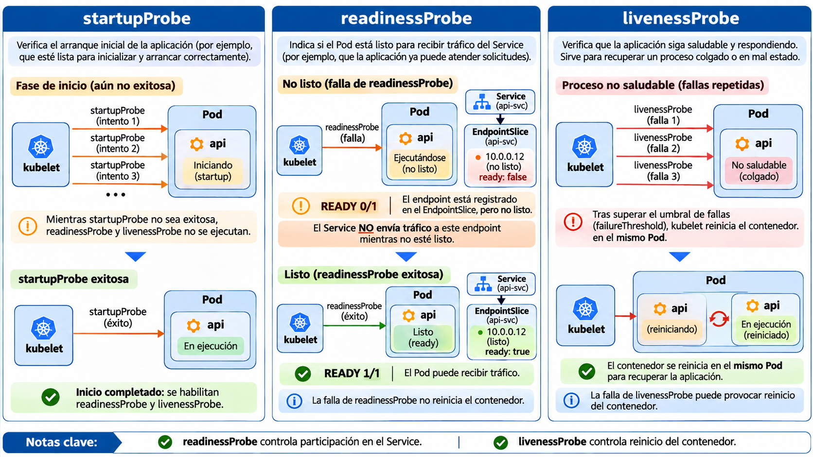
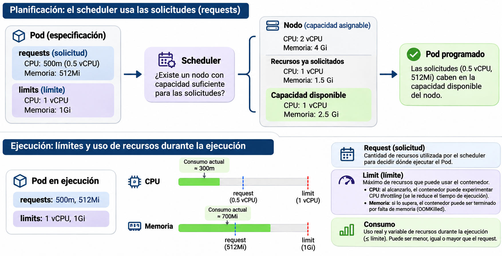
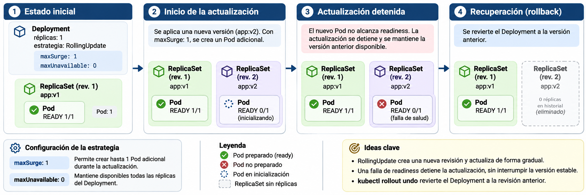

# Operación y diagnóstico de aplicaciones en Kubernetes

En Kubernetes, el estado de ejecución de un contenedor y su disponibilidad para recibir solicitudes son condiciones diferentes. Un Pod puede encontrarse en estado `Running` aunque la aplicación todavía no esté preparada para atender tráfico. Kubernetes permite comprobar estas condiciones mediante pruebas de salud (*probes*) y utilizar sus resultados para controlar el envío de tráfico o reiniciar contenedores.

## Objetivos de aprendizaje

Al finalizar la sesión, el estudiante será capaz de:

1. Distinguir los estados de un Pod y de sus contenedores, e interpretar las consecuencias de las pruebas de *startup*, *readiness* y *liveness*.
2. Explicar cómo se utilizan las solicitudes (*requests*) y los límites (*limits*) de CPU y memoria para planificar y controlar contenedores.
3. Interpretar el procedimiento de actualización de un Deployment, identificar una revisión defectuosa y recuperar una revisión anterior.
4. Diagnosticar problemas de ejecución mediante estados, eventos, registros y descripciones de recursos, contrastando hipótesis con evidencias.
5. Verificar que una aplicación recuperada vuelve a atender solicitudes y conserva los datos almacenados fuera de los Pods afectados.

## 1. Estado y salud de los contenedores

### 1.1. Estado del Pod y estado de sus contenedores

Kubernetes registra por separado la **fase del Pod**, el estado de sus contenedores y sus condiciones de funcionamiento. La fase describe el estado general del ciclo de vida del Pod; el estado de cada contenedor indica si se encuentra en espera, ejecución o terminación. Las condiciones del Pod proporcionan información adicional, incluida su preparación para atender solicitudes.

| Concepto | Ejemplo | Interpretación |
|---|---|---|
| Fase del Pod | `Pending` | El Pod fue aceptado, pero uno o más contenedores todavía no están listos para ejecutarse. Puede estar pendiente de planificación, imágenes o volúmenes. |
| Fase del Pod | `Running` | El Pod está vinculado a un nodo y al menos uno de sus contenedores se está ejecutando o iniciando/reiniciando. No asegura que la aplicación responda. |
| Estado de contenedor | `Waiting`, razón `ImagePullBackOff` | La obtención de una imagen falló y Kubernetes está espaciando los reintentos. |
| Estado de contenedor | `Waiting`, razón `CrashLoopBackOff` | Un contenedor ha fallado repetidamente y los reinicios se retrasan progresivamente. |
| Condición de preparación | `Ready=False` | El Pod no está preparado para recibir tráfico de Services que seleccionan endpoints preparados. |
| Estado de terminación | `OOMKilled` | Un contenedor terminó por agotamiento de memoria, que puede estar asociado a un límite de memoria. |

Al ejecutar `kubectl get pods`, la columna `STATUS` ofrece una síntesis construida a partir de distintos campos; no debe confundirse siempre con la fase almacenada en `status.phase`. Por ejemplo, `CrashLoopBackOff` suele aparecer en `STATUS`, pero no es una fase del Pod. El valor `READY 1/1` indica que uno de un contenedor declarado se considera preparado, no que todas las dependencias externas estén saludables.

### 1.2. Pruebas de salud

El *kubelet* ejecuta las pruebas configuradas para cada contenedor. Kubernetes admite, entre otras, comprobaciones HTTP, TCP y ejecución de comandos. Las tres clases de pruebas tienen propósitos diferentes:

| Prueba | Pregunta que responde | Consecuencia de fallas repetidas |
|---|---|---|
| `startupProbe` | ¿Terminó el proceso su arranque? | Reinicia el contenedor si supera el umbral de fallas. Mientras no tenga éxito, se suspenden las comprobaciones de readiness y liveness. |
| `readinessProbe` | ¿Puede recibir tráfico ahora? | El Pod pasa a no preparado y se excluye de los endpoints preparados del Service; por sí sola, no reinicia el contenedor. |
| `livenessProbe` | ¿Debe reiniciarse el proceso porque no puede recuperarse por sí mismo? | El contenedor se reinicia al superar el umbral de fallas. |

El siguiente fragmento es ilustrativo; se ubicaría dentro de la definición de un contenedor, no constituye un manifiesto completo:

```yaml
startupProbe:
  httpGet:
    path: /health
    port: http
  periodSeconds: 5
  failureThreshold: 12
readinessProbe:
  httpGet:
    path: /ready
    port: http
  periodSeconds: 5
  failureThreshold: 2
livenessProbe:
  httpGet:
    path: /live
    port: http
  periodSeconds: 10
  failureThreshold: 3
```

`periodSeconds` establece el intervalo entre comprobaciones; `failureThreshold` indica cuántas fallas consecutivas se toleran. En este ejemplo, la prueba de inicio dispone de un período aproximado de 60 segundos para alcanzar su umbral de fallas, aunque los tiempos efectivos dependen de la programación y duración de las pruebas. Los nombres de rutas `/ready` y `/live` son hipotéticos: la aplicación debe implementarlos para que estas comprobaciones tengan sentido.

El endpoint `/health` de `k8s-service-stack` responde cuando el servidor HTTP está disponible, pero no verifica continuamente la conectividad con PostgreSQL. Utilizarlo como única prueba de salud puede ser razonable para un ejemplo introductorio, aunque no demuestra que las operaciones de lectura y escritura en la base de datos funcionen. Una prueba de liveness que dependa de un servicio externo puede provocar reinicios innecesarios cuando falla esa dependencia; la elección del criterio de salud requiere comprender el comportamiento de la aplicación.

**Figura 1.** Comportamiento de las pruebas `startupProbe`, `readinessProbe` y `livenessProbe`.



La necesidad de una `startupProbe` depende del tiempo y las condiciones de inicialización de la aplicación. Las pruebas de readiness y liveness deben configurarse según los mecanismos de fallo y recuperación del proceso. No todos los contenedores requieren las tres pruebas.

## 2. Solicitudes y límites de recursos

Cada contenedor puede declarar recursos solicitados y recursos máximos. En CPU, una unidad representa aproximadamente un núcleo de procesamiento; `100m` equivale a 0.1 CPU. En memoria, `Mi` y `Gi` son unidades binarias. Por ejemplo, `256Mi` representa 256 mebibytes, no 256 megabytes decimales.

```yaml
resources:
  requests:
    cpu: 50m
    memory: 64Mi
  limits:
    memory: 256Mi
```

El fragmento anterior solicita 0.05 CPU y 64 MiB de memoria, y limita la memoria a 256 MiB. No declara un límite de CPU, por lo que no impone uno explícito en ese contenedor. Es un ejemplo de especificación, no una medición del consumo real.

**Requests.** El planificador (*scheduler*) usa las solicitudes para decidir si un nodo dispone de capacidad asignable suficiente para alojar el Pod. Esta decisión se basa en recursos solicitados, no solamente en el consumo instantáneo. Un Pod puede permanecer en `Pending` con un evento `FailedScheduling` aun cuando la CPU parezca poco utilizada: es posible que la suma de solicitudes ya no encaje en la capacidad asignable.

**Limits.** El límite de CPU, cuando existe, restringe el tiempo de procesamiento mediante mecanismos del sistema operativo y puede producir *throttling*. Un límite de memoria puede ocasionar la terminación del proceso por falta de memoria (*OOM*). Los resultados dependen de la carga y del entorno de ejecución; definir un límite no significa reservar físicamente esa cantidad de memoria desde el inicio.

**Figura 2.** Solicitudes, límites y consumo de CPU y memoria durante la planificación y ejecución de un Pod.



`kubectl describe pod` permite consultar las solicitudes y los límites declarados para los contenedores. El consumo observado puede consultarse mediante `kubectl top pods` **solo si el clúster dispone de una implementación funcional de Metrics API**, como Metrics Server. No debe asumirse que `kubectl top` está disponible en todos los clústeres. La justificación de recursos requiere contrastar los valores declarados con evidencia de consumo, obtenida mediante las herramientas de observabilidad disponibles.

Durante un RollingUpdate, un Deployment con una réplica puede crear temporalmente un segundo Pod. El nodo debe disponer de capacidad suficiente para programarlo; de lo contrario, la actualización puede quedar pendiente.

## 3. Actualizaciones y recuperación de Deployments

Un Deployment describe la cantidad deseada de réplicas, la plantilla de sus Pods y una estrategia de actualización. Cuando cambia `spec.template`, por ejemplo la imagen de un contenedor o una probe, Kubernetes crea una **nueva revisión** que se materializa en un ReplicaSet. Cambiar únicamente el número de réplicas no crea necesariamente una nueva revisión.

La estrategia `RollingUpdate` permite sustituir Pods gradualmente. Dos parámetros controlan el proceso: `maxSurge` permite crear temporalmente Pods por encima del número deseado y `maxUnavailable` permite reducir la cantidad de Pods disponibles durante la actualización. Con una réplica y los valores porcentuales predeterminados del Deployment, suele poder crearse un Pod adicional y se exige conservar disponible el Pod anterior. La operación puede detenerse si el nuevo Pod no alcanza la condición Ready.

**Figura 3.** Actualización gradual de un Deployment con una réplica, falla de readiness y recuperación de la revisión anterior. Los ReplicaSets con cero réplicas pueden conservarse en el historial.



El estado de un rollout se consulta con:

```bash
kubectl rollout status deployment/demo-api -n devops-demo
```

El comando observa el avance del Deployment. El resultado satisfactorio típico es `deployment "demo-api" successfully rolled out`. Este mensaje confirma el estado declarado del Deployment, no sustituye una prueba funcional del endpoint de la aplicación ni comprueba la integridad de su base de datos.

Los comandos `kubectl rollout history` y `kubectl rollout undo` permiten inspeccionar y recuperar revisiones anteriores, siempre que exista una revisión adecuada en el historial. Un rollback de Deployment modifica su plantilla de Pods; **no revierte datos en PostgreSQL ni deshace cambios de esquema**. Una imagen anterior puede resultar incompatible con los datos escritos por una versión posterior.

La ejecución de `kubectl rollout undo` modifica la plantilla del Deployment en el clúster, pero no actualiza el manifiesto almacenado en Git. Si el repositorio sigue declarando la configuración defectuosa, volver a aplicarla puede reintroducir el problema. Una recuperación completa requiere conciliar el estado operativo con la fuente de configuración versionada.

## 4. Diagnóstico de aplicaciones

El diagnóstico de un workload comienza con la identificación del recurso afectado y de la condición que impide su funcionamiento. Los estados de los Pods, los eventos del clúster y los registros de los contenedores proporcionan información complementaria. La selección de las herramientas de diagnóstico depende de si el problema se presenta durante la planificación, la inicialización o la ejecución de la aplicación.

| Herramienta | Información principal | Situación de uso |
|---|---|---|
| `kubectl get pods -o wide` | Estado resumido, reinicios, nodo e IP | Identificar el componente afectado |
| `kubectl describe pod` | Condiciones, contenedores, probes, solicitudes, límites y eventos | Investigar por qué un Pod no está preparado o no arranca |
| `kubectl logs` | Salidas estándar y de error del contenedor | Examinar fallas del proceso de aplicación |
| `kubectl logs --previous` | Registros del contenedor anterior, si está disponible | Investigar un reinicio reciente |
| `kubectl get events` | Sucesos reportados por los componentes del clúster | Identificar errores de planificación, imagen o salud |
| `kubectl get deployment,replicaset,pod` | Relación entre revisión, ReplicaSets y Pods | Investigar una actualización defectuosa |
| `kubectl get endpointslices` | Endpoints asociados a Services | Verificar qué Pods están disponibles como destinos |

Los eventos pueden caducar y los registros pueden rotar. La ausencia de una entrada no demuestra por sí sola que nunca ocurrió una falla. Para un análisis reproducible deben conservarse, cuando proceda, los comandos utilizados, las salidas relevantes y la versión de la aplicación.

Los siguientes estados y razones de espera o terminación requieren procedimientos de diagnóstico diferentes:

- **`Pending` con `FailedScheduling`:** el scheduler no ha encontrado un nodo compatible; revisar solicitudes, restricciones, capacidad y eventos.
- **`ErrImageNeverPull`:** se ha solicitado una imagen que no está disponible localmente y el contenedor tiene `imagePullPolicy: Never`. Es diferente de `ImagePullBackOff`, asociado a una descarga fallida y sus reintentos.
- **`CrashLoopBackOff`:** el contenedor falla repetidamente; examinar `Last State`, código de salida y logs, incluidos los de la ejecución anterior.
- **`Running` con `READY 0/1`:** el proceso puede estar ejecutándose mientras falla readiness. Verificar la probe y los endpoints del Service.
- **`OOMKilled`:** el proceso fue terminado por falta de memoria; revisar límites, consumo observado y circunstancias del incidente.

Eliminar un Pod o reiniciar un Deployment puede restablecer temporalmente el servicio sin corregir la causa del problema. Por ejemplo, si un contenedor termina debido a un límite de memoria insuficiente, su reemplazo no modifica ese límite y la falla puede repetirse.

## 5. Operación y recuperación de una API

Los procedimientos se realizan sobre la aplicación Express y PostgreSQL desplegada previamente en el clúster `devops-local`, utilizando el repositorio **[k8s-service-stack](https://github.com/guillermocalderon2021/k8s-service-stack)**.

La actividad no requiere Azure ni introducir imágenes en un registro remoto. Todos los comandos se ejecutan desde la **raíz del repositorio**, en una terminal Bash. Las salidas son ilustrativas: nombres de Pods, direcciones IP, revisiones y tiempos pueden variar.

### 5.1. Recuperación del entorno y estado inicial

Los experimentos continúan el trabajo realizado con `k8s-service-stack` en la sesión anterior. Se parte del **mismo repositorio y del clúster `devops-local` ya creado**, con la imagen `devops-api:local` importada y los recursos de la aplicación desplegados. No es necesario clonar el repositorio, reconstruir imágenes ni volver a aplicar todos los manifiestos.

Abrir una terminal Bash en la raíz del repositorio utilizado anteriormente. Consultar el contexto de Kubernetes:

```bash
kubectl config current-context
```

La salida esperada es `k3d-devops-local`. Si el clúster se detuvo al terminar la sesión anterior, iniciarlo y seleccionar su contexto:

```bash
k3d cluster start devops-local
kubectl config use-context k3d-devops-local
```

`k3d cluster start` inicia los contenedores que forman el clúster existente; no crea otro clúster ni vuelve a desplegar la aplicación. `kubectl config use-context` selecciona el contexto que utilizarán los comandos posteriores. Si el clúster continúa encendido y el contexto ya es el correcto, no se requieren estas operaciones.

El Deployment de la API, PostgreSQL y el PVC deben conservar el estado alcanzado en la sesión anterior. **No eliminar el PVC ni ejecutar `scripts/cleanup.sh`:** se necesita conservar el estado existente.

Comprobar el estado inicial:

```bash
kubectl get deployments,pods,services -n devops-demo
kubectl get pvc -n devops-demo
curl --silent --show-error --fail-with-body http://127.0.0.1:8081/health
curl --silent --show-error --fail-with-body http://127.0.0.1:8081/notes
```

Deben aparecer dos Deployments (`demo-api` y `postgres`) con una réplica disponible cada uno, dos Pods `Running` y `READY 1/1`, el PVC `postgres-data` en `Bound` y una respuesta JSON de `/health` semejante a `{"status":"ok","component":"api"}`. La colección de notas puede estar vacía o contener datos de prácticas anteriores. **No eliminar el PVC:** sus datos forman parte del experimento de persistencia.

Registrar la imagen actual y el número de revisión:

```bash
kubectl get deployment demo-api -n devops-demo \
  -o jsonpath='{.spec.template.spec.containers[0].image}{"\n"}'
kubectl rollout history deployment/demo-api -n devops-demo
```

La imagen de partida debe ser `devops-api:local`. El número de revisión puede ser distinto de 1 si el Deployment fue modificado anteriormente. Comprobar también que la plantilla conserva `imagePullPolicy: Never`, pues ese valor determina el resultado del experimento con una imagen inexistente:

```bash
kubectl get deployment demo-api -n devops-demo \
  -o jsonpath='{.spec.template.spec.containers[0].imagePullPolicy}{"\n"}'
```

La salida esperada es `Never`. Si el despliegue ha sido modificado respecto al repositorio de referencia, restaurar la plantilla con `kubectl apply -f k8s/06-api-deployment.yaml` y esperar a que el Deployment esté disponible antes de introducir fallas.

### 5.2. Readiness y destinos del Service

El Deployment de la API ya posee una `readinessProbe` HTTP configurada sobre `/health`. Inspeccionarla:

```bash
kubectl get deployment demo-api -n devops-demo \
  -o jsonpath='{.spec.template.spec.containers[0].readinessProbe}{"\n"}'
```

La salida muestra la estructura de la probe, incluido `httpGet.path: /health`. El siguiente comando modificará **temporalmente la plantilla del Deployment** para que consulte una ruta inexistente:

```bash
kubectl patch deployment demo-api -n devops-demo --type=json \
  -p='[{"op":"replace","path":"/spec/template/spec/containers/0/readinessProbe/httpGet/path","value":"/ruta-inexistente"}]'
```

`patch` modifica parcialmente el objeto; `--type=json` indica que se utiliza JSON Patch. `replace` sustituye el valor del campo especificado mediante su ruta completa dentro de `spec.template`. El cambio genera una nueva revisión y un nuevo Pod, ya que se modifica la plantilla. La ruta `/health` continúa implementada por la API, pero **la nueva readiness consulta una ruta que devuelve HTTP 404**. Como el Deployment conserva la estrategia `RollingUpdate` y una réplica, puede mantener el Pod anterior listo mientras intenta incorporar el nuevo. En el caso de `demo-api`, los valores predeterminados de `maxSurge: 25%` y `maxUnavailable: 25%` equivalen, respectivamente, a permitir un Pod adicional y a no admitir que quede indisponible la única réplica deseada.

Inspeccionar el resultado:

```bash
kubectl get pods -n devops-demo -l app=demo-api -w
```

`-w` mantiene la observación de cambios; terminar con `Ctrl+C` después de identificar el Pod nuevo. En el nuevo Pod debe observarse `READY 0/1` después de que falle la probe. Su columna `STATUS` puede continuar indicando `Running`: no debe confundirse el estado de ejecución del proceso con su condición de preparación. Si el Pod anterior sigue disponible, puede continuar atendiendo peticiones: con el Deployment configurado para RollingUpdate, Kubernetes intenta evitar que la actualización reduzca la disponibilidad por debajo de lo permitido.

Consultar el Deployment y los endpoints preparados del Service:

```bash
kubectl get deployment demo-api -n devops-demo
kubectl get endpointslice -n devops-demo \
  -l kubernetes.io/service-name=demo-api -o yaml
```

En los EndpointSlices, las direcciones y condiciones pertenecen a los Pods seleccionados por el Service. Un endpoint nuevo puede aparecer con `conditions.ready: false`. **No es necesario que el Service se quede sin endpoints preparados:** el Pod antiguo puede permanecer listo y continuar recibiendo tráfico mientras el rollout defectuoso está detenido.

Inspeccionar el motivo preciso de la falta de preparación:

```bash
kubectl describe pods -n devops-demo -l app=demo-api
```

En los eventos del Pod nuevo debe aparecer un mensaje semejante a `Readiness probe failed: HTTP probe failed with statuscode: 404` (el texto exacto puede variar). En `kubectl describe deployment demo-api -n devops-demo`, la actualización puede mostrarse todavía en progreso, con menos réplicas actualizadas disponibles de las esperadas. El proceso no tiene por qué reiniciarse: estamos utilizando readiness, no liveness.

Restaurar la configuración desde el manifiesto versionado. La acción solo se debe ejecutar después de haber identificado el Pod nuevo y registrado el fallo de su readiness:

```bash
kubectl apply -f k8s/06-api-deployment.yaml
kubectl rollout status deployment/demo-api -n devops-demo --timeout=120s
```

`apply` restablece la ruta `/health` y el resto de la plantilla declarada en el archivo. La revisión utilizada para recuperarse puede diferir según el historial previo. Si el cambio no se refleja, comprobar la ruta efectiva de la probe mediante `kubectl get deployment demo-api -n devops-demo -o yaml` y consultar los eventos antes de repetir cambios. Comprobar que la API vuelve a estar preparada:

```bash
kubectl get pods -n devops-demo -l app=demo-api
curl --silent --show-error --fail-with-body http://127.0.0.1:8081/health
```

**Cuestión de análisis:** ¿por qué una probe de readiness incorrecta puede impedir completar un rollout sin que el contenedor defectuoso entre en `CrashLoopBackOff`?

### 5.3. Reinicio de un contenedor mediante liveness

La prueba anterior modificó `readinessProbe` y permitió observar la diferencia entre un contenedor en ejecución y un Pod preparado para recibir solicitudes. En este experimento se añadirá temporalmente una `livenessProbe` que consulte una ruta inexistente. El resultado esperado es distinto: **kubelet reiniciará el contenedor de la API cuando se alcance `failureThreshold`**.

El experimento parte del Deployment funcional recuperado al final del apartado anterior. Comprobar que no existe una liveness configurada en la plantilla:

```bash
kubectl get deployment demo-api -n devops-demo \
  -o jsonpath='{.spec.template.spec.containers[0].livenessProbe}{"\n"}'
```

En el manifiesto de referencia, este comando muestra una línea vacía porque solo se declaró `readinessProbe`. Si ya existe una `livenessProbe`, inspeccionarla antes de modificarla y no aplicar el siguiente parche sin verificar su contenido.

Añadir una comprobación HTTP que consulte `/ruta-inexistente` en el puerto denominado `http`:

```bash
kubectl patch deployment demo-api -n devops-demo --type=json \
  -p='[{"op":"add","path":"/spec/template/spec/containers/0/livenessProbe","value":{"httpGet":{"path":"/ruta-inexistente","port":"http"},"periodSeconds":5,"failureThreshold":2}}]'
```

La operación `add` incorpora el campo `livenessProbe` a la plantilla del contenedor `api`. `httpGet.path` determina la ruta consultada y `port: http` utiliza el nombre del puerto del contenedor, definido en el Deployment con valor `3000`. Con `periodSeconds: 5` y `failureThreshold: 2`, dos fallas consecutivas bastan para que kubelet solicite el reinicio del contenedor. La duración exacta hasta el primer reinicio puede variar; la ruta inexistente produce HTTP 404 y se considera una comprobación fallida.

Como se ha modificado `spec.template`, Kubernetes inicia un RollingUpdate. **La nueva revisión puede llegar inicialmente a Ready por su `readinessProbe` válida y después comenzar a reiniciarse por liveness**. Durante el experimento puede haber interrupciones temporales en la respuesta de la API. Este comportamiento es consecuencia de una comprobación de liveness mal configurada, no de una falla espontánea del servidor.

Consultar el Pod y observar el contador de reinicios:

```bash
kubectl get pods -n devops-demo -l app=demo-api -w
```

Esperar hasta observar que `RESTARTS` aumenta en el Pod de la nueva revisión y detener la observación con `Ctrl+C`. Las fases visibles pueden incluir `Running` y `READY 0/1` mientras el contenedor se reinicia. El nombre del **Pod que se reinicia permanece igual**; lo que cambia es la instancia del contenedor en su interior. Si aparecen dos Pods, distinguirlos por su edad, su plantilla y la configuración de la probe; el Pod anterior puede coexistir durante parte del RollingUpdate.

Inspeccionar los eventos y los registros disponibles:

```bash
kubectl describe pods -n devops-demo -l app=demo-api
kubectl logs -n devops-demo deployment/demo-api --previous --tail=30
```

En los eventos del Pod afectado debe aparecer un mensaje semejante a `Liveness probe failed: HTTP probe failed with statuscode: 404` y, posteriormente, una indicación de reinicio del contenedor. `--previous` solicita los logs de la instancia anterior del contenedor; si el Deployment tiene varios Pods o el comando no encuentra una instancia anterior, identificar el Pod afectado con `kubectl get pods` y consultar directamente `kubectl logs <nombre-del-pod> -n devops-demo --previous`. La ausencia de mensajes de error en los logs de Express no invalida el diagnóstico: la causa está en la probe configurada por Kubernetes.

Restaurar el Deployment eliminando **explícitamente** el campo añadido:

```bash
kubectl patch deployment demo-api -n devops-demo --type=json \
  -p='[{"op":"remove","path":"/spec/template/spec/containers/0/livenessProbe"}]'
kubectl rollout status deployment/demo-api -n devops-demo --timeout=120s
```

Aquí se utiliza `remove` porque `livenessProbe` se añadió mediante un parche y **no figura en el manifiesto versionado**. Ejecutar únicamente `kubectl apply -f k8s/06-api-deployment.yaml` no garantiza eliminar un campo introducido por otro administrador del objeto. Una vez restaurada la plantilla, comprobar que la liveness desapareció y que la aplicación responde:

```bash
kubectl get deployment demo-api -n devops-demo \
  -o jsonpath='{.spec.template.spec.containers[0].livenessProbe}{"\n"}'
kubectl get pods -n devops-demo -l app=demo-api
curl --silent --show-error --fail-with-body http://127.0.0.1:8081/health
```

La primera consulta debe mostrar una línea vacía, la nueva revisión del Deployment debe alcanzar la disponibilidad esperada y `/health` debe devolver un JSON con `"status":"ok"`. La recuperación crea una nueva revisión de la plantilla; por ello, el historial puede contener más revisiones que antes del experimento.

**Cuestión de análisis:** ¿por qué una ruta inexistente en readiness deja al contenedor en ejecución, mientras que la misma ruta en liveness puede originar reinicios? ¿Por qué el contador `RESTARTS` no indica necesariamente que se haya creado otro Pod?

### 5.4. Solicitudes, límites y capacidad

Inspeccionar los valores declarados para la API y PostgreSQL:

```bash
kubectl get deployment demo-api -n devops-demo \
  -o jsonpath='{.spec.template.spec.containers[0].resources}{"\n"}'
kubectl get deployment postgres -n devops-demo \
  -o jsonpath='{.spec.template.spec.containers[0].resources}{"\n"}'
```

Los valores de la versión de referencia son:

| Contenedor | Request CPU | Request memoria | Límite de memoria | Límite de CPU |
|---|---:|---:|---:|---|
| `api` | `30m` | `64Mi` | `256Mi` | No declarado |
| `postgres` | `50m` | `128Mi` | `512Mi` | No declarado |

Consultar la capacidad disponible para planificar Pods:

```bash
kubectl describe node k3d-devops-local-server-0
```

Buscar `Capacity`, `Allocatable` y `Allocated resources`. `Capacity` describe los recursos detectados; `Allocatable`, los disponibles para Pods después de reservas del sistema; `Allocated resources` resume las solicitudes y límites contabilizados para los contenedores programados. No interpretar `Allocated resources` como consumo instantáneo.

Si el clúster dispone de Metrics API, ejecutar:

```bash
kubectl top pods -n devops-demo
```

Se esperan columnas como `NAME`, `CPU(cores)` y `MEMORY(bytes)`. Si aparece `Metrics API not available`, la consulta no puede utilizarse en ese entorno: **no es una falla de la aplicación**. Habilitar mediciones requiere disponer de una implementación de Metrics API y comprobar su funcionamiento; las cifras de uso no deben inferirse de las solicitudes configuradas. En una implementación real, la selección de valores debería justificarse con mediciones de carga representativa y margen suficiente para el funcionamiento de la aplicación.


### 5.5. Actualización defectuosa y rollback

En el entorno local se importó `devops-api:local` y el Deployment declara `imagePullPolicy: Never`. Se introducirá una referencia de imagen que **no existe en el almacenamiento de imágenes del nodo**. Esto permite provocar una falla de actualización sin modificar la aplicación ni descargar otra imagen.

Primero, comprobar que la API sigue disponible:

```bash
curl --silent --show-error --fail-with-body http://127.0.0.1:8081/health
```

Introducir la imagen inexistente:

```bash
kubectl set image deployment/demo-api \
  api=devops-api:inexistente \
  -n devops-demo
```

`set image` modifica la referencia de imagen del contenedor llamado `api` dentro de la plantilla del Deployment. Se crea una revisión nueva y Kubernetes intenta iniciar un Pod con la imagen indicada. Como `imagePullPolicy` es `Never` y esa imagen no fue importada, se espera una razón semejante a **`ErrImageNeverPull`**, no necesariamente `ImagePullBackOff`.

Inspeccionar las revisiones, los ReplicaSets y los Pods:

```bash
kubectl rollout history deployment/demo-api -n devops-demo
kubectl get deployment demo-api -n devops-demo
kubectl get replicasets,pods -n devops-demo -l app=demo-api
kubectl describe pods -n devops-demo -l app=demo-api
```

En el Pod nuevo puede aparecer `READY 0/1`, `STATUS ErrImageNeverPull` y un evento que indica que la imagen no está presente localmente. El Pod anterior, correspondiente a la imagen válida, puede continuar en `READY 1/1`. Un Pod en espera por una imagen ausente normalmente no dispone de logs de la aplicación, porque el contenedor no ha llegado a iniciarse; los **eventos** constituyen aquí la evidencia principal. Para comprobar la imagen y la política de descarga de la revisión fallida se puede ejecutar:

```bash
kubectl get pods -n devops-demo -l app=demo-api \
  -o jsonpath='{range .items[*]}{.metadata.name}{"  "}{.spec.containers[0].image}{"  "}{.spec.containers[0].imagePullPolicy}{"\n"}{end}'
```

Se espera encontrar la imagen `devops-api:inexistente` en el Pod nuevo junto con `Never`. La revisión anterior puede seguir utilizando `devops-api:local`.

Comprobar que el rollout no termina correctamente, sin dejar una espera indefinida:

```bash
kubectl rollout status deployment/demo-api \
  -n devops-demo --timeout=20s
```

Se espera que el comando finalice con un error de tiempo de espera si el Pod no llega a estar preparado durante esos 20 segundos. **El timeout únicamente demuestra que la actualización no se completó dentro del plazo consultado**; la razón de la falla se obtiene al inspeccionar el estado del contenedor y los eventos. Un timeout corto no equivale a la condición `ProgressDeadlineExceeded`, cuyo plazo predeterminado es mayor. Comprobar también el endpoint externo:

```bash
curl -i http://127.0.0.1:8081/health
```

Puede continuar devolviendo HTTP 200 porque el Deployment mantiene la réplica anterior preparada. Esta observación depende de la estrategia, la disponibilidad previa y la capacidad del nodo; no debe presentarse como garantía absoluta de ausencia de interrupciones.

Recuperar la revisión anterior:

```bash
kubectl rollout undo deployment/demo-api -n devops-demo
kubectl rollout status deployment/demo-api -n devops-demo --timeout=120s
kubectl get pods -n devops-demo -l app=demo-api
```

`rollout undo` recupera la plantilla de la revisión previa. En este procedimiento, la revisión inmediatamente anterior corresponde a la configuración funcional recuperada al terminar el experimento de liveness; si se han aplicado modificaciones adicionales, se debe inspeccionar `rollout history` y especificar `--to-revision` cuando sea necesario. Verificar que la imagen válida volvió a quedar declarada:

```bash
kubectl get deployment demo-api -n devops-demo \
  -o jsonpath='{.spec.template.spec.containers[0].image}{"\n"}'
```

Debe aparecer `devops-api:local`. Comprobar la aplicación y los registros:

```bash
curl --silent --show-error --fail-with-body http://127.0.0.1:8081/health
curl --silent --show-error --fail-with-body http://127.0.0.1:8081/notes
```

Las notas almacenadas en PostgreSQL deben continuar disponibles. **No es el rollback el que conserva las notas**: los datos permanecen en PostgreSQL y su PVC, recursos que no se han eliminado ni revertido durante la actualización de `demo-api`.

Finalmente, comprobar que la plantilla del Deployment coincide con el manifiesto versionado:

```bash
kubectl diff -f k8s/06-api-deployment.yaml
```

Si no muestra diferencias, el resultado de aplicar el archivo no introduciría cambios respecto del objeto vivo según la comparación efectuada. `kubectl diff` puede mostrar diferencias de metadatos o valores normalizados según el servidor; examinar especialmente `spec.template` antes de concluir que existe una desviación funcional. El comando puede devolver código de salida 1 cuando detecta diferencias.

**Cuestión de análisis:** ¿por qué el rollback de `demo-api` puede restablecer el servicio sin modificar el PVC de PostgreSQL? ¿En qué situación real podría ser peligroso suponer que revertir la imagen también revierte la base de datos?

### 5.6. Verificación y registro de evidencias

Después del rollback, deben verificarse el estado del Deployment, los Pods disponibles, la imagen desplegada y el acceso a los datos de PostgreSQL. Ejecutar:

```bash
kubectl get deployment demo-api -n devops-demo
kubectl get replicasets,pods -n devops-demo -l app=demo-api
kubectl get pvc -n devops-demo
kubectl rollout history deployment/demo-api -n devops-demo
curl --silent --show-error --fail-with-body http://127.0.0.1:8081/health
curl --silent --show-error --fail-with-body http://127.0.0.1:8081/notes
```

Para conservar un registro reproducible del procedimiento, documentar:

1. La razón de fallo observada en el experimento de readiness y el efecto sobre los endpoints.
2. Los requests y limits declarados, y si Metrics API estaba disponible.
3. El incremento de reinicios provocado por la prueba de liveness y los eventos que explican su causa.
4. La razón exacta de la falla de imagen y el evento que la respalda.
5. El historial de revisiones antes del rollback, la acción correctiva y la imagen final.
6. La respuesta HTTP y la consulta de notas después de la recuperación.

Si queda algún Pod defectuoso después del rollback, inspeccionar los ReplicaSets y esperar a que los Pods asociados a la revisión abandonada terminen. No eliminar arbitrariamente los Pods correctos. Si la aplicación no responde, revisar primero `kubectl get pods`, `kubectl describe pod` y la referencia de imagen del Deployment.

El clúster puede detenerse conservando la configuración local:

```bash
k3d cluster stop devops-local
```

Para reanudarlo posteriormente:

```bash
k3d cluster start devops-local
```

No ejecutar `scripts/cleanup.sh` salvo que se pretenda eliminar el clúster y su almacenamiento local. La eliminación del clúster no es necesaria para completar estos experimentos.

---

## Cuestiones de estudio

1. Un contenedor responde HTTP 200 en `/health`, pero las operaciones que utilizan PostgreSQL fallan. ¿Qué puede concluirse acerca de su liveness y su readiness? ¿Qué criterio adicional de comprobación tendría sentido?
2. Un Pod tiene `requests.cpu: 500m` y utiliza 20m. ¿Por qué podría permanecer pendiente de planificación si el nodo está aparentemente poco ocupado?
3. Durante un RollingUpdate de una sola réplica, el Pod nuevo presenta `READY 0/1` y el anterior continúa atendiendo solicitudes. ¿Qué propiedades de la estrategia hacen posible esa situación? ¿Cómo cambia el diagnóstico si también aumenta el contador `RESTARTS`?
4. ¿Por qué `kubectl logs` puede no ofrecer información útil ante `ErrImageNeverPull`? ¿Qué comando permite recuperar la causa?
5. ¿Qué aspectos de la configuración o de los datos no quedan recuperados necesariamente al ejecutar `kubectl rollout undo`?

## Referencias

- Kubernetes. [Liveness, Readiness and Startup Probes](https://kubernetes.io/docs/concepts/configuration/liveness-readiness-startup-probes/).
- Kubernetes. [Configure Liveness, Readiness and Startup Probes](https://kubernetes.io/docs/tasks/configure-pod-container/configure-liveness-readiness-startup-probes/).
- Kubernetes. [Resource Management for Pods and Containers](https://kubernetes.io/docs/concepts/configuration/manage-resources-containers/).
- Kubernetes. [Deployments](https://kubernetes.io/docs/concepts/workloads/controllers/deployment/).
- Kubernetes. [Debug Running Pods](https://kubernetes.io/docs/tasks/debug/debug-application/debug-running-pod/).
- Kubernetes. [Debug Pods](https://kubernetes.io/docs/tasks/debug/debug-application/debug-pods/).
