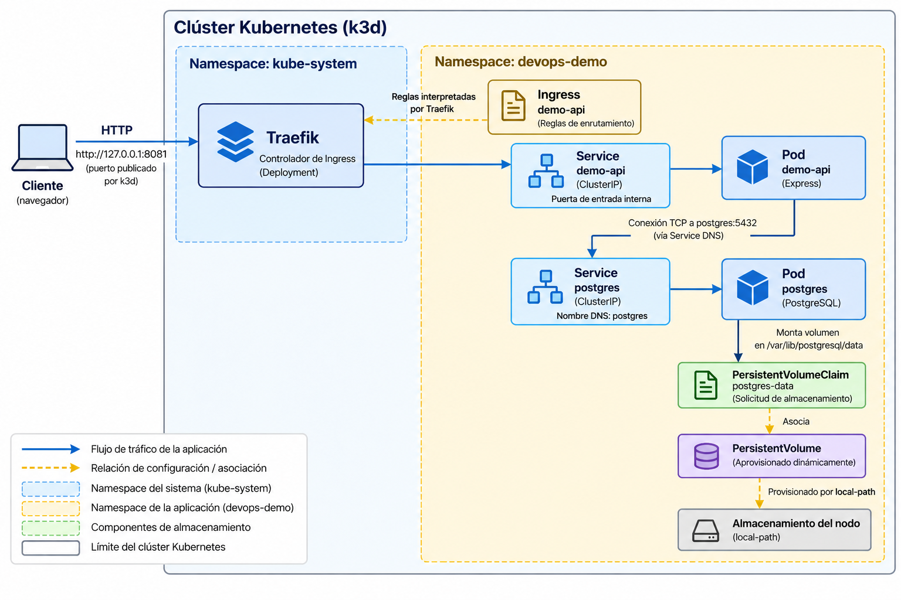
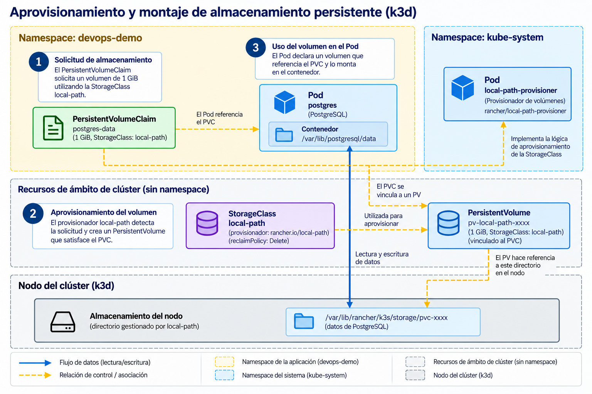
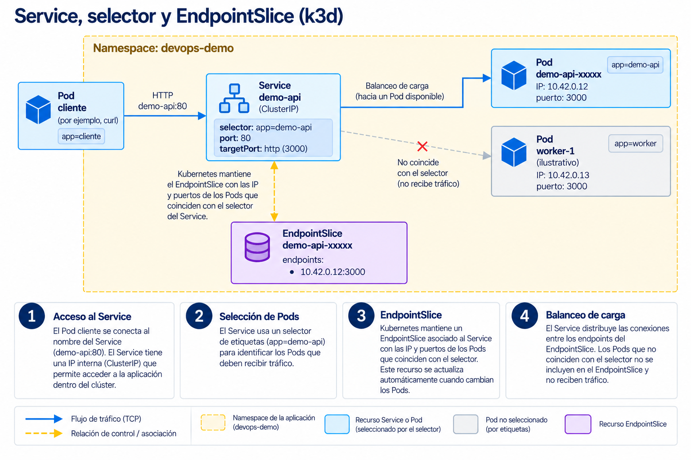
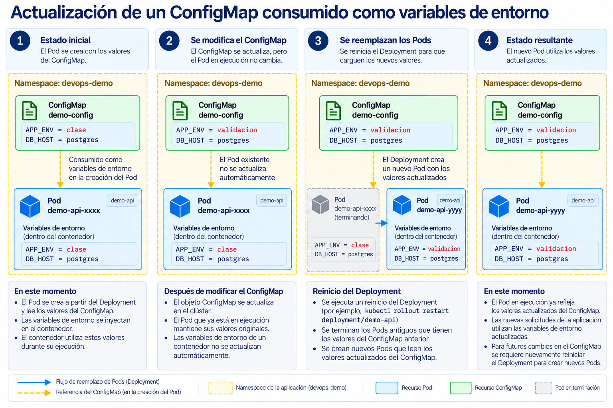

# Clase 19. Servicios, configuración y almacenamiento en Kubernetes

El despliegue de un contenedor no resuelve por sí mismo las necesidades de comunicación, configuración y conservación de datos de una aplicación. Un Pod puede ser sustituido por otro durante una actualización, una recuperación o una decisión de planificación. El nuevo Pod puede recibir una dirección IP distinta y su sistema de archivos escribible no conserva automáticamente los cambios del contenedor anterior.

En esta sesión se utiliza una API HTTP desarrollada con Express y una base de datos PostgreSQL. Se construirá su entorno de ejecución en K3s, incorporando los recursos en el orden necesario para que el sistema funcione. La aplicación admite la creación y consulta de notas, lo que permitirá comprobar la comunicación entre componentes y la conservación de datos.

Los experimentos están integrados en las secciones correspondientes. Las salidas ilustrativas no reproducen identificadores fijos: las direcciones IP, nombres de Pods, edades y nombres de volúmenes se generan durante cada ejecución.

## Objetivos de aprendizaje

Al finalizar la sesión, el estudiante será capaz de:

1. Configurar aplicaciones en Kubernetes mediante ConfigMaps y Secrets, diferenciando sus mecanismos de consumo, actualización y protección.
2. Configurar almacenamiento persistente mediante PersistentVolumeClaims y explicar la relación entre PersistentVolumes, StorageClasses y volúmenes montados en contenedores.
3. Implementar Services para comunicar componentes de una aplicación e interpretar selectores, puertos, EndpointSlices y resolución DNS.
4. Configurar el acceso HTTP a una aplicación mediante Ingress y un controlador de entrada.
5. Verificar los recursos desplegados mediante inspección de estados, eventos y pruebas de conectividad, configuración y persistencia.

## 1. Preparación del entorno

### 1.1. Aplicación de referencia

El repositorio [k8s-service-stack](https://github.com/guillermocalderon2021/k8s-service-stack) contiene el código de la API, sus dependencias, los manifiestos y algunos scripts auxiliares. La aplicación expone cuatro operaciones:

| Método | Ruta | Función |
|---|---|---|
| `GET` | `/health` | Responder que el proceso HTTP está disponible |
| `GET` | `/config` | Mostrar parámetros no sensibles recibidos por la aplicación |
| `POST` | `/notes` | Insertar una nota en PostgreSQL |
| `GET` | `/notes` | Consultar las notas almacenadas |

En `app/src/db.js`, la biblioteca `pg` crea un conjunto de conexiones (*pool*) a PostgreSQL a partir de variables de entorno. La propiedad `host` utiliza `DB_HOST`; la contraseña se obtiene de `DB_PASSWORD`. El archivo `app/src/server.js` inicializa la tabla `notes`, si todavía no existe, antes de iniciar el servidor HTTP. Por tanto, una respuesta correcta de `/health` confirma que el proceso arrancó, pero no constituye una prueba permanente del estado de la base de datos.

La arquitectura resultante se muestra en la figura 1. El diagrama representa el estado final del entorno y distingue el flujo de solicitudes de las relaciones de configuración.



*Figura 1. Arquitectura de la aplicación Express y PostgreSQL en el clúster K3s.*

El Ingress y los Services todavía no existen al comenzar la práctica. Se incorporarán después de preparar los recursos de configuración y almacenamiento. La figura representa el estado final, no la secuencia de creación.

### 1.2. Requisitos y repositorio

Se requiere una terminal Bash en Linux o en un entorno que disponga de Docker Engine, `kubectl`, `k3d`, `curl`, `openssl` y acceso a Internet para descargar imágenes. El puerto TCP `8081` de la computadora debe estar libre. La demostración se ejecuta localmente y no requiere Azure.

Comprobar las herramientas:

```bash
for tool in docker kubectl k3d curl openssl; do
  command -v "$tool" || echo "No se encontró: $tool"
done

docker info >/dev/null && echo "Docker disponible"
```

`command -v` busca cada ejecutable en las rutas configuradas en `PATH`. `docker info` comprueba la comunicación con el motor de Docker; la redirección `>/dev/null` oculta su salida normal. Si Docker informa de un problema de permisos o de conexión con el daemon, debe resolverse antes de continuar.

Obtener el repositorio:

```bash
git clone https://github.com/guillermocalderon2021/k8s-service-stack.git
cd k8s-service-stack
```

Los comandos posteriores asumen que la terminal permanece en la raíz de ese repositorio. Las rutas `k8s/` y `scripts/` son relativas a ese directorio. Los manifiestos numerados indican el orden de aplicación del ejemplo, no un número de sesión.

### 1.3. Creación del clúster e importación de la imagen

En esta preparación se utilizan dos scripts, pero sus operaciones deben comprenderse. El primero crea el entorno de Kubernetes y el segundo traslada la imagen construida con Docker al almacenamiento de imágenes que utiliza K3s dentro de k3d.

```bash
bash scripts/create-cluster.sh
```

El script comprueba la presencia de herramientas y que Docker esté disponible. Cuando no existe `devops-local`, ejecuta un comando equivalente a:

```bash
k3d cluster create devops-local \
  --servers 1 \
  --agents 0 \
  --image rancher/k3s:v1.35.2-k3s1 \
  --port '127.0.0.1:8081:80@loadbalancer' \
  --wait
```

`cluster create` solicita a k3d crear un clúster K3s dentro de contenedores Docker. `--servers 1` establece un único nodo servidor; `--agents 0` no añade nodos agentes. El servidor podrá ejecutar las cargas de trabajo de esta demostración. `--image` selecciona la imagen de K3s utilizada por el repositorio y `--wait` espera a que la creación finalice. La expresión de `--port` publica el puerto 80 del balanceador de entrada de k3d como `127.0.0.1:8081` de la computadora. El enlace a la interfaz de loopback evita exponer intencionalmente ese puerto a toda la red local.

Comprobar el contexto y el nodo:

```bash
kubectl config current-context
kubectl get nodes -o wide
```

La primera instrucción debe devolver `k3d-devops-local`. En la segunda debe aparecer un nodo similar a `k3d-devops-local-server-0`, con `STATUS` igual a `Ready`. `-o wide` agrega columnas, entre ellas la dirección interna del nodo y la versión de Kubernetes. Si el contexto activo no corresponde al clúster del ejercicio, ejecutar `kubectl config use-context k3d-devops-local` antes de aplicar recursos: `kubectl` actúa sobre el contexto activo, no necesariamente sobre el último clúster creado.

Construir e importar la imagen:

```bash
bash scripts/build-import.sh
```

Las dos operaciones principales del script son:

```bash
docker build -t devops-api:local ./app
k3d image import devops-api:local -c devops-local
```

`docker build` interpreta `app/Dockerfile` y produce la imagen `devops-api:local`. La opción `-t` establece nombre y etiqueta. La operación `k3d image import` copia la imagen al entorno de ejecución de contenedores del clúster; construirla en Docker no garantiza por sí solo que K3s pueda encontrarla. El Deployment de la API utiliza `imagePullPolicy: Never`: K3s debe disponer de esa imagen local y no intentará descargarla de un registro remoto.

El resultado esperado es un mensaje de construcción satisfactoria de Docker y la confirmación de importación de k3d. En esta etapa todavía no se ha creado ningún Pod de la aplicación.

### 1.4. Namespace

Los Namespaces permiten organizar recursos con nombres potencialmente iguales dentro de un mismo clúster. No constituyen por sí solos una frontera de aislamiento de red o de seguridad. Los Pods, Services, ConfigMaps, Secrets y PVC de esta aplicación estarán en `devops-demo`; los nodos y las StorageClasses son recursos de alcance de clúster.

El archivo `k8s/01-namespace.yaml` define:

```yaml
apiVersion: v1
kind: Namespace
metadata:
  name: devops-demo
```

`apiVersion` identifica el grupo y la versión de la API que interpreta el objeto; `kind` señala su tipo y `metadata.name`, su nombre. Crear el recurso y comprobarlo:

```bash
kubectl apply -f k8s/01-namespace.yaml
kubectl get namespace devops-demo
```

`apply -f` envía al servidor API la declaración contenida en el archivo. En una primera ejecución se espera `namespace/devops-demo created`; al volver a aplicarlo normalmente se informará que no hubo cambios. Esta propiedad facilita mantener el estado declarado sin crear un objeto nuevo en cada ejecución. La consulta debe mostrar `devops-demo` con estado `Active`.

En lo sucesivo se utiliza `-n devops-demo` para consultar los recursos del Namespace. La opción `-n` selecciona el ámbito de la consulta, pero no cambia permanentemente el contexto predeterminado de `kubectl`.

## 2. ConfigMaps y Secrets

### 2.1. Configuración externa a la imagen

Una imagen de contenedor describe la aplicación y sus dependencias. Parámetros como el nombre de la base de datos, el hostname de un servicio o el entorno de ejecución pueden variar entre despliegues sin requerir una imagen diferente. Kubernetes proporciona ConfigMaps para almacenar esta información no sensible como datos de configuración.

El archivo `k8s/02-configmap.yaml` contiene:

```yaml
apiVersion: v1
kind: ConfigMap
metadata:
  name: demo-config
  namespace: devops-demo
data:
  APP_ENV: "clase"
  DB_HOST: "postgres"
  DB_PORT: "5432"
  DB_NAME: "demo"
  DB_USER: "demo"
```

Cada entrada de `data` contiene una cadena de texto. `DB_HOST` no representa la dirección IP de un Pod: más adelante se creará un Service denominado `postgres` que podrá resolverse mediante DNS dentro del Namespace. Las comillas del puerto son convenientes porque los valores de `data` deben ser cadenas.

Crear e inspeccionar el ConfigMap:

```bash
kubectl apply -f k8s/02-configmap.yaml
kubectl get configmap demo-config -n devops-demo
kubectl describe configmap demo-config -n devops-demo
```

La primera salida debe indicar `configmap/demo-config created`. La consulta `get` muestra el objeto y la cantidad de claves, mientras que `describe` presenta su contenido y metadatos. En este caso es apropiado inspeccionar los valores porque no son secretos.

Los Deployments consumirán esas entradas de dos maneras. La API utiliza `envFrom`, que carga las claves del ConfigMap como variables de entorno:

```yaml
envFrom:
  - configMapRef:
      name: demo-config
```

PostgreSQL emplea referencias individuales con `configMapKeyRef`, por ejemplo:

```yaml
- name: POSTGRES_DB
  valueFrom:
    configMapKeyRef:
      name: demo-config
      key: DB_NAME
```

La primera forma evita enumerar cada variable, pero incorpora todas las claves compatibles con nombres de variables de entorno. La segunda permite especificar el nombre que debe recibir el proceso y seleccionar una sola clave. En ambos casos el ConfigMap debe existir cuando se intente iniciar el contenedor, salvo que la referencia se haya declarado opcional.

La configuración puede modificarse sin reconstruir la imagen. Sin embargo, **las variables de entorno de un contenedor en ejecución no cambian automáticamente** cuando cambia el ConfigMap: el proceso recibe sus valores al iniciarse. Si el ConfigMap se monta como volumen, Kubernetes puede actualizar posteriormente los archivos proyectados, aunque la aplicación debe volver a leerlos para utilizar los nuevos valores. El ejemplo utiliza variables de entorno; la actualización se observará después de iniciar la API. Referencia: [ConfigMaps y variables de entorno](https://kubernetes.io/docs/tasks/configure-pod-container/configure-pod-configmap/).

### 2.2. Credenciales y Secrets

La contraseña de PostgreSQL no debe incorporarse al Dockerfile, al código fuente ni a un ConfigMap. Un Secret es un objeto de Kubernetes destinado a información sensible que los Pods necesitan consumir. Su utilización separa la distribución de la credencial de la construcción de la imagen, aunque no sustituye los controles de acceso ni garantiza por sí sola el cifrado de los datos almacenados.

En el repositorio, `scripts/create-secret.sh` genera una credencial ficticia y crea el objeto `postgres-credentials`. Conviene inspeccionarlo antes de ejecutarlo:

```bash
cat scripts/create-secret.sh
```

Las instrucciones esenciales son:

```bash
PASSWORD="$(openssl rand -hex 16)"
printf %s "$PASSWORD" | kubectl -n devops-demo \
  create secret generic postgres-credentials \
  --from-file=password=/dev/stdin
unset PASSWORD
```

`openssl rand -hex 16` obtiene 16 bytes aleatorios y los representa en 32 caracteres hexadecimales. La sustitución `$(...)` captura la salida en una variable de Bash. `printf %s` escribe el valor sin añadir un salto de línea. La tubería `|` suministra esos bytes a `kubectl`; `--from-file=password=/dev/stdin` indica que la clave del Secret se llamará `password` y que su contenido se leerá de la entrada estándar. `unset` elimina la variable de la sesión del script. La implementación completa verifica también el Namespace, evita sustituir un Secret existente y no imprime la credencial.

Ejecutar el script:

```bash
bash scripts/create-secret.sh
kubectl get secret postgres-credentials -n devops-demo
kubectl describe secret postgres-credentials -n devops-demo
```

Debe aparecer un Secret de tipo `Opaque` con una entrada `password`. `describe` informa del nombre de la clave y de su tamaño sin revelar la contraseña. La instrucción `kubectl get secret -o yaml`, en cambio, puede exponer los bytes codificados como Base64. **Base64 es una codificación reversible, no un mecanismo de cifrado.** En un clúster real deben aplicarse permisos RBAC adecuados, protección del almacén del servidor API y, cuando corresponda, cifrado en reposo. Tampoco deben registrarse las contraseñas en logs de aplicación. Referencia: [Secrets de Kubernetes](https://kubernetes.io/docs/concepts/configuration/secret/).

El Deployment de PostgreSQL recibirá la credencial como `POSTGRES_PASSWORD`:

```yaml
- name: POSTGRES_PASSWORD
  valueFrom:
    secretKeyRef:
      name: postgres-credentials
      key: password
```

La API recibirá el mismo valor bajo el nombre `DB_PASSWORD`. El nombre del Secret y la clave referenciada deben coincidir exactamente; los Pods solo pueden referenciar directamente Secrets de su propio Namespace. El valor de la contraseña no tiene que aparecer en los manifiestos de Deployment.


## 3. Almacenamiento persistente

### 3.1. Volúmenes y reclamaciones

El sistema de archivos escribible asociado al contenedor no constituye un almacenamiento durable para una base de datos. Si el contenedor se reemplaza, no debe suponerse que el siguiente conserve ese contenido. Kubernetes permite montar volúmenes en los contenedores y separar el ciclo de vida de ciertos datos del ciclo de vida de un Pod.

Un **PersistentVolume** (`PV`) representa capacidad de almacenamiento ofrecida al clúster. Un **PersistentVolumeClaim** (`PVC`) expresa una solicitud de almacenamiento efectuada por una carga de trabajo. Una **StorageClass** describe una clase de almacenamiento y puede indicar qué provisionador debe crear los volúmenes solicitados. Con aprovisionamiento dinámico no es necesario definir manualmente un PV antes de crear el PVC: el provisionador correspondiente puede crearlo cuando sea necesario.



*Figura 2. Aprovisionamiento y montaje de almacenamiento persistente con `local-path`.*

K3s incluye normalmente la StorageClass `local-path`, respaldada por almacenamiento local del nodo. Consultar las clases disponibles:

```bash
kubectl get storageclass
```

Se espera una entrada denominada `local-path`, frecuentemente marcada como predeterminada. El nombre del provisionador y los demás campos pueden observarse mediante:

```bash
kubectl describe storageclass local-path
```

Identificar particularmente `Provisioner`, `VolumeBindingMode` y `ReclaimPolicy`. El primero designa el componente responsable del aprovisionamiento; el segundo determina si la vinculación se realiza inmediatamente o se difiere hasta que exista un Pod consumidor. `ReclaimPolicy` indica qué acción corresponde al PV cuando se libera de su reclamación: `Delete` puede conducir a la eliminación del volumen respaldante, mientras que `Retain` conserva el recurso para una recuperación administrada. **No se debe inferir que borrar un PVC equivale a una operación segura de conservación de datos**. En el clúster de práctica debe consultarse el valor efectivo en vez de asumirlo.

Este almacenamiento facilita los experimentos en un clúster de un nodo. El provisionador `local-path` de K3s administra directorios locales y no debe confundirse con el tipo de volumen `local` definido directamente en Kubernetes. **No proporciona por sí mismo replicación de datos ni recuperación ante la pérdida del nodo o de su disco.** Una solución productiva debe seleccionar el mecanismo de almacenamiento de acuerdo con requisitos de disponibilidad, copias de seguridad y recuperación.

El archivo `k8s/03-postgres-pvc.yaml` declara:

```yaml
apiVersion: v1
kind: PersistentVolumeClaim
metadata:
  name: postgres-data
  namespace: devops-demo
spec:
  accessModes:
    - ReadWriteOnce
  storageClassName: local-path
  resources:
    requests:
      storage: 1Gi
```

`storageClassName` selecciona la clase `local-path`. `requests.storage` solicita 1 GiB. El modo `ReadWriteOnce` permite montar el volumen con acceso de lectura y escritura desde un nodo; no debe interpretarse como una garantía general de acceso exclusivo a un único Pod. Las reglas exactas dependen del tipo de almacenamiento.

Crear la reclamación:

```bash
kubectl apply -f k8s/03-postgres-pvc.yaml
kubectl get pvc -n devops-demo
```

La primera salida debe indicar `persistentvolumeclaim/postgres-data created`. Inmediatamente después, el PVC puede aparecer `Pending` durante algunos instantes. Algunas StorageClasses utilizan `WaitForFirstConsumer`, por lo que el aprovisionamiento se completa cuando existe un Pod que necesita el volumen y se conoce dónde se programará. En consecuencia, no se debe diagnosticar una falla únicamente porque la reclamación no aparezca `Bound` antes de crear el Deployment.

### 3.2. Deployment de PostgreSQL

El archivo `k8s/04-postgres-deployment.yaml` define un Deployment con una réplica. En el manifiesto destacan las siguientes decisiones:

```yaml
spec:
  replicas: 1
  strategy:
    type: Recreate
```

`replicas: 1` solicita un Pod de PostgreSQL. `Recreate` se aplica a las actualizaciones del Deployment para evitar que la estrategia genere simultáneamente un Pod anterior y otro nuevo que compitan por la misma base de datos. **No convierte PostgreSQL en un servicio de alta disponibilidad** ni sustituye una estrategia de respaldo o recuperación.

El contenedor utiliza la imagen `postgres:16.9-alpine`, lee parámetros del ConfigMap, obtiene la contraseña del Secret y monta el PVC:

```yaml
volumeMounts:
  - name: database
    mountPath: /var/lib/postgresql/data
# ...
volumes:
  - name: database
    persistentVolumeClaim:
      claimName: postgres-data
```

`volumeMounts` establece la ruta visible dentro del contenedor; `volumes` conecta el nombre lógico `database` con el PVC existente. El manifiesto también establece `PGDATA` en `/var/lib/postgresql/data/pgdata`, una subcarpeta del directorio montado. PostgreSQL almacenará sus archivos en esa ubicación. El volumen y el directorio deben distinguirse: el primero es el recurso de almacenamiento; el segundo es la ruta que observa el proceso.

Crear el Deployment:

```bash
kubectl apply -f k8s/04-postgres-deployment.yaml
kubectl rollout status deployment/postgres -n devops-demo --timeout=180s
```

`rollout status` espera hasta que el Deployment informe que la revisión está disponible o hasta agotar los 180 segundos. En una ejecución satisfactoria se obtiene un mensaje semejante a `deployment "postgres" successfully rolled out`. La primera inicialización puede tardar más que los reinicios posteriores.

Examinar los recursos:

```bash
kubectl get pods -n devops-demo -l app=postgres -o wide
kubectl get pvc -n devops-demo
kubectl get pv
```

`-l app=postgres` filtra los Pods por etiqueta. Se espera un Pod `Running` y una reclamación `postgres-data` en estado `Bound`, vinculada a un PV generado dinámicamente. El nombre del PV suele incluir un identificador y no debe copiarse de una salida de ejemplo. `kubectl get pv` consulta un recurso de alcance de clúster, por lo que no necesita `-n`.

Para inspeccionar la relación entre Pod, volumen y nodo:

```bash
kubectl describe pod -n devops-demo -l app=postgres
kubectl describe pvc postgres-data -n devops-demo
```

`describe` muestra eventos, montajes y condiciones. En la descripción del Pod, revisar `Volumes` y `Mounts` para comprobar la asociación del PVC y su ruta, `Conditions` para identificar si está preparado, y `Events` para encontrar problemas de programación o montaje. Una salida de diagnóstico puede contener, por ejemplo, `Warning  FailedMount`, acompañada de un mensaje sobre un volumen que no pudo montarse; esa línea es **un ejemplo de falla**, no un resultado esperado de este despliegue.

Si un Pod figura como `Pending`, examinar además `PodScheduled` y los eventos `FailedScheduling`; si figura como `CreateContainerConfigError`, comprobar las referencias a ConfigMaps y Secrets. Si el contenedor inicia y termina, consultar `kubectl logs -n devops-demo deployment/postgres --tail=50` y los eventos del Pod. No todos estos estados producen las mismas señales ni tienen la misma causa.

La comprobación de preparación del contenedor se realiza con `pg_isready`. Esa prueba informa de la disposición del servidor PostgreSQL para aceptar conexiones, pero no garantiza por sí sola la ejecución correcta de todas las consultas de la aplicación.

Si un Pod permanece en `Pending` o en `ContainerCreating`, revisar los eventos en lugar de eliminarlo inmediatamente:

```bash
kubectl get events -n devops-demo --sort-by='.lastTimestamp'
```

Entre las causas posibles se encuentran problemas de aprovisionamiento del volumen, restricciones de recursos o referencias incorrectas. Una ausencia de Secret o de clave de ConfigMap puede impedir que se inicie el contenedor. Los diagnósticos deben basarse en el motivo mostrado por Kubernetes.

La conservación de registros después del reemplazo del Pod se verificará cuando la API haya permitido insertar datos, en la sección siguiente.

## 4. Services y descubrimiento de servicios

### 4.1. Direcciones de Pods y Services

Cada Pod obtiene una dirección IP dentro de la red del clúster. Esa dirección identifica a una instancia concreta, pero la instancia no es necesariamente permanente: un Deployment puede reemplazarla durante una recuperación o actualización. Una aplicación cliente que almacene directamente la IP de un Pod podría quedar conectándose a una dirección que ya no corresponde al servicio buscado.

Un objeto **Service** proporciona un mecanismo estable de acceso a un conjunto de Pods seleccionados. Para un Service de tipo `ClusterIP`, Kubernetes asigna una IP virtual accesible desde la red del clúster; el tráfico se encamina a los endpoints del Service. La selección habitual se basa en etiquetas (`labels`) de Pods. Los **EndpointSlices** representan los destinos disponibles para el Service y permiten que los componentes de red utilicen información actualizada. Referencia: [Services](https://kubernetes.io/docs/concepts/services-networking/service/).

La figura 3 muestra un ejemplo complementario con el Service `demo-api`, un Pod seleccionado por su etiqueta y otro Pod ilustrativo que no coincide con el selector. El EndpointSlice registra el destino; no recibe ni reenvía tráfico. Las direcciones IP representadas son ilustrativas.



*Figura 3. Selección de Pods y registro de endpoints asociados a un Service.*

El manifiesto `k8s/05-postgres-service.yaml` contiene:

```yaml
apiVersion: v1
kind: Service
metadata:
  name: postgres
  namespace: devops-demo
spec:
  type: ClusterIP
  selector:
    app: postgres
  ports:
    - name: postgres
      port: 5432
      targetPort: postgres
```

`type: ClusterIP` indica que se utilizará un punto de acceso interno. El selector `app: postgres` busca Pods con esa etiqueta, que está presente en la plantilla del Deployment. `port` es el puerto en que escucha el Service; `targetPort` identifica el puerto de destino del contenedor. En este manifiesto se utiliza el nombre `postgres`, declarado en `containerPort: 5432`, en vez de repetir el número del puerto en ambos lugares. El Service no inicia el proceso PostgreSQL: únicamente expone el acceso a un proceso que ya está desplegado.

Aplicar el manifiesto:

```bash
kubectl apply -f k8s/05-postgres-service.yaml
kubectl get svc postgres -n devops-demo -o wide
```

El resultado debe indicar `service/postgres created`. En la siguiente consulta, `TYPE` será `ClusterIP`, `PORT(S)` mostrará `5432/TCP` y `CLUSTER-IP` contendrá una dirección asignada por el clúster, por ejemplo `10.43.x.x`. No habrá una IP pública asociada al Service.

Consultar los destinos:

```bash
kubectl get endpointslices -n devops-demo \
  -l kubernetes.io/service-name=postgres
kubectl describe svc postgres -n devops-demo
```

El primer comando filtra los EndpointSlices administrados para `postgres`. Una salida abreviada puede mostrar `NAME`, `ADDRESSTYPE`, `PORTS`, `ENDPOINTS` y `AGE`; por ejemplo, la columna `ENDPOINTS` puede contener `10.42.0.8`, que representa la IP de un Pod y **no** la ClusterIP del Service. El campo `PORTS` debe corresponder al destino 5432. Comprobar la dirección real mediante `kubectl get pods -n devops-demo -l app=postgres -o wide`. `describe` muestra, entre otros datos, el selector, los puertos y los endpoints. Si PostgreSQL está preparado, debe aparecer un destino que corresponda a la dirección del Pod y al puerto 5432. Si la selección de etiquetas no coincide o no hay Pods listos, el Service puede existir pero carecer de destinos utilizables.

**Comprobación de diagnóstico.** Antes de continuar, observar qué sucede cuando el selector no coincide con ningún Pod. Guardar primero el selector actual, que debe ser `app: postgres`:

```bash
kubectl get service postgres -n devops-demo \
  -o jsonpath='{.spec.selector.app}{"\n"}'
```

Modificar temporalmente el selector **del Service**, sin tocar las etiquetas del Deployment ni el manifiesto versionado:

```bash
kubectl patch service postgres -n devops-demo \
  --type merge -p '{"spec":{"selector":{"app":"sin-coincidencias"}}}'

kubectl get endpointslices -n devops-demo \
  -l kubernetes.io/service-name=postgres
```

El Service debe continuar existiendo y conservar su ClusterIP, pero no tendrá destinos preparados correspondientes a PostgreSQL. Puede aparecer un EndpointSlice sin direcciones o desaparecer el EndpointSlice anterior, según el momento de la consulta y el controlador. Confirmar el estado también con `kubectl describe svc postgres -n devops-demo`, cuyo campo `Endpoints` debería indicar `<none>`. La ausencia de destinos no significa que DNS haya dejado de resolver el Service.

Restaurar el manifiesto original y comprobar que vuelven a aparecer endpoints:

```bash
kubectl apply -f k8s/05-postgres-service.yaml
kubectl describe svc postgres -n devops-demo
```

El restablecimiento puede tardar algunos segundos. **No continuar con el despliegue de la API hasta comprobar que el selector y los endpoints se han recuperado.** El ejercicio distingue tres operaciones distintas: resolver el nombre de un Service, seleccionar Pods y disponer de un proceso preparado detrás de ese Service.

### 4.2. DNS de servicios

Además de la IP virtual, Kubernetes permite consultar Services por nombre DNS. En el dominio habitual `cluster.local`, el nombre completo del Service utilizado aquí es:

```text
postgres.devops-demo.svc.cluster.local
```

Desde un Pod en `devops-demo` suele ser suficiente utilizar `postgres`: la configuración DNS del contenedor incluye sufijos de búsqueda correspondientes a su Namespace. Un Pod en otro Namespace puede utilizar `postgres.devops-demo` o el nombre completo. No se debe suponer que la misma abreviatura funciona indistintamente desde todos los Namespaces. Referencia: [DNS para Services y Pods](https://kubernetes.io/docs/concepts/services-networking/dns-pod-service/).

Crear un Pod temporal para investigar el DNS del clúster:

```bash
kubectl run dns-test -n devops-demo \
  --image=busybox:1.36 \
  --restart=Never \
  --command -- sleep 600

kubectl wait -n devops-demo pod/dns-test \
  --for=condition=Ready --timeout=120s
```

`kubectl run` crea un Pod directamente; `--restart=Never` establece su política de reinicio y evita generar un Deployment. La expresión situada después de `--` es el comando que ejecutará el contenedor (`sleep 600`). `kubectl wait` espera a que la condición `Ready` del Pod sea verdadera. La descarga inicial de BusyBox puede requerir unos segundos.

Inspeccionar los parámetros de resolución:

```bash
kubectl exec -n devops-demo dns-test -- cat /etc/resolv.conf
```

`exec` ejecuta un comando dentro del contenedor. Después del separador `--` aparece `cat /etc/resolv.conf`, que muestra el servidor DNS y la lista de búsqueda configurada para el Pod. Es habitual observar un servidor del clúster como `10.43.0.10` y sufijos como `devops-demo.svc.cluster.local`.

Realizar una consulta DNS:

```bash
kubectl exec -n devops-demo dns-test -- \
  nslookup postgres.devops-demo.svc.cluster.local.
```

El punto final declara un nombre DNS absoluto y evita aplicar sufijos de búsqueda. La respuesta esperada contiene la ClusterIP del Service, no necesariamente la IP del Pod:

```text
Name:    postgres.devops-demo.svc.cluster.local
Address: 10.43.x.x
```

Al consultar solamente `nslookup postgres`, algunas versiones de BusyBox también imprimen intentos fallidos con `NXDOMAIN` para nombres construidos a partir de los sufijos de búsqueda y pueden terminar con un código distinto de cero. Si la consulta al nombre completo devuelve la dirección correcta, esas respuestas negativas adicionales no demuestran por sí mismas una falla de CoreDNS.

Comprobar conectividad TCP al puerto de PostgreSQL:

```bash
kubectl exec -n devops-demo dns-test -- nc -z -w 3 postgres 5432
```

En BusyBox, `nc -z` comprueba la posibilidad de establecer una conexión sin enviar datos de aplicación y `-w 3` limita el tiempo de espera a tres segundos. Algunas variantes de `nc` no muestran ninguna salida cuando la conexión es satisfactoria. Para comprobar el código de salida:

```bash
kubectl exec -n devops-demo dns-test -- \
  sh -c 'nc -z -w 3 postgres 5432 && echo "TCP accesible"'
```

Se espera `TCP accesible`. Esta prueba demuestra resolución de nombre y conectividad al puerto; no valida credenciales ni la ejecución de consultas SQL. Eliminar el Pod temporal:

```bash
kubectl delete pod dns-test -n devops-demo
```

### 4.3. Deployment y Service de la API

El archivo `k8s/06-api-deployment.yaml` define un Deployment de una réplica con la imagen `devops-api:local`. El contenedor expone el puerto 3000, recibe variables de `demo-config` mediante `envFrom` y obtiene `DB_PASSWORD` de `postgres-credentials`. Cuando se inicia, `server.js` consulta PostgreSQL para crear la tabla `notes` si no existe. Por ello, es necesario que `postgres` pueda resolverse y que la base de datos acepte conexiones antes del primer arranque. Un Service existente no demuestra por sí solo que PostgreSQL tenga endpoints preparados, ni que acepte una consulta autenticada. Si el intento inicial de conexión falla, el proceso de la API puede terminar; Kubernetes intentará reiniciar su contenedor conforme al comportamiento del Pod. Conviene inspeccionar la causa mediante logs y eventos antes de intervenir.

Crear la API y comprobar su disponibilidad:

```bash
kubectl apply -f k8s/06-api-deployment.yaml
kubectl rollout status deployment/demo-api -n devops-demo --timeout=180s
kubectl get pod -n devops-demo -l app=demo-api
```

Se espera `deployment.apps/demo-api created`, después un mensaje de despliegue satisfactorio y finalmente un Pod `Running`, con `READY` igual a `1/1`. Si el proceso se reinicia reiteradamente, inspeccionar los logs y eventos:

```bash
kubectl logs -n devops-demo deployment/demo-api --tail=50
kubectl describe deployment demo-api -n devops-demo
kubectl get pods -n devops-demo -l app=demo-api
kubectl describe pod -n devops-demo -l app=demo-api
```

Un estado transitorio `CrashLoopBackOff` puede indicar reinicios repetidos después de fallas del proceso; un mensaje relacionado con la conexión a PostgreSQL en los logs permitiría orientar el diagnóstico. En cambio, un error de imagen o una referencia inexistente a un Secret requiere examinar otros campos de `describe`. No es correcto tratar todos los estados como fallas de red. La API del ejemplo no realiza reintentos internos indefinidos al crear la tabla: la recuperación depende de que PostgreSQL se encuentre disponible en un arranque posterior.

El manifiesto `k8s/07-api-service.yaml` utiliza otro Service de tipo `ClusterIP`. El puerto del Service es 80, mientras que el `targetPort` apunta al puerto denominado `http` del contenedor, que corresponde a 3000. Esto permite diferenciar la interfaz estable que utilizan los clientes del puerto interno del proceso Express.

```bash
kubectl apply -f k8s/07-api-service.yaml
kubectl get svc -n devops-demo
```

La salida debe mostrar dos Services: `postgres`, con puerto 5432, y `demo-api`, con puerto 80. Ambos tienen ClusterIP y ninguno se encuentra todavía expuesto mediante Ingress.

Para comprobar provisionalmente la API desde la computadora, puede utilizarse `port-forward`, sin depender aún de Traefik:

```bash
kubectl port-forward -n devops-demo service/demo-api 8090:80
```

Esta instrucción debe permanecer ejecutándose en una terminal. `8090` es el puerto local; `80` es el puerto del Service. `kubectl` establecerá un túnel desde la computadora hasta un Pod seleccionado como destino del Service. En otra terminal, situada también en la raíz del repositorio, ejecutar:

```bash
curl -i http://127.0.0.1:8090/health
curl -sS http://127.0.0.1:8090/config
```

La primera petición debe devolver un estado HTTP `200` y un cuerpo JSON como `{"status":"ok","component":"api"}`. La segunda debe mostrar `{"environment":"clase","databaseHost":"postgres"}`. La opción `-i` incluye los encabezados HTTP; `-sS` reduce mensajes de progreso sin ocultar errores de `curl`. Una vez comprobadas ambas operaciones, detener `port-forward` con `Ctrl+C`. El túnel no crea ni modifica un Ingress.

### 4.4. Actualización de un ConfigMap en uso

La API ya permite observar la diferencia entre el objeto ConfigMap almacenado en Kubernetes y las variables de entorno que recibió el proceso al iniciar. La figura 4 compara el entorno del Pod anterior con el que recibe un Pod nuevo después de reiniciar el Deployment.



*Figura 4. Actualización de un ConfigMap consumido como variables de entorno.*

Modificar únicamente el dato `APP_ENV` del ConfigMap:

```bash
kubectl patch configmap demo-config -n devops-demo \
  --type merge \
  -p '{"data":{"APP_ENV":"validacion"}}'

kubectl get configmap demo-config -n devops-demo \
  -o jsonpath='{.data.APP_ENV}{"\n"}'
```

`patch` modifica un recurso existente; `--type merge` solicita aplicar una modificación parcial y `-p` proporciona el fragmento JSON. La expresión `jsonpath` selecciona únicamente el valor de `APP_ENV`. Se espera `validacion` como salida.

Registrar el Pod actual antes de provocar un reemplazo:

```bash
kubectl get pods -n devops-demo -l app=demo-api
```

Abrir de nuevo el acceso temporal en una terminal:

```bash
kubectl port-forward -n devops-demo service/demo-api 8090:80
```

Desde otra terminal:

```bash
curl -sS http://127.0.0.1:8090/config
```

Aunque el ConfigMap contiene `validacion`, la respuesta debe continuar mostrando `"environment":"clase"`: el contenedor existente recibió sus variables de entorno al iniciarse. Reiniciar controladamente el Deployment desde otra terminal, o después de detener temporalmente el túnel:

```bash
kubectl rollout restart deployment/demo-api -n devops-demo
kubectl rollout status deployment/demo-api -n devops-demo --timeout=120s
```

`rollout restart` cambia la plantilla del Deployment para iniciar una nueva revisión y sustituir sus Pods; no modifica la imagen ni el código de aplicación. Durante la transición, `kubectl get pods -n devops-demo -l app=demo-api` puede mostrar simultáneamente un Pod anterior y uno nuevo; sus nombres y estados varían según el avance del controlador. La disponibilidad se determina a partir de los Pods preparados y de la estrategia de actualización, por lo que el reemplazo no garantiza por sí solo ausencia de interrupciones. Si el túnel `port-forward` se interrumpe al desaparecer su Pod de destino, iniciarlo nuevamente. Después de `rollout status`, volver a consultar los Pods y comparar el identificador actual con el registrado antes del reinicio. Consultar entonces `/config`: la respuesta debe incluir `"environment":"validacion"`.

Restablecer el valor declarado en Git y volver a crear el Pod:

```bash
kubectl apply -f k8s/02-configmap.yaml
kubectl rollout restart deployment/demo-api -n devops-demo
kubectl rollout status deployment/demo-api -n devops-demo --timeout=120s
```

Después de este procedimiento, `/config` debe mostrar otra vez `"environment":"clase"`. Detener cualquier sesión de `port-forward` que continúe abierta. La secuencia ilustra la diferencia entre el valor almacenado en el objeto ConfigMap y el entorno efectivo de un proceso ya iniciado.

### 4.5. Persistencia después del reemplazo del Pod

La API permite generar una evidencia que no estaba disponible al crear el PVC: una fila escrita en PostgreSQL. Abrir temporalmente el túnel, si todavía no está activo:

```bash
kubectl port-forward -n devops-demo service/demo-api 8090:80
```

En una segunda terminal, insertar y consultar una nota:

```bash
curl --fail-with-body -sS -X POST \
  http://127.0.0.1:8090/notes \
  -H 'Content-Type: application/json' \
  -d '{"text":"Persistencia comprobada"}'

curl --fail-with-body -sS http://127.0.0.1:8090/notes
```

La opción `-X POST` indica el método HTTP, `-H` establece que el cuerpo es JSON y `-d` envía el documento indicado. La primera respuesta debe contener un `id`, el texto y `created_at`; el identificador será generado por PostgreSQL. La segunda devuelve un objeto con el arreglo `notes` que incluye la fila creada. `--fail-with-body` hace que `curl` informe un error ante determinadas respuestas HTTP no satisfactorias conservando el cuerpo de la respuesta.

Observar el nombre actual del Pod:

```bash
kubectl get pods -n devops-demo -l app=postgres
```

Eliminarlo mediante su etiqueta, sin borrar el Deployment ni el PVC:

```bash
kubectl delete pod -n devops-demo -l app=postgres
kubectl wait -n devops-demo \
  --for=condition=Ready pod -l app=postgres --timeout=180s
kubectl get pods -n devops-demo -l app=postgres
kubectl get pvc postgres-data -n devops-demo
```

El controlador del Deployment detectará que falta una réplica y solicitará un nuevo Pod. `kubectl wait` espera a que un Pod que coincide con la etiqueta satisfaga la condición `Ready`; no presupone que se haya creado una nueva revisión del Deployment. El nombre del Pod debe cambiar respecto del registrado antes de eliminarlo. El PVC debe permanecer `Bound`. Cuando PostgreSQL vuelva a estar disponible, repetir la consulta a `/notes`. Si la API perdió temporalmente su conexión, la petición puede fallar durante la recuperación; en ese caso esperar unos segundos y repetirla. La presencia de `Persistencia comprobada` demuestra que el registro sobrevivió a la sustitución del Pod. No demuestra tolerancia a una pérdida del nodo o del almacenamiento local.

Esta comprobación no exige modificar el contenido del PVC: la información debe conservarse precisamente porque el objeto y su volumen permanecen asociados al Deployment. Finalizado el experimento, detener el túnel con `Ctrl+C`.

## 5. Acceso HTTP mediante Ingress

### 5.1. Exposición de servicios y enrutamiento

Hasta este punto la API se ha consultado mediante `kubectl port-forward`, un túnel establecido por un cliente administrativo. Ese mecanismo es conveniente para inspección y diagnóstico, pero no equivale a configurar un punto de entrada HTTP para los usuarios de la aplicación.

Los Services admiten distintos tipos. `ClusterIP` proporciona una dirección interna; `NodePort` reserva un puerto en los nodos; `LoadBalancer` solicita integración con un balanceador externo cuando el entorno dispone de un controlador que lo implementa. Un objeto **Ingress**, en cambio, define reglas de entrada para tráfico HTTP/HTTPS, como seleccionar un Service según el hostname o la ruta solicitada. Un Ingress necesita un **controlador** que interprete sus reglas y efectúe realmente el enrutamiento. Crear el objeto sin un controlador operativo no basta para recibir tráfico.

La distribución K3s utilizada aquí incorpora Traefik como controlador Ingress. k3d publica el puerto 80 de entrada a través del puerto 8081 de la computadora. Esta configuración está destinada al uso local; la aplicación se expondrá por HTTP sin TLS. En una infraestructura pública deben definirse, entre otras medidas, TLS, control de acceso, políticas de red y límites apropiados.

Consultar el controlador instalado:

```bash
kubectl get pods -n kube-system
kubectl get ingressclass
```

Entre los Pods de `kube-system` debe aparecer el controlador Traefik y una clase Ingress denominada `traefik`. Los nombres completos de los Pods variarán. Si Traefik no aparece o no está disponible, revisar la instalación de K3s y los eventos del Namespace antes de aplicar el Ingress.

### 5.2. Regla de Ingress y acceso a la aplicación

El archivo `k8s/08-ingress.yaml` contiene:

```yaml
apiVersion: networking.k8s.io/v1
kind: Ingress
metadata:
  name: demo-api
  namespace: devops-demo
spec:
  ingressClassName: traefik
  rules:
    - http:
        paths:
          - path: /
            pathType: Prefix
            backend:
              service:
                name: demo-api
                port:
                  number: 80
```

`ingressClassName: traefik` selecciona el controlador. La regla no declara un hostname, por lo que no restringe el encaminamiento a un nombre concreto. `path: /` y `pathType: Prefix` permiten que las rutas de la API coincidan con la regla. El bloque `backend` dirige las solicitudes al **Service** `demo-api` en su puerto 80, no directamente al Pod ni al puerto 3000 del contenedor.

Aplicar e inspeccionar:

```bash
kubectl apply -f k8s/08-ingress.yaml
kubectl get ingress -n devops-demo
kubectl describe ingress demo-api -n devops-demo
```

El primer comando debe indicar `ingress.networking.k8s.io/demo-api created`. La consulta debe mostrar `CLASS` igual a `traefik`; el campo `HOSTS` suele presentarse como `*` y el puerto como `80`. La dirección anunciada en `ADDRESS` puede depender de la implementación y no debe confundirse con la dirección que se utilizará en el navegador de la computadora anfitriona.

Ejecutar una solicitud real a través del puerto publicado por k3d:

```bash
curl -i http://127.0.0.1:8081/health
curl --fail-with-body -sS http://127.0.0.1:8081/config
curl --fail-with-body -sS http://127.0.0.1:8081/notes
```

La primera respuesta debe tener estado HTTP `200` y contener `{"status":"ok","component":"api"}`. La segunda debe indicar `"environment":"clase"`; la tercera debe incluir la nota conservada durante el experimento de persistencia.

La solicitud sigue esta secuencia: `curl` se conecta al puerto 8081 de la computadora; k3d lo dirige hacia la entrada del clúster; Traefik evalúa la regla Ingress; el Service `demo-api` encamina la petición a un Pod de Express; la API, si requiere datos, se comunica con PostgreSQL mediante el Service `postgres`. Ni el Ingress ni el Service acceden directamente al sistema de archivos del volumen.

### 5.3. Comprobación y cierre del entorno

Examinar el estado final:

```bash
kubectl get deployments,pods,services,pvc,ingress -n devops-demo
kubectl get endpointslices -n devops-demo \
  -l kubernetes.io/service-name=demo-api
```

Debe observarse una réplica disponible por Deployment, Pods en `Running`, dos Services `ClusterIP`, un PVC `Bound` y el Ingress administrado por Traefik. El EndpointSlice de `demo-api` debe reflejar al menos un destino preparado. Si las consultas fallan, comenzar por comprobar el estado de los Pods, sus eventos y los endpoints de los Services. Un Ingress existente no garantiza que su backend esté disponible.

En el repositorio existe `scripts/verify.sh`, que reúne consultas de estado y algunas peticiones HTTP. Puede utilizarse como comprobación de repetición una vez realizadas las operaciones de esta sección, pero no reemplaza la inspección de manifiestos y resultados.

Para suspender la práctica sin eliminar los objetos:

```bash
k3d cluster stop devops-local
```

Para reanudarla posteriormente:

```bash
k3d cluster start devops-local
kubectl config use-context k3d-devops-local
kubectl get pods -n devops-demo
```

Si se decide destruir el entorno:

```bash
bash scripts/cleanup.sh
```

El script solicita escribir `ELIMINAR` y elimina el clúster k3d con los datos locales asociados. **La detención no equivale a la eliminación.** El experimento de persistencia solo verificó la conservación de datos mientras el PVC y su almacenamiento seguían presentes; destruir el clúster no es un procedimiento de respaldo.

## Cuestiones de análisis

1. Si el Pod de PostgreSQL cambia de dirección IP tras ser reemplazado, ¿por qué la API puede continuar utilizando `DB_HOST=postgres` sin modificar su configuración?
2. ¿Qué comportamiento cabría esperar si el selector del Service `postgres` se modificara para que no coincidiera con ninguna etiqueta de Pod? ¿Qué recursos permitirían confirmarlo?
3. ¿Por qué actualizar `demo-config` no cambió inmediatamente la respuesta de `/config`? ¿En qué se diferenciaría una aplicación que leyera un archivo montado desde un ConfigMap?
4. ¿Qué evidencia proporciona la conservación de una nota tras sustituir el Pod? ¿Qué riesgos del almacenamiento `local-path` permanecen sin cubrir?
5. ¿Por qué el éxito de `GET /health` no garantiza, por sí solo, que una solicitud `POST /notes` pueda completarse?
6. ¿Qué diferencia existe entre el acceso mediante `port-forward`, un Service de tipo `ClusterIP` y la ruta de entrada definida por Ingress?

## Referencias

- Kubernetes. [Service](https://kubernetes.io/docs/concepts/services-networking/service/).
- Kubernetes. [DNS for Services and Pods](https://kubernetes.io/docs/concepts/services-networking/dns-pod-service/).
- Kubernetes. [Configure a Pod to Use a ConfigMap](https://kubernetes.io/docs/tasks/configure-pod-container/configure-pod-configmap/).
- Kubernetes. [Secrets](https://kubernetes.io/docs/concepts/configuration/secret/).
- Kubernetes. [Persistent Volumes](https://kubernetes.io/docs/concepts/storage/persistent-volumes/) y [Storage Classes](https://kubernetes.io/docs/concepts/storage/storage-classes/).
- Kubernetes. [Ingress](https://kubernetes.io/docs/concepts/services-networking/ingress/).
- K3s. [Documentación oficial](https://docs.k3s.io/).
