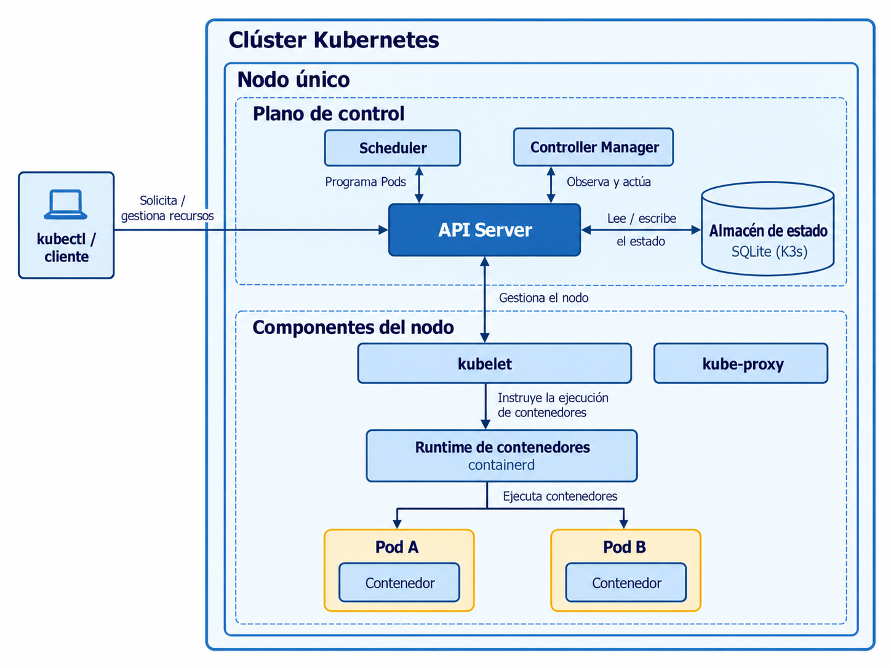
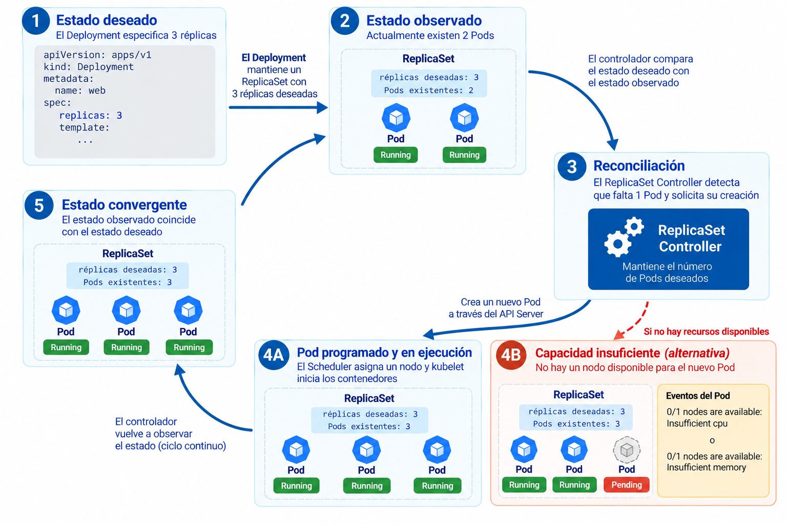
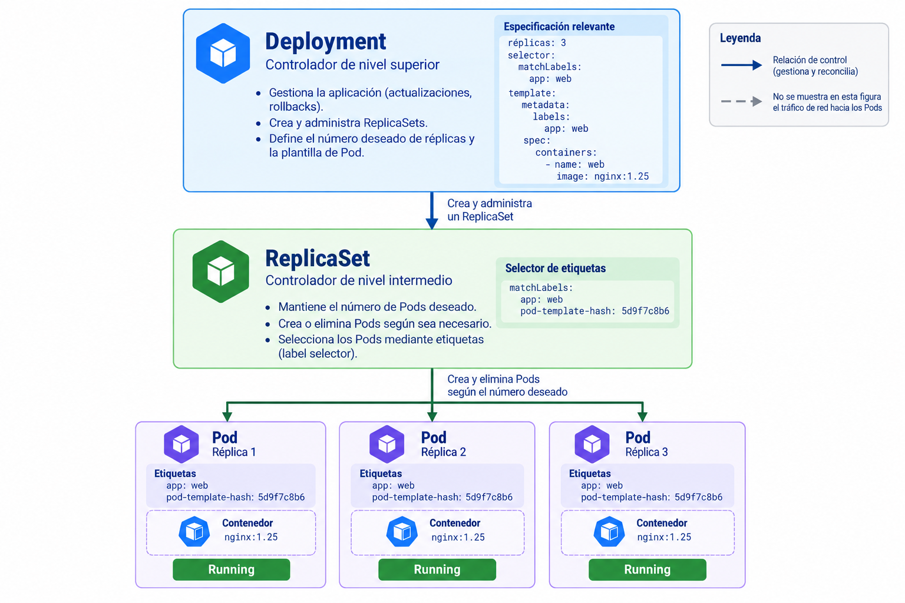

# Tema 18. Fundamentos de Kubernetes y administración de workloads

## Resultados de aprendizaje

Al finalizar el estudio de este tema, se espera que el estudiante pueda:

1. Describir los componentes esenciales de un clúster Kubernetes y la responsabilidad de cada uno durante la ejecución de una aplicación.
2. Explicar el modelo declarativo, el estado deseado y el funcionamiento de la reconciliación.
3. Distinguir las responsabilidades de Pods, ReplicaSets y Deployments.
4. Interpretar y modificar manifiestos YAML de workloads básicos.
5. Ejecutar operaciones de despliegue, escalamiento, actualización e inspección con `kubectl` y explicar los resultados observados.

## 18.1. Introducción a Kubernetes

### 18.1.1. Administración de contenedores

Una imagen de contenedor empaqueta una aplicación y las dependencias necesarias para ejecutarla. Un runtime de contenedores crea procesos aislados a partir de esa imagen. Este mecanismo no determina por sí mismo cuántas instancias debe mantener una plataforma, en qué máquina deben ejecutarse ni cómo proceder cuando una máquina deja de estar disponible.

Docker y Docker Compose permiten ejecutar y administrar contenedores. Compose define aplicaciones compuestas por servicios, redes y volúmenes, y dispone de políticas de reinicio. Para un ambiente local o un despliegue sencillo, estas capacidades pueden ser suficientes. Al aumentar las necesidades de operación, surgen requisitos adicionales: distribuir cargas entre máquinas, mantener un número solicitado de instancias, programar la colocación de nuevos contenedores y coordinar actualizaciones.

La **orquestación de contenedores** comprende los mecanismos utilizados para administrar esas responsabilidades sobre un conjunto de recursos de cómputo. Kubernetes es una plataforma de orquestación que expone una API para declarar y administrar recursos de ejecución. En lugar de gestionar exclusivamente contenedores individuales, permite expresar condiciones que el sistema intenta mantener.

Por ejemplo, una aplicación requiere tres instancias de su servidor HTTP. Si una instancia deja de existir, un controlador debe detectar la diferencia e intentar crear un reemplazo. Si se solicita una nueva versión, el sistema debe coordinar la sustitución de las instancias conforme a una estrategia definida. Estas operaciones dependen del estado del clúster y de la disponibilidad efectiva de sus recursos.

Kubernetes no garantiza que toda solicitud pueda cumplirse. Una imagen inexistente, la ausencia de capacidad o una configuración inválida pueden impedir alcanzar el estado deseado. En esas condiciones, la diferencia entre la configuración solicitada y el estado observado se convierte en información necesaria para el diagnóstico.

### 18.1.2. Clústeres y nodos

Un **clúster** está compuesto por un plano de control y uno o más **nodos**, que son máquinas físicas o virtuales preparadas para ejecutar cargas de trabajo. Un **workload** es una aplicación o componente que se ejecuta bajo la administración de Kubernetes. Los nodos aportan recursos como CPU y memoria; el plano de control coordina la creación y administración de objetos.

Una instalación de aprendizaje puede concentrar el plano de control y los workloads en un solo nodo. Esto permite estudiar el comportamiento de los controladores, aunque no ofrece tolerancia a la pérdida de la máquina que aloja el clúster.

### 18.1.3. Implementaciones de Kubernetes

Kubernetes puede operar como un servicio gestionado por un proveedor de nube o instalarse directamente sobre máquinas administradas por el equipo. En la primera modalidad, el proveedor asume parte de las tareas de operación de la plataforma. En la segunda, el equipo conserva mayor responsabilidad sobre instalación, actualizaciones, configuración y recuperación.

**K3s** es una distribución ligera y conforme con Kubernetes, adecuada para entornos con recursos limitados y escenarios de un solo servidor. En el proyecto de cátedra se utilizará K3s sobre máquinas virtuales de Azure. Los recursos y conceptos desarrollados en esta sesión también se aplican a K3s; las particularidades de instalación y operación se estudiarán en un tema posterior.

Para estudiar la API sin aprovisionar servicios en Azure se utilizará **k3d**, que ejecuta K3s dentro de contenedores Docker. De este modo, los ejemplos locales utilizan la misma distribución de Kubernetes prevista para el proyecto de cátedra, aunque el entorno Docker no reproduce la red, el almacenamiento ni la administración de una máquina virtual de Azure. Un clúster k3d de un solo nodo permite observar Pods, ReplicaSets, Deployments y reconciliación.

| Aspecto | Docker Compose | Kubernetes |
| --- | --- | --- |
| Unidad de configuración habitual | Aplicación compuesta por servicios | Recursos expuestos mediante una API |
| Ejecución | Contenedores gestionados por un motor Docker | Pods programados en nodos |
| Administración de réplicas | Capacidades de escalamiento de servicios, según la modalidad de ejecución | Controladores que mantienen un estado deseado |
| Distribución entre nodos | No es su función principal en su modalidad habitual | Capacidad fundamental del planificador |
| Actualizaciones | Procedimientos que dependen de la solución de despliegue | Estrategias declarativas de actualización de workloads |
| Complejidad operativa | Menor en escenarios locales sencillos | Mayor, por los componentes y mecanismos del clúster |

La elección entre ambas herramientas depende de los requisitos operativos. Kubernetes introduce capacidades adicionales, junto con nuevas responsabilidades de configuración, mantenimiento y diagnóstico.

## 18.2. Arquitectura de Kubernetes

### 18.2.1. Plano de control

El **plano de control** mantiene la información y coordina las decisiones relativas al estado del clúster. Sus componentes principales son los siguientes:

- **kube-apiserver:** expone la API de Kubernetes. Las operaciones de clientes como `kubectl` y las interacciones entre componentes utilizan esta API. El servidor autentica, autoriza y valida solicitudes según los mecanismos configurados.
- **Almacén de datos del clúster:** conserva la información de los objetos de la API. Kubernetes utiliza habitualmente `etcd`; distribuciones como K3s también admiten otras configuraciones de almacenamiento, incluida SQLite en instalaciones de un solo servidor.
- **kube-scheduler:** identifica Pods pendientes de asignación y selecciona un nodo apropiado. Considera, entre otros factores, los recursos solicitados y las restricciones de planificación.
- **kube-controller-manager:** ejecuta controladores que observan recursos y solicitan cambios para aproximar su estado al especificado.

Estos componentes desempeñan funciones distintas. Los controladores consultan objetos a través de la API y solicitan modificaciones cuando detectan diferencias respecto del estado deseado. El Scheduler decide la asignación de un Pod a un nodo mediante la API; no ejecuta directamente sus contenedores. El kubelet del nodo asignado interviene en su ejecución. En un clúster de un solo nodo, los componentes del plano de control y los workloads pueden compartir una máquina sin perder esa separación de responsabilidades.

### 18.2.2. Componentes de nodo

Los nodos que ejecutan workloads disponen de componentes encargados de materializar la ejecución:

- **kubelet:** agente que recibe las especificaciones de los Pods asignados al nodo y procura que sus contenedores estén en ejecución de acuerdo con ellas.
- **Container runtime:** software que administra la ejecución de contenedores a través de la interfaz utilizada por Kubernetes. K3s utiliza containerd de forma predeterminada.
- **Implementación de red:** proporciona conectividad a los Pods y a los recursos del clúster. En numerosas instalaciones participa `kube-proxy`, aunque existen implementaciones en las que esa función se reemplaza por otros mecanismos. El funcionamiento detallado de Services se estudiará en el siguiente tema.

Kubernetes también necesita componentes auxiliares, como DNS del clúster. La existencia exacta y la organización de estos componentes depende de la distribución y su configuración.

### 18.2.3. Secuencia de creación de un workload

Considérese una solicitud para crear un Deployment con dos réplicas:

1. `kubectl` envía la configuración al API Server.
2. El API Server valida y registra el objeto.
3. El controlador de Deployments observa el recurso y crea o actualiza un ReplicaSet asociado.
4. El controlador del ReplicaSet solicita los Pods necesarios para alcanzar el número requerido.
5. El Scheduler asigna a un nodo los Pods que todavía no lo tienen.
6. El kubelet de ese nodo solicita al runtime la creación de los contenedores correspondientes.
7. Los componentes publican información de estado mediante la API; los controladores continúan observando posibles diferencias.

Esta secuencia representa responsabilidades lógicas, no una única llamada síncrona que complete todo el proceso. La creación de un objeto puede finalizar correctamente aunque sus Pods todavía no estén en ejecución.



*Figura 1. Arquitectura de un clúster Kubernetes de un solo nodo con K3s.*

## 18.3. Modelo declarativo y reconciliación

### 18.3.1. Recursos y objetos de la API

Kubernetes representa la configuración y el estado de la plataforma mediante **objetos**. Cada objeto pertenece a un tipo, identificado por `kind`, y se administra a través de una versión concreta de la API (`apiVersion`). Un manifiesto es un documento YAML o JSON que expresa la configuración de uno o varios objetos. El primer ejemplo utiliza un Deployment, recurso que se estudiará en la sección 18.4. Por ahora interesa reconocer la estructura externa del objeto. Los campos internos `selector`, `template` y `containers` se explicarán después.

Una estructura mínima habitual es:

```yaml
apiVersion: apps/v1
kind: Deployment
metadata:
  name: web
spec:
  replicas: 2
  selector:
    matchLabels:
      app: web
  template:
    metadata:
      labels:
        app: web
    spec:
      containers:
        - name: nginx
          image: nginx:1.30.6
```

Los campos principales cumplen funciones diferentes:

| Campo | Función |
| --- | --- |
| `apiVersion` | Identifica el grupo y la versión de la API del objeto. |
| `kind` | Identifica el tipo de recurso. |
| `metadata` | Contiene el nombre y otros metadatos, como etiquetas. |
| `spec` | Expresa la configuración solicitada para ese tipo de recurso. |
| `status` | Describe información observada y mantenida por Kubernetes; normalmente no se incorpora a los manifiestos de creación. |

La estructura interna de `spec` depende de `kind`. En un Deployment se incluye la plantilla de Pods; en otros tipos de recurso aparecen campos diferentes.

### 18.3.2. Estado deseado y estado observado

El **estado deseado** es la configuración que se declara para un recurso. El **estado observado** es la información que Kubernetes conoce sobre su situación efectiva.

Si el Deployment anterior especifica dos réplicas, pero solo existe un Pod, hay una diferencia entre ambos estados. El controlador correspondiente solicita acciones para restablecer las dos réplicas. Si no hay capacidad para ejecutar el segundo Pod, este puede permanecer pendiente. La reconciliación describe el proceso de observación y ajuste, sin garantizar éxito inmediato ni permanente.

Este comportamiento exige distinguir tres situaciones:

- El objeto fue **aceptado** por la API.
- Los recursos dependientes fueron **creados**.
- El workload alcanzó una condición **operativa** adecuada.

Son situaciones relacionadas, pero no equivalentes. Un `kubectl apply` exitoso confirma una operación sobre la configuración; por sí solo, no acredita que todos los contenedores estén ejecutándose.



*Figura 2. Reconciliación del número de Pods administrados por un ReplicaSet.*

### 18.3.3. Etiquetas y selectores

Las **labels** son pares clave-valor que identifican objetos. Los **selectors** permiten seleccionar recursos por sus etiquetas.

En el manifiesto anterior:

```yaml
selector:
  matchLabels:
    app: web
```

identifica los Pods administrados por el Deployment a través de su ReplicaSet. La plantilla contiene la etiqueta correspondiente:

```yaml
template:
  metadata:
    labels:
      app: web
```

El selector de un Deployment debe coincidir con las etiquetas de la plantilla; en `apps/v1` es obligatorio y, una vez creado, no puede modificarse. Esto permite que los controladores identifiquen de manera consistente sus Pods. Una etiqueta es información de clasificación; no constituye un mecanismo de seguridad ni una garantía de aislamiento.

Los selectores deben distinguir los conjuntos de Pods que administran controladores diferentes. Por ejemplo, un selector amplio:

```yaml
selector:
  matchLabels:
    app: web
```

selecciona todos los Pods que tengan esa etiqueta. Un selector más específico:

```yaml
selector:
  matchLabels:
    app: web
    component: frontend
```

selecciona únicamente los Pods que tengan **ambas** etiquetas. Si dos controladores independientes utilizan selectores superpuestos sobre los mismos Pods, pueden producir conflictos de administración. En una misma aplicación, las etiquetas y los selectores deben diseñarse de forma coherente y sin solapamientos involuntarios.

### 18.3.4. Aplicación e inspección

`kubectl` es un cliente de la API de Kubernetes. Los comandos siguientes permiten registrar y consultar recursos:

```bash
kubectl apply -f deployment.yaml
kubectl get deployments
kubectl get replicasets
kubectl get pods
kubectl describe deployment web
```

`apply` configura recursos a partir de un archivo. `get` muestra una representación resumida, mientras que `describe` proporciona detalles y eventos relevantes. Estos resultados deben interpretarse junto con el estado reportado: la existencia de un Deployment no implica que su aplicación esté disponible.

Por ejemplo, una salida ilustrativa de `kubectl get deployment web` podría ser:

```text
NAME   READY   UP-TO-DATE   AVAILABLE   AGE
web    2/3     3            2           5m
```

- **READY (`2/3`)**: dos réplicas están listas para atender solicitudes, de tres réplicas deseadas. Este valor resume los Pods con condición Ready, que se abordará en el tema de salud de workloads.
- **UP-TO-DATE (`3`)**: tres réplicas corresponden a la plantilla actual del Deployment; estar actualizado no implica estar listo.
- **AVAILABLE (`2`)**: dos réplicas satisfacen las condiciones de disponibilidad del Deployment. El valor puede depender de `minReadySeconds`, que por defecto es cero.

Los valores pueden cambiar mientras se crean o sustituyen Pods. Esta salida constituye evidencia parcial del estado del workload y debe contrastarse con el detalle de los recursos cuando hay discrepancias.

## 18.4. Pods, ReplicaSets y Deployments

### 18.4.1. Pods

El **Pod** es la unidad desplegable mínima de Kubernetes. Aloja uno o varios contenedores que comparten determinadas características de ejecución, incluida una identidad de red común y la posibilidad de compartir volúmenes. Habitualmente, una aplicación simple se ejecuta con un contenedor por Pod.

Los Pods son recursos reemplazables. Si un Pod deja de existir, un controlador puede crear otro con una identidad diferente. Esto tiene una consecuencia arquitectónica: la información que deba sobrevivir al reemplazo del Pod no debe depender exclusivamente del sistema de archivos efímero del contenedor. Los mecanismos concretos de persistencia se estudian en el Tema 19.

El estado de un Pod requiere interpretación. La fase `Running` no equivale a la condición `Ready` ni garantiza que el servicio HTTP responda correctamente. `Pending` indica que fue aceptado, pero no todos sus contenedores están listos para ejecutarse; `Running` indica que fue asignado a un nodo y que se han creado sus contenedores, con al menos uno en ejecución o iniciándose. La columna `STATUS` que muestra `kubectl get pods` puede incluir motivos como `CrashLoopBackOff`, que no constituyen fases oficiales del ciclo de vida del Pod. El análisis detallado de fallas queda reservado para la sesión de diagnóstico.

### 18.4.2. ReplicaSets

Un **ReplicaSet** mantiene un número especificado de Pods que coinciden con su selector. Cuando hay menos Pods de los requeridos, intenta crear nuevos; cuando hay más, puede eliminar los excedentes. El número especificado es una condición deseada y puede no coincidir temporalmente con el número de Pods disponibles.

Aunque los ReplicaSets pueden crearse directamente, en las aplicaciones habituales se administran mediante Deployments. Esto permite conservar el mecanismo de replicación e incorporar una gestión declarativa de versiones y actualizaciones.

### 18.4.3. Deployments

Un **Deployment** describe la ejecución deseada de una aplicación y administra ReplicaSets asociados. Sus campos esenciales incluyen:

- `replicas`: cantidad deseada de Pods.
- `selector`: criterio para identificar Pods.
- `template`: definición de los Pods que deben crearse.
- `strategy`: mecanismo empleado al reemplazar Pods durante una actualización.

Al modificarse la plantilla de Pods, por ejemplo la imagen, el Deployment puede crear un nuevo ReplicaSet y ajustar gradualmente las cantidades de réplicas de la versión anterior y la nueva. Cambiar únicamente `replicas` escala el workload y no requiere crear una nueva revisión de la plantilla.



*Figura 3. Relaciones de administración entre Deployment, ReplicaSet y Pods.*

### 18.4.4. Escalamiento y actualizaciones

El escalamiento modifica la cantidad deseada de réplicas. Puede aplicarse desde un manifiesto o mediante un comando como:

```bash
kubectl scale deployment/web --replicas=3
```

Este comando modifica el recurso existente. Si la configuración versionada continúa declarando dos réplicas y posteriormente vuelve a aplicarse, esa configuración puede restablecer el valor anterior. Por ello, los cambios persistentes deben incorporarse a los archivos que se utilicen como fuente de configuración.

La estrategia predeterminada de un Deployment es `RollingUpdate`. Durante una actualización, Kubernetes crea gradualmente Pods con la nueva plantilla y reduce los correspondientes a la versión anterior. Los parámetros `maxSurge` y `maxUnavailable` controlan cuántos Pods adicionales pueden crearse y cuántas réplicas pueden estar temporalmente no disponibles respecto del valor deseado. Sus valores predeterminados son 25% cada uno; para `maxSurge` se redondea hacia arriba y para `maxUnavailable`, hacia abajo.

Para un Deployment con `replicas: 3` y los valores predeterminados, los límites se interpretan así:

| Parámetro | Valor efectivo | Interpretación |
| --- | --- | --- |
| `replicas` | 3 | Réplicas deseadas. |
| `maxSurge: 25%` | 1 | Se permite una réplica adicional durante la actualización (redondeo hacia arriba). |
| `maxUnavailable: 25%` | 0 | Deben mantenerse disponibles tres réplicas (redondeo hacia abajo). |
| Réplicas previstas durante el rollout | Hasta 4 | Límite derivado de `replicas + maxSurge`, sin contar necesariamente todos los Pods que continúen terminando. |

Por tanto, un Deployment con tres réplicas puede mostrar temporalmente más de tres Pods durante un rollout. La presencia de Pods en terminación también puede afectar el número total observado. La actualización no asegura que la nueva versión sea funcional desde el punto de vista del negocio: los mecanismos de comprobación de salud y recuperación se estudiarán posteriormente.

La creación de un ReplicaSet nuevo depende de cambios en la plantilla (`spec.template`). La creación o eliminación de Pods individuales como parte de la reconciliación habitual no genera por sí sola una revisión nueva del Deployment.

## 18.5. Administración de workloads con `kubectl`

### 18.5.1. Entorno de práctica

La siguiente práctica utiliza un clúster local con `k3d`, Docker y `kubectl`. No requiere suscripción de Azure. Es necesario contar con espacio disponible para las imágenes, conectividad de red y memoria suficiente para el clúster local. Las instrucciones de instalación de las herramientas se encuentran en sus sitios oficiales.

Comprobar los prerrequisitos desde una terminal:

```bash
docker version
k3d version
kubectl version --client
```

`docker version` debe mostrar información del cliente y del servidor; si no aparece el servidor, debe iniciarse el motor Docker antes de continuar. `k3d version` confirma la instalación de k3d. Para que todos los equipos utilicen la misma versión de Kubernetes, se especifica una imagen concreta de K3s mediante `--image`. La etiqueta `v1.35.2-k3s1` corresponde a una versión explícita utilizada en la documentación de configuración de k3d; para reproducibilidad estricta, además puede fijarse el digest verificado de esa imagen.

Crear el clúster y comprobar el contexto:

```bash
k3d cluster create devops18 --servers 1 --agents 0 --image rancher/k3s:v1.35.2-k3s1
kubectl config current-context
kubectl get nodes
kubectl version
```

El contexto esperado es `k3d-devops18`. Antes de aplicar o eliminar recursos, debe verificarse el contexto activo para evitar operar accidentalmente sobre otro clúster.

```bash
kubectl config get-contexts
kubectl cluster-info --context k3d-devops18
```

Un clúster de un solo nodo es suficiente para la práctica, aunque las tres réplicas del ejemplo compartirán capacidad de cómputo y un mismo dominio de falla.

### 18.5.2. Despliegue inicial

Crear el directorio `tema18` y guardar el siguiente contenido como `deployment.yaml`:

```yaml
apiVersion: apps/v1
kind: Deployment
metadata:
  name: web
  labels:
    app: web
spec:
  replicas: 1
  selector:
    matchLabels:
      app: web
  template:
    metadata:
      labels:
        app: web
    spec:
      containers:
        - name: nginx
          image: nginx:1.30.6
          ports:
            - containerPort: 80
```

El campo `containerPort` documenta el puerto utilizado por el contenedor; no publica por sí mismo una dirección accesible externamente. La exposición mediante Services e Ingress se estudiará en el Tema 19.

Aplicar la configuración:

```bash
kubectl apply -f deployment.yaml
kubectl get deployments
kubectl get replicasets
kubectl get pods -l app=web -o wide
kubectl rollout status deployment/web --timeout=120s
```

Examinar la relación entre recursos. El nombre del ReplicaSet incluye normalmente un sufijo generado a partir de la plantilla y el de cada Pod contiene un identificador adicional; no deben escribirse esos nombres como constantes en scripts.

```bash
kubectl describe deployment web
kubectl get pods -l app=web --show-labels
```

**Comprobación:** identificar el Deployment, el ReplicaSet que administra y el Pod creado. Explicar por qué sus nombres no son idénticos y qué etiquetas permiten asociarlos.

Verificar que el servidor HTTP responde. En una primera terminal, ejecutar:

```bash
kubectl port-forward deployment/web 8080:80
```

Mantener esa terminal abierta y ejecutar, en una segunda terminal:

```bash
curl --fail http://localhost:8080/
```

Debe recibirse contenido HTML de bienvenida de Nginx. `kubectl port-forward` crea un reenvío temporal entre la máquina local y un Pod seleccionado por el Deployment. No constituye una publicación permanente del servicio ni garantiza que todas las réplicas respondan. Si el puerto local 8080 está ocupado, puede sustituirse por otro puerto disponible y utilizar el mismo número en la URL. Finalizar el reenvío con `Ctrl+C` antes de continuar. Los Services e Ingress se estudiarán en el Tema 19.

### 18.5.3. Escalamiento declarativo

Editar `deployment.yaml` y cambiar `replicas: 1` por `replicas: 3`. Aplicar nuevamente:

```bash
kubectl apply -f deployment.yaml
kubectl rollout status deployment/web --timeout=120s
kubectl get deployments,replicasets,pods -l app=web
```

El Deployment debe solicitar tres réplicas, sin necesidad de crear tres manifiestos de Pod. Si los Pods no llegan a estar disponibles, se debe examinar su estado antes de asumir que el comando falló.

**Comprobación:** registrar el número de Deployments, ReplicaSets y Pods. ¿Por qué cambiar la cantidad de réplicas no requiere una nueva imagen ni necesariamente un nuevo ReplicaSet?

### 18.5.4. Reconciliación ante eliminación de un Pod

En una primera terminal, observar los Pods:

```bash
kubectl get pods -l app=web -w
```

En una segunda terminal, obtener el nombre de un Pod y eliminarlo. En un shell compatible con Bash:

```bash
kubectl get pods -l app=web
kubectl delete pod NOMBRE_DEL_POD
```

Sustituir `NOMBRE_DEL_POD` por un valor real listado por el comando anterior. La eliminación del Pod no elimina el Deployment ni modifica `replicas`. El ReplicaSet solicita un reemplazo para restablecer el número deseado.

**Comprobación:** comparar los nombres de los Pods antes y después. Durante la transición es posible observar simultáneamente un Pod en terminación y su reemplazo. ¿Por qué esto no significa que el Deployment haya cambiado a cuatro réplicas?

### 18.5.5. Actualización de una imagen

Editar `deployment.yaml` y sustituir `nginx:1.30.6` por `nginx:1.31.8`. Mantener `replicas: 3` y aplicar:

```bash
kubectl apply -f deployment.yaml
kubectl get replicasets -l app=web
kubectl rollout status deployment/web --timeout=180s
kubectl get pods -l app=web -o wide
```

Las etiquetas `nginx:1.30.6` y `nginx:1.31.8` corresponden a versiones específicas de la imagen oficial publicadas en Docker Hub. Se utilizan únicamente para producir un cambio verificable de plantilla. Aunque una etiqueta fija mejora la identificación, puede modificarse en el registro; para reproducibilidad estricta se deben fijar las imágenes por digest en los proyectos. Las imágenes se descargan desde el registry, por lo que este paso requiere conectividad o imágenes previamente cargadas.

Comprobar la imagen declarada y el historial del Deployment:

```bash
kubectl get deployment web -o jsonpath='{.spec.template.spec.containers[0].image}{"\n"}'
kubectl get pods -l app=web -o jsonpath='{range .items[*]}{.metadata.name}{" | "}{.spec.containers[0].image}{" | "}{.status.containerStatuses[0].imageID}{"\n"}{end}'
kubectl rollout history deployment/web
kubectl describe deployment web
```

El primer comando muestra la imagen declarada en la plantilla del Deployment. El segundo muestra, para cada Pod seleccionado, la imagen solicitada y el identificador (`imageID`) que el runtime informa para el contenedor en ejecución. Durante el rollout pueden coexistir Pods de ambas versiones; al finalizar, las réplicas activas deben utilizar la plantilla nueva. El `imageID` permite inspeccionar la imagen efectivamente obtenida, aunque su representación exacta depende del runtime.

Comprobar nuevamente que el servidor responde con el procedimiento de `port-forward` anterior. La página predeterminada de Nginx puede ser visualmente idéntica en las dos versiones; una respuesta HTTP correcta verifica funcionamiento básico, mientras que las propiedades del Pod permiten identificar la versión desplegada.

**Comprobación:** identificar qué ReplicaSet corresponde a la plantilla anterior y cuál a la nueva. Explicar por qué pueden coexistir temporalmente y qué información evidencia que el rollout terminó.

### 18.5.6. Eliminación de recursos

Eliminar el Deployment y verificar la desaparición de sus recursos dependientes:

```bash
kubectl delete -f deployment.yaml
kubectl get deployments,replicasets,pods -l app=web
```

Por último, eliminar el clúster de práctica:

```bash
k3d cluster delete devops18
```

Este último comando elimina el clúster local de k3d creado para el ejercicio, incluidos sus nodos alojados en contenedores Docker. No debe ejecutarse sobre un entorno que contenga otros recursos que se necesiten conservar.

### 18.5.7. Interpretación de resultados

Antes de dar por terminada la práctica, comprobar las siguientes relaciones:

| Cambio realizado | Objeto cuya especificación cambia | Resultado esperado |
| --- | --- | --- |
| `replicas: 1` a `replicas: 3` | Deployment | El ReplicaSet ajusta la cantidad de Pods. |
| Eliminación manual de un Pod | Ningún cambio en la especificación del Deployment | El ReplicaSet intenta crear un reemplazo. |
| Cambio en la imagen de la plantilla | Deployment | Se inicia un rollout; puede aparecer un nuevo ReplicaSet. |
| Eliminación del Deployment | Se elimina el recurso principal | Normalmente se eliminan también los ReplicaSets y Pods dependientes mediante la política de propagación predeterminada. |

## Ejercicios de análisis

1. Un Deployment declara tres réplicas y solo dos Pods están en ejecución. ¿Es suficiente esa observación para afirmar que falló la reconciliación? ¿Qué información adicional se necesita?
2. Una actualización muestra dos ReplicaSets y cuatro Pods, aunque `replicas: 3`. Identificar al menos dos condiciones bajo las cuales este resultado puede ser transitorio y esperado.
3. Un Pod independiente se elimina manualmente, mientras otro Pod perteneciente a un Deployment también se elimina. ¿Cuál es el comportamiento esperado en cada caso y qué recurso conserva la cantidad deseada de réplicas?
4. Una persona ejecuta `kubectl scale deployment/web --replicas=5`, pero después se ejecuta `kubectl apply -f deployment.yaml`, que declara tres réplicas. ¿Qué configuración debería prevalecer y por qué?
5. Un Deployment muestra el estado deseado de tres réplicas, pero sus Pods no pueden descargarse del registry. ¿Qué componentes han podido funcionar correctamente a pesar de que la aplicación no esté disponible?
6. Una consulta de Deployments presenta `READY 2/3`, `UP-TO-DATE 3` y `AVAILABLE 2`. ¿Qué indica cada columna? ¿Permite esta salida concluir que los tres Pods ejecutan correctamente la aplicación HTTP? Justificar.

## Referencias

- Kubernetes. [Kubernetes Components](https://kubernetes.io/docs/concepts/overview/components/).
- Kubernetes. [Objects in Kubernetes](https://kubernetes.io/docs/concepts/overview/working-with-objects/).
- Kubernetes. [Pods](https://kubernetes.io/docs/concepts/workloads/pods/).
- Kubernetes. [ReplicaSet](https://kubernetes.io/docs/concepts/workloads/controllers/replicaset/).
- Kubernetes. [Deployments](https://kubernetes.io/docs/concepts/workloads/controllers/deployment/).
- Kubernetes. [Update a Deployment Without Downtime](https://kubernetes.io/docs/tasks/run-application/update-deployment-rolling/).
- k3d. [Documentación y guía inicial](https://k3d.io/).
- k3d. [Configuración de clústeres](https://k3d.io/stable/usage/configfile/).
- Docker Hub. [NGINX Official Image](https://hub.docker.com/_/nginx).
- K3s. [Architecture](https://docs.k3s.io/architecture).
